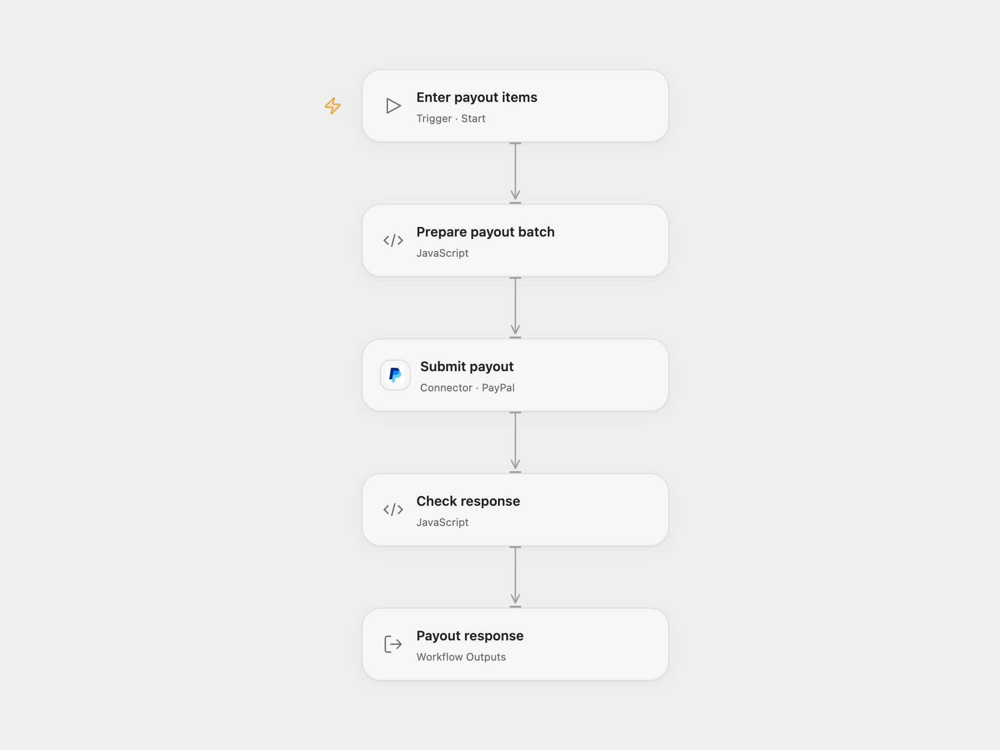

# Create a PayPal Payout Batch

Submit a configured batch of payout items to PayPal.

<picture>
  <source media="(prefers-color-scheme: dark)" srcset="preview-dark.png">
  
</picture>

[Open Flow JSON](templates/create-a-paypal-payout-batch.openflow.json) · [n8n JSON](templates/create-a-paypal-payout-batch.n8n.json)

## Setup and use

Enable PayPal Payouts for your account. Connect PayPal using REST application credentials and allow Provider API Request. Open Flow defaults to the sandbox endpoint; match the endpoint to the connection environment. Enter a new sender batch ID in **Prepare payout batch** and provide a non-empty array of [PayPal payout items](https://developer.paypal.com/api/payments.payouts-batch/v1/definitions/create_payout_request/), including recipient type, receiver and amount with currency. In n8n, connect PayPal, set a batch ID and add at least one payout item in the PayPal node. The source contains no configured recipients or amounts.

## Behavior

A run submits one batch and returns the PayPal response. The source batch ID is `123`; replace it with an ID for your payout. PayPal rejects a batch ID reused within 30 days. An accepted batch may still be processing. If the result is unknown, check PayPal before retrying and keep the same ID for the same payout.

Inspiration &amp; credits

## Changes to the source

- Open Flow accepts the payout items as input and uses the PayPal Provider API Request. Sandbox is the default endpoint.

Adapted from [Create a PayPal payout](https://github.com/Zie619/n8n-workflows/blob/ae8cf6dc5b873cbb4f74587aa9180ed3a9f70682/workflows/Manual/0957_Manual_Paypal_Automation_Triggered.json) in [Zie619/n8n-workflows](https://github.com/Zie619/n8n-workflows). The source export does not identify a separate template author or license.

The collection’s [MIT notice](https://github.com/Zie619/n8n-workflows/blob/94007c1445d9258a7da116646b79473e7c7c3282/LICENSE) is pinned at a later revision. This is the collection notice at that revision; it does not establish a separate original template author's license. Our changes are listed above; see [repository licensing](../../README.md#licensing).

> MIT License
>
> Copyright (c) 2025 Zie619
>
> Permission is hereby granted, free of charge, to any person obtaining a copy
> of this software and associated documentation files (the "Software"), to deal
> in the Software without restriction, including without limitation the rights
> to use, copy, modify, merge, publish, distribute, sublicense, and/or sell
> copies of the Software, and to permit persons to whom the Software is
> furnished to do so, subject to the following conditions:
>
> The above copyright notice and this permission notice shall be included in all
> copies or substantial portions of the Software.
>
> THE SOFTWARE IS PROVIDED "AS IS", WITHOUT WARRANTY OF ANY KIND, EXPRESS OR
> IMPLIED, INCLUDING BUT NOT LIMITED TO THE WARRANTIES OF MERCHANTABILITY,
> FITNESS FOR A PARTICULAR PURPOSE AND NONINFRINGEMENT. IN NO EVENT SHALL THE
> AUTHORS OR COPYRIGHT HOLDERS BE LIABLE FOR ANY CLAIM, DAMAGES OR OTHER
> LIABILITY, WHETHER IN AN ACTION OF CONTRACT, TORT OR OTHERWISE, ARISING FROM,
> OUT OF OR IN CONNECTION WITH THE SOFTWARE OR THE USE OR OTHER DEALINGS IN THE
> SOFTWARE.

