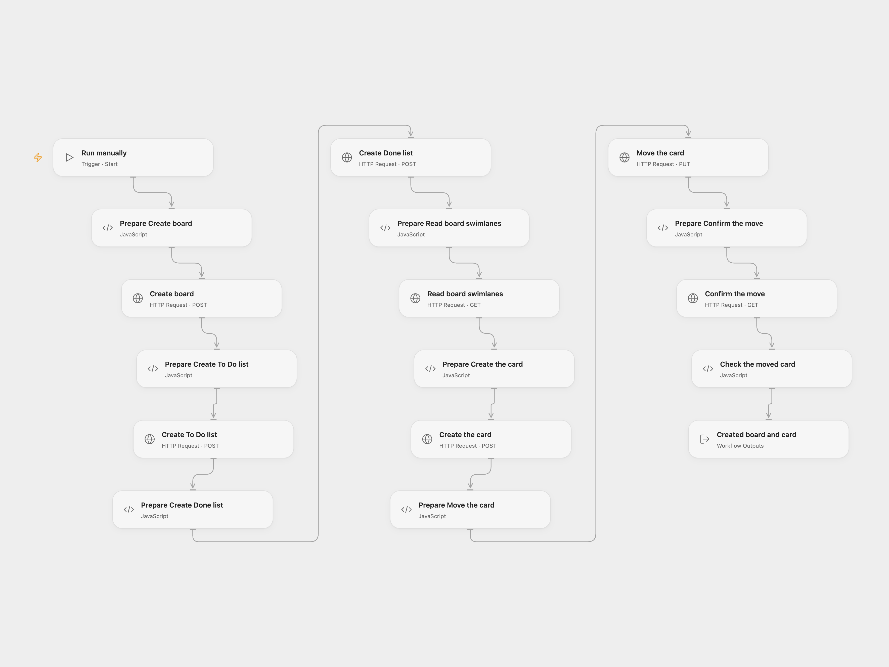

# Create a Wekan Board and Move a Card

Create a Wekan board with To Do and Done lists, then move a sample card.

<picture>
  <source media="(prefers-color-scheme: dark)" srcset="preview-dark.png">
  
</picture>

[Open Flow JSON](templates/create-a-wekan-board-and-move-a-card.openflow.json) · [n8n JSON](templates/create-a-wekan-board-and-move-a-card.n8n.json)

## Setup and use

In Open Flow set the HTTPS Wekan URL and user ID in **Prepare Create board**, and bind the same Wekan session token as secret Variable **WEKAN_SESSION_TOKEN** in each HTTP node. Refresh the token when it expires. In n8n configure the Wekan credential, set the owner and author user ID, and set the same Wekan HTTPS URL in **Read board swimlanes**.

## Behavior

A manual run creates a board named Documentation, lists named To Do and Done, and a card named Document Wekan node in To Do, then moves the card to Done. It queries the newly created board's swimlane and requires exactly one; if there are multiple swimlanes, it stops for inspection. Open Flow checks the moved card after updating it. These are real writes when run. If a request fails or its result is unknown, earlier objects may already exist; inspect the board before retrying to avoid duplicates.

Inspiration &amp; credits

## Changes to the source

- Replace personal identifiers with configuration placeholders. Resolve the swimlane from the new board rather than reusing a fixed ID from another board.
- Open Flow uses an explicitly configured session token and confirms the final card location.

Adapted from [Create a Wekan board and move a card](https://github.com/Zie619/n8n-workflows/blob/ae8cf6dc5b873cbb4f74587aa9180ed3a9f70682/workflows/Manual/1115_Manual_Wekan_Automation_Triggered.json) in [Zie619/n8n-workflows](https://github.com/Zie619/n8n-workflows). The source export does not identify a separate template author or license.

The collection’s [MIT notice](https://github.com/Zie619/n8n-workflows/blob/94007c1445d9258a7da116646b79473e7c7c3282/LICENSE) is pinned at a later revision. This is the collection notice at that revision; it does not establish a separate original template author's license. Our changes are listed above; see [repository licensing](../../README.md#licensing).

> MIT License
>
> Copyright (c) 2025 Zie619
>
> Permission is hereby granted, free of charge, to any person obtaining a copy
> of this software and associated documentation files (the "Software"), to deal
> in the Software without restriction, including without limitation the rights
> to use, copy, modify, merge, publish, distribute, sublicense, and/or sell
> copies of the Software, and to permit persons to whom the Software is
> furnished to do so, subject to the following conditions:
>
> The above copyright notice and this permission notice shall be included in all
> copies or substantial portions of the Software.
>
> THE SOFTWARE IS PROVIDED "AS IS", WITHOUT WARRANTY OF ANY KIND, EXPRESS OR
> IMPLIED, INCLUDING BUT NOT LIMITED TO THE WARRANTIES OF MERCHANTABILITY,
> FITNESS FOR A PARTICULAR PURPOSE AND NONINFRINGEMENT. IN NO EVENT SHALL THE
> AUTHORS OR COPYRIGHT HOLDERS BE LIABLE FOR ANY CLAIM, DAMAGES OR OTHER
> LIABILITY, WHETHER IN AN ACTION OF CONTRACT, TORT OR OTHERWISE, ARISING FROM,
> OUT OF OR IN CONNECTION WITH THE SOFTWARE OR THE USE OR OTHER DEALINGS IN THE
> SOFTWARE.

