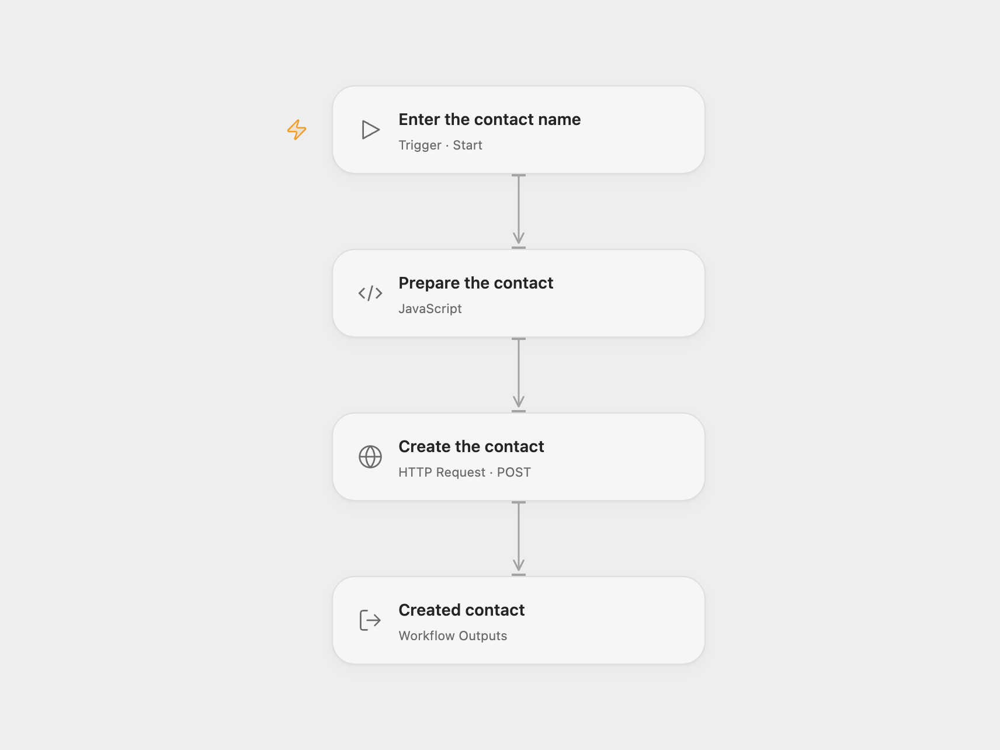

# Create an Agile CRM Contact

Create an Agile CRM contact with a first and last name.

<picture>
  <source media="(prefers-color-scheme: dark)" srcset="preview-dark.png">
  
</picture>

[Open Flow JSON](templates/create-agile-crm-contact.openflow.json) · [n8n JSON](templates/create-agile-crm-contact.n8n.json)

## Setup

In Open Flow set your Agile CRM subdomain in **Prepare the contact**. Create secret Variables `AGILE_CRM_EMAIL` and `AGILE_CRM_API_KEY`, containing the account email and REST API key, and bind them to **Create the contact**. Run with the contact's first and last name. In n8n connect Agile CRM, set its subdomain in the credential, and enter the names in **AgileCRM**. Use one format per creation.

## Behavior

A manual run creates one contact and returns the API response. Empty name fields are omitted. If a request fails or its outcome is uncertain, check Agile CRM before retrying; the contact may already exist.

Inspiration &amp; credits

## Changes to the source

- Open Flow uses Agile CRM's contact API directly and accepts names as run inputs. The subdomain is validated before sending credentials.

Adapted from [Create a new contact in Agile CRM](https://github.com/Zie619/n8n-workflows/blob/ae8cf6dc5b873cbb4f74587aa9180ed3a9f70682/workflows/Manual/1219_Manual_Agilecrm_Create_Triggered.json) in [Zie619/n8n-workflows](https://github.com/Zie619/n8n-workflows). The matching [n8n community listing](https://n8n.io/workflows/474-create-a-new-contact-in-agile-crm/) credits tanaypant. The original template does not state a separate license.

The collection’s [MIT notice](https://github.com/Zie619/n8n-workflows/blob/94007c1445d9258a7da116646b79473e7c7c3282/LICENSE) is pinned at a later revision. This is the collection notice at that revision; it does not establish a separate original template author's license. Our changes are listed above; see [repository licensing](../../README.md#licensing).

> MIT License
>
> Copyright (c) 2025 Zie619
>
> Permission is hereby granted, free of charge, to any person obtaining a copy
> of this software and associated documentation files (the "Software"), to deal
> in the Software without restriction, including without limitation the rights
> to use, copy, modify, merge, publish, distribute, sublicense, and/or sell
> copies of the Software, and to permit persons to whom the Software is
> furnished to do so, subject to the following conditions:
>
> The above copyright notice and this permission notice shall be included in all
> copies or substantial portions of the Software.
>
> THE SOFTWARE IS PROVIDED "AS IS", WITHOUT WARRANTY OF ANY KIND, EXPRESS OR
> IMPLIED, INCLUDING BUT NOT LIMITED TO THE WARRANTIES OF MERCHANTABILITY,
> FITNESS FOR A PARTICULAR PURPOSE AND NONINFRINGEMENT. IN NO EVENT SHALL THE
> AUTHORS OR COPYRIGHT HOLDERS BE LIABLE FOR ANY CLAIM, DAMAGES OR OTHER
> LIABILITY, WHETHER IN AN ACTION OF CONTRACT, TORT OR OTHERWISE, ARISING FROM,
> OUT OF OR IN CONNECTION WITH THE SOFTWARE OR THE USE OR OTHER DEALINGS IN THE
> SOFTWARE.

