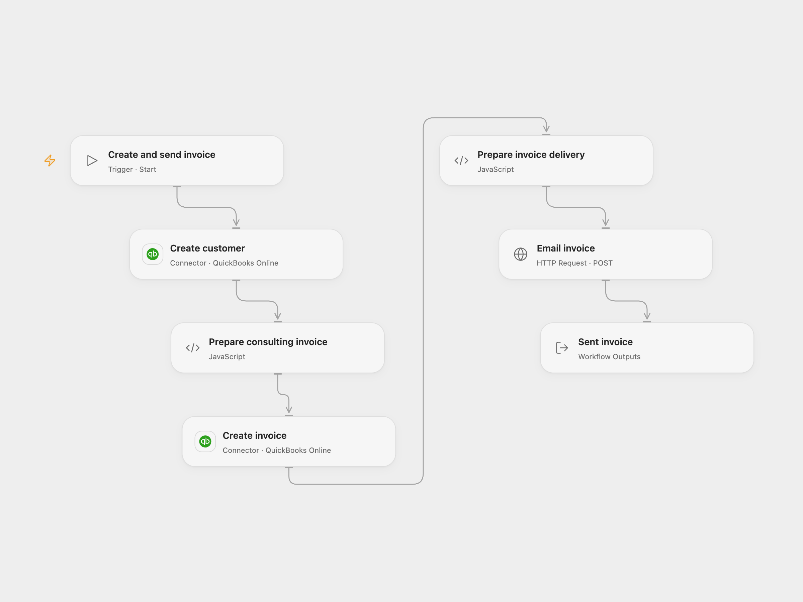

# Create and Email a QuickBooks Invoice

Create a customer, create a consulting invoice, and send it by email.

<picture>
  <source media="(prefers-color-scheme: dark)" srcset="preview-dark.png">
  
</picture>

[Open Flow JSON](templates/create-and-email-a-quickbooks-invoice.openflow.json) · [n8n JSON](templates/create-and-email-a-quickbooks-invoice.n8n.json)

## Setup and use

Connect QuickBooks Online with accounting access. Obtain an OAuth access token for the same company and bind it as the secret Variable QUICKBOOKS_ACCESS_TOKEN; refresh it when it expires. Run with a unique customer name, email, existing service item ID, company realm ID and either production or sandbox. The token, environment and connected company must refer to the same company. In n8n configure the QuickBooks credential and replace the example customer, email and item ID before running manually. Use one format.

## Behavior

Each run creates a customer, creates a 100-unit consulting invoice for the specified service item, then sends the invoice to the customer's email. These are real accounting and email actions. If any write has an unknown outcome, inspect the QuickBooks company before retrying; starting again can create duplicate customers or invoices, or send another email. Accounting details may appear in execution history.

Inspiration &amp; credits

## Changes to the source

- Add a manual trigger and configurable inputs, and use the QuickBooks send-invoice API with a user-provided access token in Open Flow.

Adapted from [Create and email a QuickBooks invoice](https://github.com/Zie619/n8n-workflows/blob/ae8cf6dc5b873cbb4f74587aa9180ed3a9f70682/workflows/Quickbooks/1208_Quickbooks_Automate.json) in [Zie619/n8n-workflows](https://github.com/Zie619/n8n-workflows). The source export does not identify a separate template author or license.

The collection’s [MIT notice](https://github.com/Zie619/n8n-workflows/blob/94007c1445d9258a7da116646b79473e7c7c3282/LICENSE) is pinned at a later revision. This is the collection notice at that revision; it does not establish a separate original template author's license. Our changes are listed above; see [repository licensing](../../README.md#licensing).

> MIT License
>
> Copyright (c) 2025 Zie619
>
> Permission is hereby granted, free of charge, to any person obtaining a copy
> of this software and associated documentation files (the "Software"), to deal
> in the Software without restriction, including without limitation the rights
> to use, copy, modify, merge, publish, distribute, sublicense, and/or sell
> copies of the Software, and to permit persons to whom the Software is
> furnished to do so, subject to the following conditions:
>
> The above copyright notice and this permission notice shall be included in all
> copies or substantial portions of the Software.
>
> THE SOFTWARE IS PROVIDED "AS IS", WITHOUT WARRANTY OF ANY KIND, EXPRESS OR
> IMPLIED, INCLUDING BUT NOT LIMITED TO THE WARRANTIES OF MERCHANTABILITY,
> FITNESS FOR A PARTICULAR PURPOSE AND NONINFRINGEMENT. IN NO EVENT SHALL THE
> AUTHORS OR COPYRIGHT HOLDERS BE LIABLE FOR ANY CLAIM, DAMAGES OR OTHER
> LIABILITY, WHETHER IN AN ACTION OF CONTRACT, TORT OR OTHERWISE, ARISING FROM,
> OUT OF OR IN CONNECTION WITH THE SOFTWARE OR THE USE OR OTHER DEALINGS IN THE
> SOFTWARE.

