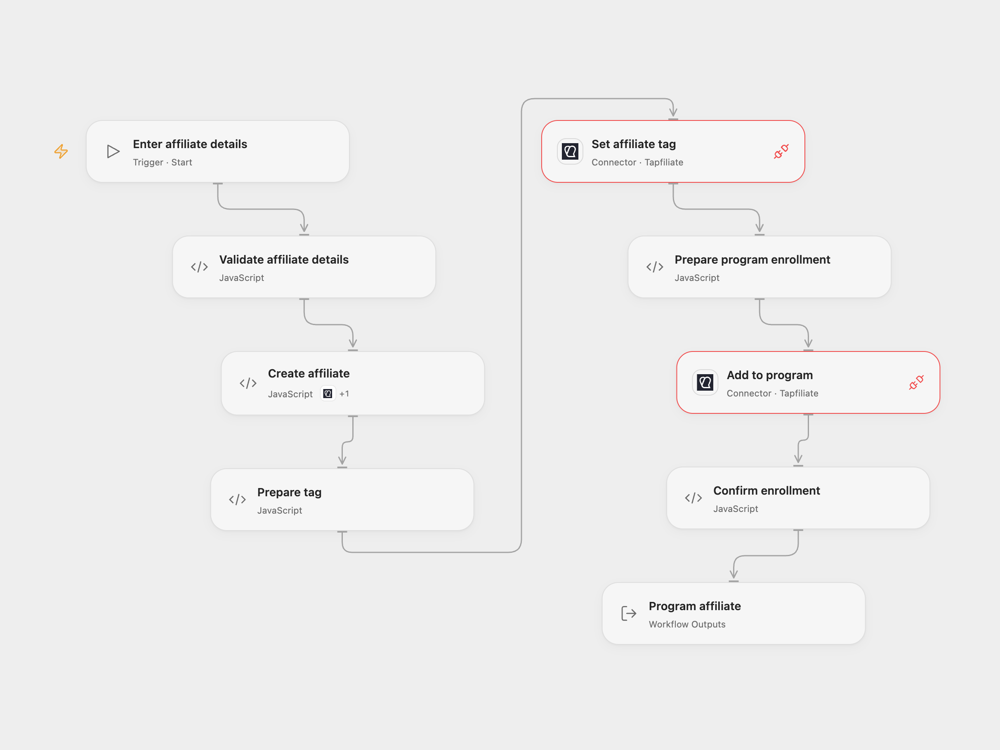

# Create and Enroll a Tapfiliate Affiliate

Create an affiliate, set a tag and add them to a Tapfiliate program.

<picture>
  <source media="(prefers-color-scheme: dark)" srcset="preview-dark.png">
  
</picture>

[Open Flow JSON](templates/create-and-enroll-tapfiliate-affiliate.openflow.json) · [n8n JSON](templates/create-and-enroll-tapfiliate-affiliate.n8n.json)

## Setup

Connect Tapfiliate with access to create affiliates and add them to the program. In Open Flow, select the connection for **Create affiliate**, **Set affiliate tag** and **Add to program**. Allow the create-affiliate Action for the first node and **Provider API** access for the other two. Run with the affiliate's name and email, program ID and tag. In n8n, create an HTTP Header Auth credential with header name `X-Api-Key` and your Tapfiliate API key as its value, connect it to all three HTTP nodes, and edit **Set affiliate details**.

## Behavior

The workflow creates an affiliate, sets the metadata key **tag** and adds that same affiliate to the program. Tapfiliate controls approval and welcome-email behavior. An error stops later steps; there is no automatic retry or rollback. A lost response may mean a write succeeded, so check Tapfiliate before retrying. An affiliate created but not enrolled can remain archived.

Tapfiliate may return an automatically generated affiliate password when creating the account. n8n execution data can contain that response; restrict access to execution history. Open Flow returns the affiliate ID and enrollment details, not the password.

Inspiration &amp; credits

## Changes to the source

- Replace the example affiliate, program and tag with inputs and verify enrollment identity.
- Use the Tapfiliate create Action and Provider API in Open Flow. n8n uses HTTP nodes to avoid the source create node emitting both a raw and a wrapped copy of the affiliate.

Adapted from [Tapfiliate affiliate onboarding](https://github.com/Zie619/n8n-workflows/blob/ae8cf6dc5b873cbb4f74587aa9180ed3a9f70682/workflows/Manual/1205_Manual_Tapfiliate_Automate_Triggered.json) in [Zie619/n8n-workflows](https://github.com/Zie619/n8n-workflows). The matching [n8n community listing](https://n8n.io/workflows/936-add-the-affiliate-to-a-program-automatically/) credits Harshil Agrawal. The original template does not state a separate license.

The collection’s [MIT notice](https://github.com/Zie619/n8n-workflows/blob/94007c1445d9258a7da116646b79473e7c7c3282/LICENSE) is pinned at a later revision. This is the collection notice at that revision; it does not establish a separate original template author's license. Our changes are listed above; see [repository licensing](../../README.md#licensing).

> MIT License
>
> Copyright (c) 2025 Zie619
>
> Permission is hereby granted, free of charge, to any person obtaining a copy
> of this software and associated documentation files (the "Software"), to deal
> in the Software without restriction, including without limitation the rights
> to use, copy, modify, merge, publish, distribute, sublicense, and/or sell
> copies of the Software, and to permit persons to whom the Software is
> furnished to do so, subject to the following conditions:
>
> The above copyright notice and this permission notice shall be included in all
> copies or substantial portions of the Software.
>
> THE SOFTWARE IS PROVIDED "AS IS", WITHOUT WARRANTY OF ANY KIND, EXPRESS OR
> IMPLIED, INCLUDING BUT NOT LIMITED TO THE WARRANTIES OF MERCHANTABILITY,
> FITNESS FOR A PARTICULAR PURPOSE AND NONINFRINGEMENT. IN NO EVENT SHALL THE
> AUTHORS OR COPYRIGHT HOLDERS BE LIABLE FOR ANY CLAIM, DAMAGES OR OTHER
> LIABILITY, WHETHER IN AN ACTION OF CONTRACT, TORT OR OTHERWISE, ARISING FROM,
> OUT OF OR IN CONNECTION WITH THE SOFTWARE OR THE USE OR OTHER DEALINGS IN THE
> SOFTWARE.

