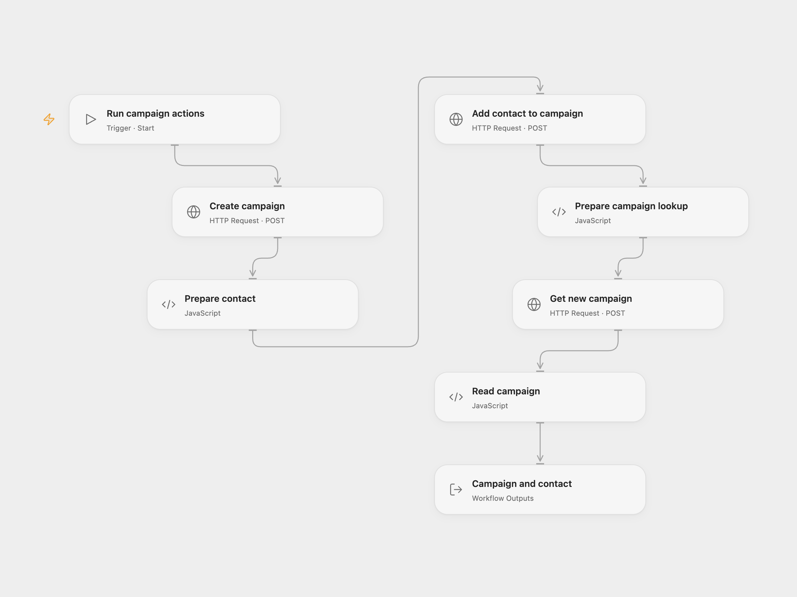

# Create and Inspect an Emelia Campaign

Create a campaign, add a contact to a configured campaign, and retrieve the newly created campaign.

<picture>
  <source media="(prefers-color-scheme: dark)" srcset="preview-dark.png">
  
</picture>

[Open Flow JSON](templates/create-and-inspect-emelia-campaign.openflow.json) · [n8n JSON](templates/create-and-inspect-emelia-campaign.n8n.json)

## Setup and use

Bind the secret Variable EMELIA_API_KEY to your Emelia API key. Enter the campaign name in **Create campaign** and the existing campaign ID, contact email and first name in **Prepare contact**. In n8n connect the Emelia credential and configure the same values. Run one format manually.

## Behavior

The contact is added to the configured existing campaign, while the final lookup uses the ID of the newly created campaign, as in the source. Both creation and contact insertion write to Emelia. If a write fails or its response is lost, inspect Emelia before rerunning because it may have succeeded.

Inspiration &amp; credits

## Changes to the source

- Add a manual trigger and replace the sample campaign ID with a placeholder. Open Flow uses native HTTP requests for the source GraphQL operations and a Secret Variable.

Adapted from [Emelia campaign actions](https://github.com/Zie619/n8n-workflows/blob/ae8cf6dc5b873cbb4f74587aa9180ed3a9f70682/workflows/Emelia/1214_Emelia_Automate.json) in [Zie619/n8n-workflows](https://github.com/Zie619/n8n-workflows). The source export does not identify a separate template author or license.

The collection’s [MIT notice](https://github.com/Zie619/n8n-workflows/blob/94007c1445d9258a7da116646b79473e7c7c3282/LICENSE) is pinned at a later revision. This is the collection notice at that revision; it does not establish a separate original template author's license. Our changes are listed above; see [repository licensing](../../README.md#licensing).

> MIT License
>
> Copyright (c) 2025 Zie619
>
> Permission is hereby granted, free of charge, to any person obtaining a copy
> of this software and associated documentation files (the "Software"), to deal
> in the Software without restriction, including without limitation the rights
> to use, copy, modify, merge, publish, distribute, sublicense, and/or sell
> copies of the Software, and to permit persons to whom the Software is
> furnished to do so, subject to the following conditions:
>
> The above copyright notice and this permission notice shall be included in all
> copies or substantial portions of the Software.
>
> THE SOFTWARE IS PROVIDED "AS IS", WITHOUT WARRANTY OF ANY KIND, EXPRESS OR
> IMPLIED, INCLUDING BUT NOT LIMITED TO THE WARRANTIES OF MERCHANTABILITY,
> FITNESS FOR A PARTICULAR PURPOSE AND NONINFRINGEMENT. IN NO EVENT SHALL THE
> AUTHORS OR COPYRIGHT HOLDERS BE LIABLE FOR ANY CLAIM, DAMAGES OR OTHER
> LIABILITY, WHETHER IN AN ACTION OF CONTRACT, TORT OR OTHERWISE, ARISING FROM,
> OUT OF OR IN CONNECTION WITH THE SOFTWARE OR THE USE OR OTHER DEALINGS IN THE
> SOFTWARE.

