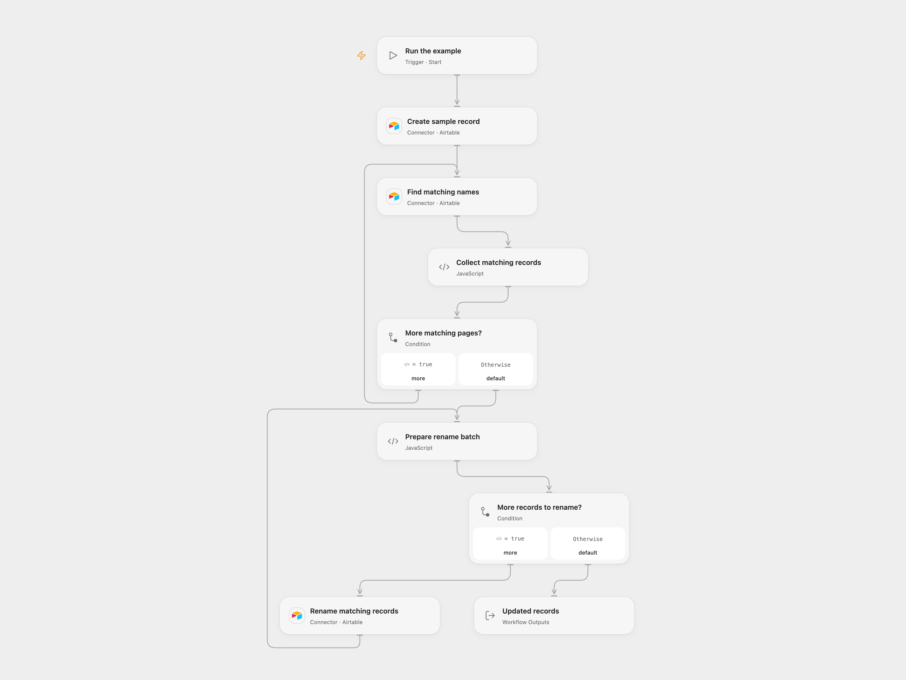

# Create and Rename Airtable Records

Create a sample record and rename all matching records in an Airtable table.

<picture>
  <source media="(prefers-color-scheme: dark)" srcset="preview-dark.png">
  
</picture>

[Open Flow JSON](templates/create-and-rename-airtable-records.openflow.json) · [n8n JSON](templates/create-and-rename-airtable-records.n8n.json)

## Setup

Connect Airtable and configure the same base and table in all three Airtable nodes. The table needs a numeric `ID` field and a text `Name` field. Use a test table: this tutorial modifies existing matching records. In n8n, configure an Airtable Personal Access Token and the same base and table in each Airtable node. Run one format at a time.

## Behavior

A manual run creates one record with `ID = 3` and `Name = n8n`. It then reads every page of records whose `Name` is `n8n` and changes the `Name` to `nodemation` for each match, including pre-existing matches. Updates are sent in batches of at most 10. Other fields remain unchanged. Open Flow returns the update responses and count.

A failure after creation can leave the new record in the table; a later failed or uncertain update may have changed some records. Inspect the table before retrying, as another run creates another sample record. Avoid overlapping runs. Collected records and responses must fit execution limits.

Inspiration &amp; credits

## Changes to the source

- Configure the same base and table explicitly and use a braced Airtable field reference in the filter formula.
- Open Flow follows all result pages and updates each returned record ID in batches.

Adapted from [Insert and update data in Airtable](https://github.com/Zie619/n8n-workflows/blob/ae8cf6dc5b873cbb4f74587aa9180ed3a9f70682/workflows/Manual/0218_Manual_Airtable_Update_Triggered.json) in [Zie619/n8n-workflows](https://github.com/Zie619/n8n-workflows). The matching [n8n community listing](https://n8n.io/workflows/818-insert-and-update-data-in-airtable/) credits Harshil Agrawal. The original template does not state a separate license.

The collection’s [MIT notice](https://github.com/Zie619/n8n-workflows/blob/94007c1445d9258a7da116646b79473e7c7c3282/LICENSE) is pinned at a later revision. This is the collection notice at that revision; it does not establish a separate original template author's license. Our changes are listed above; see [repository licensing](../../README.md#licensing).

> MIT License
>
> Copyright (c) 2025 Zie619
>
> Permission is hereby granted, free of charge, to any person obtaining a copy
> of this software and associated documentation files (the "Software"), to deal
> in the Software without restriction, including without limitation the rights
> to use, copy, modify, merge, publish, distribute, sublicense, and/or sell
> copies of the Software, and to permit persons to whom the Software is
> furnished to do so, subject to the following conditions:
>
> The above copyright notice and this permission notice shall be included in all
> copies or substantial portions of the Software.
>
> THE SOFTWARE IS PROVIDED "AS IS", WITHOUT WARRANTY OF ANY KIND, EXPRESS OR
> IMPLIED, INCLUDING BUT NOT LIMITED TO THE WARRANTIES OF MERCHANTABILITY,
> FITNESS FOR A PARTICULAR PURPOSE AND NONINFRINGEMENT. IN NO EVENT SHALL THE
> AUTHORS OR COPYRIGHT HOLDERS BE LIABLE FOR ANY CLAIM, DAMAGES OR OTHER
> LIABILITY, WHETHER IN AN ACTION OF CONTRACT, TORT OR OTHERWISE, ARISING FROM,
> OUT OF OR IN CONNECTION WITH THE SOFTWARE OR THE USE OR OTHER DEALINGS IN THE
> SOFTWARE.

