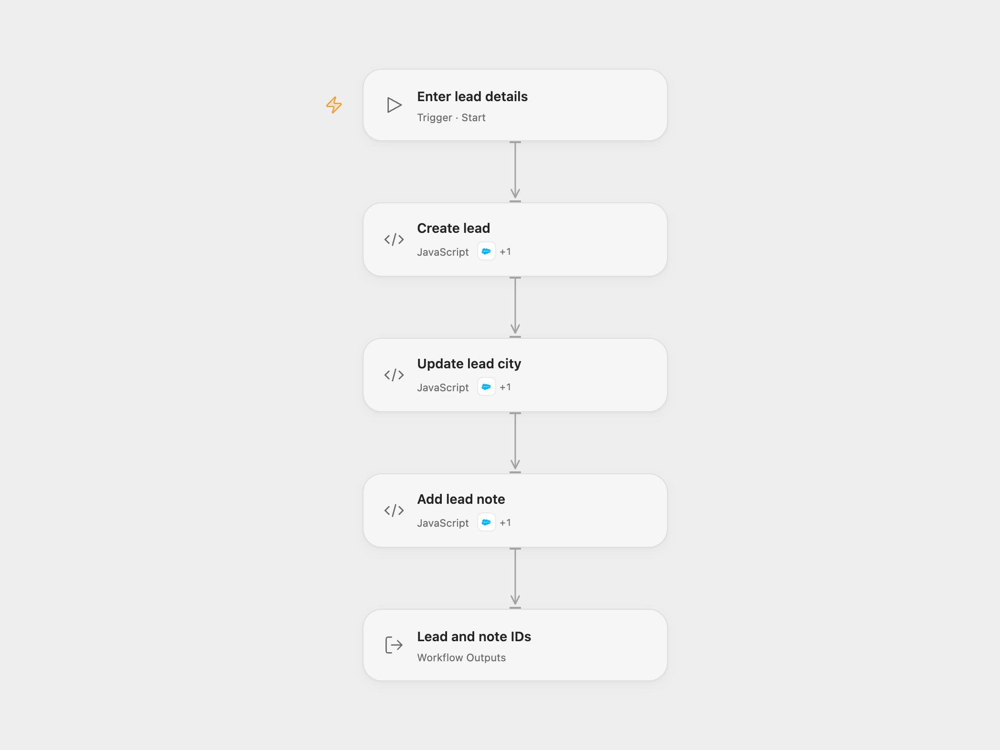

# Create and Update a Salesforce Lead with a Note

Create a Salesforce lead, update its city and add a note to that lead.

<picture>
  <source media="(prefers-color-scheme: dark)" srcset="preview-dark.png">
  
</picture>

[Open Flow JSON](templates/create-and-update-salesforce-lead-with-note.openflow.json) · [n8n JSON](templates/create-and-update-salesforce-lead-with-note.n8n.json)

## Setup

Connect Salesforce with permission to create and update Leads and create legacy Note records. In Open Flow select the connection for **Create lead**, **Update lead city** and **Add lead note**, and allow each node's declared Action. Run with company, last name, city and note title. In n8n, set those fields in the corresponding Salesforce nodes and connect your Salesforce credential.

## Behavior

Each run creates one Lead, updates that Lead's city and creates a title-only Note linked to it. The note is a Salesforce legacy Note record; no note body or lead status is set. Failure stops later steps, but earlier writes are not rolled back. A lost response may mean a write succeeded, so inspect Salesforce before retrying. No automatic retry is configured.

Inspiration &amp; credits

## Changes to the source

- Replace example company, name, city and note title with user-provided values. Open Flow verifies the returned IDs and passes only the source fields to Salesforce Actions.

Adapted from [Create and update a Salesforce lead](https://github.com/Zie619/n8n-workflows/blob/ae8cf6dc5b873cbb4f74587aa9180ed3a9f70682/workflows/Manual/1094_Manual_Salesforce_Automate_Triggered.json) in [Zie619/n8n-workflows](https://github.com/Zie619/n8n-workflows). The matching [n8n community listing](https://n8n.io/workflows/664-create-and-update-lead-in-salesforce/) credits amudhan. The original template does not state a separate license.

The collection’s [MIT notice](https://github.com/Zie619/n8n-workflows/blob/94007c1445d9258a7da116646b79473e7c7c3282/LICENSE) is pinned at a later revision. This is the collection notice at that revision; it does not establish a separate original template author's license. Our changes are listed above; see [repository licensing](../../README.md#licensing).

> MIT License
>
> Copyright (c) 2025 Zie619
>
> Permission is hereby granted, free of charge, to any person obtaining a copy
> of this software and associated documentation files (the "Software"), to deal
> in the Software without restriction, including without limitation the rights
> to use, copy, modify, merge, publish, distribute, sublicense, and/or sell
> copies of the Software, and to permit persons to whom the Software is
> furnished to do so, subject to the following conditions:
>
> The above copyright notice and this permission notice shall be included in all
> copies or substantial portions of the Software.
>
> THE SOFTWARE IS PROVIDED "AS IS", WITHOUT WARRANTY OF ANY KIND, EXPRESS OR
> IMPLIED, INCLUDING BUT NOT LIMITED TO THE WARRANTIES OF MERCHANTABILITY,
> FITNESS FOR A PARTICULAR PURPOSE AND NONINFRINGEMENT. IN NO EVENT SHALL THE
> AUTHORS OR COPYRIGHT HOLDERS BE LIABLE FOR ANY CLAIM, DAMAGES OR OTHER
> LIABILITY, WHETHER IN AN ACTION OF CONTRACT, TORT OR OTHERWISE, ARISING FROM,
> OUT OF OR IN CONNECTION WITH THE SOFTWARE OR THE USE OR OTHER DEALINGS IN THE
> SOFTWARE.

