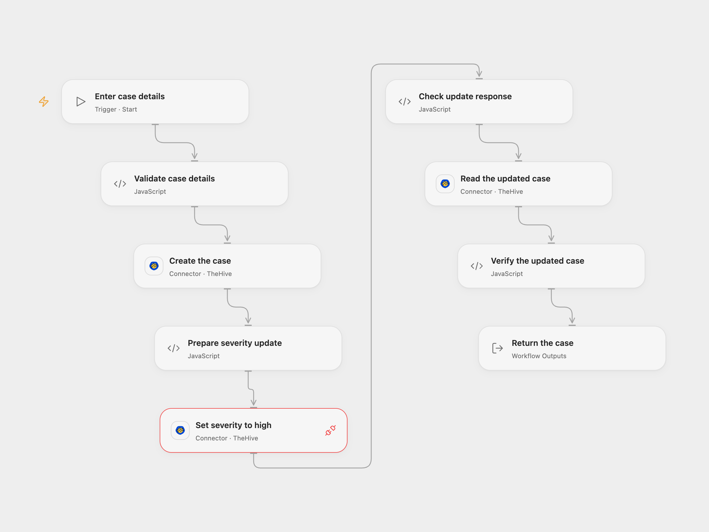

# Create and Update a TheHive Case

Create a TheHive 4 case, change its severity and read it back.

<picture>
  <source media="(prefers-color-scheme: dark)" srcset="preview-dark.png">
  
</picture>

[Open Flow JSON](templates/create-and-update-thehive-case.openflow.json) · [n8n JSON](templates/create-and-update-thehive-case.n8n.json)

## Setup

Connect the same TheHive 4 instance and API key in **Create the case**, **Set severity to high** and **Read the updated case**. Allow case create, update and read and Provider API Request access. The instance must be publicly reachable by the Connector. Run the Open Flow workflow with a title, description and valid owner login. In n8n, connect TheHive credentials, select **TheHive 4+ (api v1)**, and replace the values in **Set case details**.

## Behavior

Each run creates a case with severity 1, current start time, TLP 2, flag false and the security tag, then updates that same case to severity 3 and reads it back. The workflow checks the returned ID and final severity. These are real writes; each run creates another case. Check that the inputs and owner are appropriate before running.

A failure stops later steps. A case can already exist when creation or update returns an uncertain result, and an update can succeed before its response is lost. Inspect TheHive before retrying. The workflow does not retry or roll back writes.

Inspiration &amp; credits

## Changes to the source

- Replace the example owner and case text with configurable inputs, use the current time and a security tag.
- Require TheHive 4 in both formats and verify the saved ID and severity. Open Flow uses the TheHive Provider API for the partial severity update.

Adapted from [Create, update and get a case in TheHive](https://github.com/Zie619/n8n-workflows/blob/ae8cf6dc5b873cbb4f74587aa9180ed3a9f70682/workflows/Manual/0198_Manual_Thehive_Create_Triggered.json) in [Zie619/n8n-workflows](https://github.com/Zie619/n8n-workflows). The matching [n8n community listing](https://n8n.io/workflows/808-create-update-and-get-a-case-in-thehive/) credits Harshil Agrawal. The original template does not state a separate license.

The collection’s [MIT notice](https://github.com/Zie619/n8n-workflows/blob/94007c1445d9258a7da116646b79473e7c7c3282/LICENSE) is pinned at a later revision. This is the collection notice at that revision; it does not establish a separate original template author's license. Our changes are listed above; see [repository licensing](../../README.md#licensing).

> MIT License
>
> Copyright (c) 2025 Zie619
>
> Permission is hereby granted, free of charge, to any person obtaining a copy
> of this software and associated documentation files (the "Software"), to deal
> in the Software without restriction, including without limitation the rights
> to use, copy, modify, merge, publish, distribute, sublicense, and/or sell
> copies of the Software, and to permit persons to whom the Software is
> furnished to do so, subject to the following conditions:
>
> The above copyright notice and this permission notice shall be included in all
> copies or substantial portions of the Software.
>
> THE SOFTWARE IS PROVIDED "AS IS", WITHOUT WARRANTY OF ANY KIND, EXPRESS OR
> IMPLIED, INCLUDING BUT NOT LIMITED TO THE WARRANTIES OF MERCHANTABILITY,
> FITNESS FOR A PARTICULAR PURPOSE AND NONINFRINGEMENT. IN NO EVENT SHALL THE
> AUTHORS OR COPYRIGHT HOLDERS BE LIABLE FOR ANY CLAIM, DAMAGES OR OTHER
> LIABILITY, WHETHER IN AN ACTION OF CONTRACT, TORT OR OTHERWISE, ARISING FROM,
> OUT OF OR IN CONNECTION WITH THE SOFTWARE OR THE USE OR OTHER DEALINGS IN THE
> SOFTWARE.

