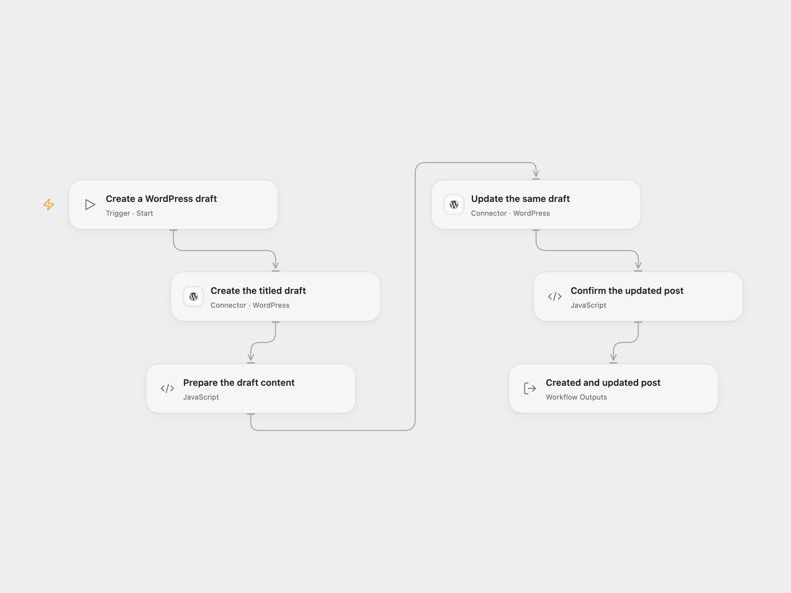

# Create and Update a WordPress Draft

Create a WordPress draft with a title, then update the same post with content.

<picture>
  <source media="(prefers-color-scheme: dark)" srcset="preview-dark.png">
  
</picture>

[Open Flow JSON](templates/create-and-update-wordpress-draft.openflow.json) · [n8n JSON](templates/create-and-update-wordpress-draft.n8n.json)

## Setup

Connect both WordPress nodes to the same public HTTPS site using a username and [Application Password](https://developer.wordpress.org/rest-api/using-the-rest-api/authentication/#basic-authentication-with-application-passwords). The account needs permission to create and edit posts. Set the title in **Create the titled draft** and the content in **Prepare the draft content**.

In n8n, select WordPress API credentials on both nodes, edit the title in **Wordpress** and the content in **Wordpress1**. The second node uses the ID returned by the first. Activate only one format for each intended draft.

## Behavior

Run manually. The first request creates a draft with the title. The second request adds the configured content to that exact post. Open Flow returns both WordPress post responses and checks that the update response has the same post ID. n8n returns the update response, with the create response available in the previous node. The draft is not published by this workflow; review and publish it in WordPress when ready.

If creation or update fails or its result is uncertain, inspect WordPress before retrying. A draft may already exist or its content may already have changed. Earlier changes are not rolled back and the workflow does not search for or deduplicate posts. The hosted Connector accepts public HTTPS sites and may reject private network addresses; both requests use the same WordPress Connection.

Inspiration &amp; credits

## Changes to the source

- Explicitly set draft status and replace credentials with setup.
- Keep the separate create and content update requests, using the returned post ID. Open Flow also checks the update response ID.

Adapted from [Create a post and update the post in WordPress](https://github.com/Zie619/n8n-workflows/blob/ae8cf6dc5b873cbb4f74587aa9180ed3a9f70682/workflows/Manual/1075_Manual_Wordpress_Create_Triggered.json) in [Zie619/n8n-workflows](https://github.com/Zie619/n8n-workflows). The source export does not identify a separate template author or license.

The collection’s [MIT notice](https://github.com/Zie619/n8n-workflows/blob/94007c1445d9258a7da116646b79473e7c7c3282/LICENSE) is pinned at a later revision. This is the collection notice at that revision; it does not establish a separate original template author's license. Our changes are listed above; see [repository licensing](../../README.md#licensing).

> MIT License
>
> Copyright (c) 2025 Zie619
>
> Permission is hereby granted, free of charge, to any person obtaining a copy
> of this software and associated documentation files (the "Software"), to deal
> in the Software without restriction, including without limitation the rights
> to use, copy, modify, merge, publish, distribute, sublicense, and/or sell
> copies of the Software, and to permit persons to whom the Software is
> furnished to do so, subject to the following conditions:
>
> The above copyright notice and this permission notice shall be included in all
> copies or substantial portions of the Software.
>
> THE SOFTWARE IS PROVIDED "AS IS", WITHOUT WARRANTY OF ANY KIND, EXPRESS OR
> IMPLIED, INCLUDING BUT NOT LIMITED TO THE WARRANTIES OF MERCHANTABILITY,
> FITNESS FOR A PARTICULAR PURPOSE AND NONINFRINGEMENT. IN NO EVENT SHALL THE
> AUTHORS OR COPYRIGHT HOLDERS BE LIABLE FOR ANY CLAIM, DAMAGES OR OTHER
> LIABILITY, WHETHER IN AN ACTION OF CONTRACT, TORT OR OTHERWISE, ARISING FROM,
> OUT OF OR IN CONNECTION WITH THE SOFTWARE OR THE USE OR OTHER DEALINGS IN THE
> SOFTWARE.

