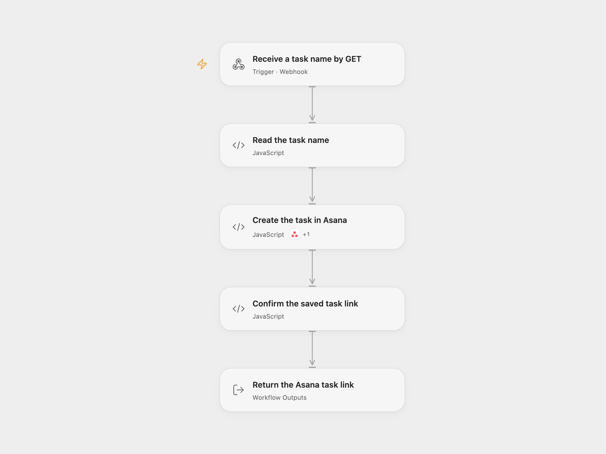

# Create an Asana Task from a Webhook

Send a GET request with a task name to create one task in Asana and receive its permalink as plain text.

<picture>
  <source media="(prefers-color-scheme: dark)" srcset="preview-dark.png">
  
</picture>

[Open Flow JSON](templates/create-asana-task-from-webhook.openflow.json) · [n8n JSON](templates/create-asana-task-from-webhook.n8n.json)

## Setup

In **Create the task in Asana**, connect an Asana Personal Access Token to its Action and replace **Workspace ID** and **Project IDs**. The project must belong to that workspace, and the token’s account must be able to create tasks there.

Enable the workflow webhook and copy its URL. The endpoint accepts GET requests. No authentication is configured; anyone with the webhook URL can create a task using the configured Asana account. Restrict access to the endpoint.

In n8n, select **Asana API** Personal Access Token credentials on the HTTP Request node, and replace the workspace/project IDs in its JSON body expression. This uses PAT authentication in both formats; the source export used an unconfigured Asana OAuth2 credential. Keep the fixed Asana URL, `opt_fields`, POST body structure, JSON response mode and redirect settings. Activate one format for this endpoint.

## Use

Supply a single URL-encoded `parameter` query value:

```sh
curl --get --data-urlencode 'parameter=Follow up with customer' 'YOUR_WEBHOOK_URL'
```

A successful request returns HTTP 200 with plain text:

```text
Created Asana Task:  https://app.asana.com/…
```

The link comes from Asana’s saved task response. The workflow does not construct a task URL. The task name is trimmed at its edges; empty, missing or repeated values fail before any Asana request. Internal spaces, Unicode and special characters remain in the name. No assignee, due date, comment or other task mutation is added.

Open Flow waits up to 60 seconds for the workflow response. The n8n Asana HTTP request has a 30-second timeout. Asana errors, invalid receipts or a missing permalink fail the run. A task can already have been created when its response is lost, incomplete or delayed beyond the response window. Check the configured project before repeating such a request. Repeating a request can create another task; the workflow keeps no task history or custom deduplication and adds no retry.

The workflow result also keeps the task object returned by the API. The HTTP response contains only the confirmation text.

<details>
<summary>Inspiration &amp; credits</summary>

## Changes to the source

- Replace empty workspace/project configuration with explicit setup placeholders and use PAT credentials in both formats.
- Validate and trim a single task-name query value before creating a task.
- Explicitly request the saved task’s real permalink and verify the task ID/link before responding.
- Make the GET endpoint and plain-text completion response explicit.

Adapted from [Asana task creation from a webhook](https://github.com/Zie619/n8n-workflows/blob/ae8cf6dc5b873cbb4f74587aa9180ed3a9f70682/workflows/Asana/1223_Asana_Webhook_Automate_Webhook.json) in [Zie619/n8n-workflows](https://github.com/Zie619/n8n-workflows). The source export does not identify a separate template author or license.

The collection’s [MIT notice](https://github.com/Zie619/n8n-workflows/blob/94007c1445d9258a7da116646b79473e7c7c3282/LICENSE) is pinned at a later revision. This is the collection notice at that revision; it does not establish a separate original template author's license. Our changes are listed above; see [repository licensing](../../README.md#licensing).

> MIT License
>
> Copyright (c) 2025 Zie619
>
> Permission is hereby granted, free of charge, to any person obtaining a copy
> of this software and associated documentation files (the "Software"), to deal
> in the Software without restriction, including without limitation the rights
> to use, copy, modify, merge, publish, distribute, sublicense, and/or sell
> copies of the Software, and to permit persons to whom the Software is
> furnished to do so, subject to the following conditions:
>
> The above copyright notice and this permission notice shall be included in all
> copies or substantial portions of the Software.
>
> THE SOFTWARE IS PROVIDED "AS IS", WITHOUT WARRANTY OF ANY KIND, EXPRESS OR
> IMPLIED, INCLUDING BUT NOT LIMITED TO THE WARRANTIES OF MERCHANTABILITY,
> FITNESS FOR A PARTICULAR PURPOSE AND NONINFRINGEMENT. IN NO EVENT SHALL THE
> AUTHORS OR COPYRIGHT HOLDERS BE LIABLE FOR ANY CLAIM, DAMAGES OR OTHER
> LIABILITY, WHETHER IN AN ACTION OF CONTRACT, TORT OR OTHERWISE, ARISING FROM,
> OUT OF OR IN CONNECTION WITH THE SOFTWARE OR THE USE OR OTHER DEALINGS IN THE
> SOFTWARE.

</details>
