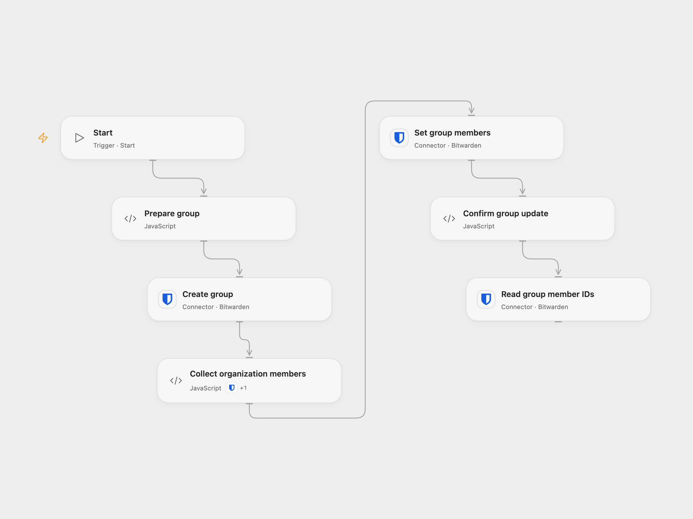

# Create a Bitwarden Group for Organization Members

Create a Bitwarden organization group, add the organization members, and retrieve its member IDs.

<picture>
  <source media="(prefers-color-scheme: dark)" srcset="preview-dark.png">
  
</picture>

[Open Flow JSON](templates/create-bitwarden-group-for-organization-members.openflow.json) · [n8n JSON](templates/create-bitwarden-group-for-organization-members.n8n.json)

## Setup and use

Connect the same Bitwarden organization to each Bitwarden node. Use an organization API key with group-management permissions. Set the group name in **Prepare group**. In n8n connect Bitwarden and set the group name in **Bitwarden**. Run one format manually.

## Behavior

The workflow creates a new group with access to all collections disabled, lists all organization members, sets the group membership to those IDs and reads the resulting IDs. It changes group membership for the whole organization, so use it only when that is intended. If no members are returned, the new group remains empty. Changes made concurrently may affect the result.

A failed or uncertain creation can leave a group behind. An uncertain membership update may have succeeded. Inspect the organization and group before retrying; earlier changes are not rolled back.

Inspiration &amp; credits

## Changes to the source

- Add a manual trigger. Collect the member IDs and submit one membership update, preserving all listed members instead of issuing one update per member. Open Flow uses the Bitwarden Provider API for the two writes.

Adapted from [Create a Bitwarden group and assign members](https://github.com/Zie619/n8n-workflows/blob/ae8cf6dc5b873cbb4f74587aa9180ed3a9f70682/workflows/Bitwarden/0003_Bitwarden_Automate.json) in [Zie619/n8n-workflows](https://github.com/Zie619/n8n-workflows). The source export does not identify a separate template author or license.

The collection’s [MIT notice](https://github.com/Zie619/n8n-workflows/blob/94007c1445d9258a7da116646b79473e7c7c3282/LICENSE) is pinned at a later revision. This is the collection notice at that revision; it does not establish a separate original template author's license. Our changes are listed above; see [repository licensing](../../README.md#licensing).

> MIT License
>
> Copyright (c) 2025 Zie619
>
> Permission is hereby granted, free of charge, to any person obtaining a copy
> of this software and associated documentation files (the "Software"), to deal
> in the Software without restriction, including without limitation the rights
> to use, copy, modify, merge, publish, distribute, sublicense, and/or sell
> copies of the Software, and to permit persons to whom the Software is
> furnished to do so, subject to the following conditions:
>
> The above copyright notice and this permission notice shall be included in all
> copies or substantial portions of the Software.
>
> THE SOFTWARE IS PROVIDED "AS IS", WITHOUT WARRANTY OF ANY KIND, EXPRESS OR
> IMPLIED, INCLUDING BUT NOT LIMITED TO THE WARRANTIES OF MERCHANTABILITY,
> FITNESS FOR A PARTICULAR PURPOSE AND NONINFRINGEMENT. IN NO EVENT SHALL THE
> AUTHORS OR COPYRIGHT HOLDERS BE LIABLE FOR ANY CLAIM, DAMAGES OR OTHER
> LIABILITY, WHETHER IN AN ACTION OF CONTRACT, TORT OR OTHERWISE, ARISING FROM,
> OUT OF OR IN CONNECTION WITH THE SOFTWARE OR THE USE OR OTHER DEALINGS IN THE
> SOFTWARE.

