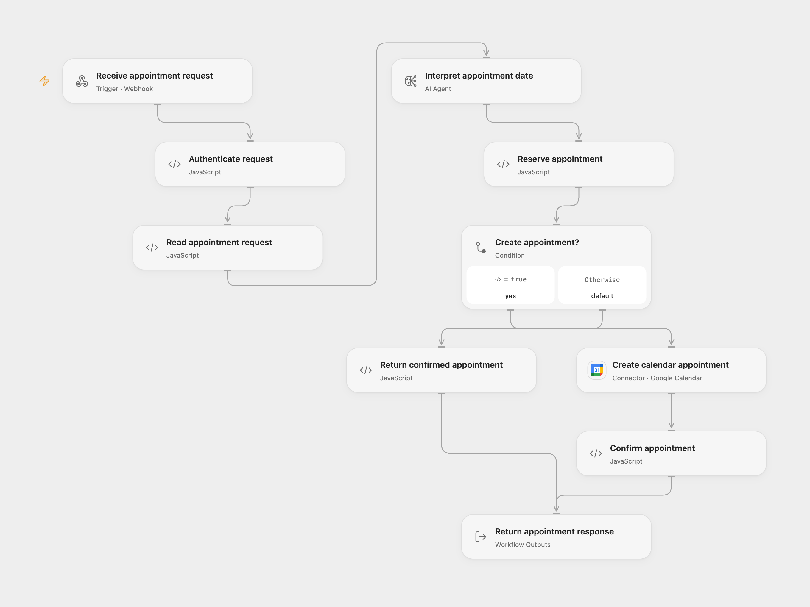

# Create Calendar Appointments from a Webhook

Convert a requested date and create a one-hour Calendar appointment.

<!-- template-actions:start -->
 
<!-- template-actions:end -->

<picture>
  <source media="(prefers-color-scheme: dark)" srcset="preview-dark.png">
  
</picture>

## Setup and use

Connect a model and Google Calendar, set the Calendar ID, and enable persistent State. Configure the secret variable APPOINTMENT_WEBHOOK_AUTH and require it as the Authorization header. Send a POST with a unique requestId, email, and appointmentDate including its time zone. Review the model interpretation before relying on the scheduled time. The email is included in the event title; the source does not invite an attendee.

If the Calendar result is unknown, inspect the calendar. Replay the same request with its exact pending key in **Reserve appointment**, setting resolution to confirmed only if the event exists or absent only if it does not. Clear both fields afterwards. Prevent overlapping runs for the same request ID.

In n8n

The supplied n8n workflow has a disabled trigger; configure its credentials, Data Table with item_key and status text columns, and webhook authentication before enabling it. Inspect a pending row before retrying: mark it done only after confirming the event exists, or delete it only after confirming it does not. Run one format only.

Inspiration &amp; credits

## Changes to the source

- This template implements the independent appointment capture from the larger Voiceflow example. Order tracking has an unconfigured URL and unverified GET request-body contract and is not included.
- Use a stable request ID and persist a pending record before Calendar writes; keep the one-hour duration and synchronous response.

Adapted from [Build a Chatbot, Voice Agent and Phone Agent with Voiceflow, Google Calendar and RAG](https://github.com/Zie619/n8n-workflows/blob/ae8cf6dc5b873cbb4f74587aa9180ed3a9f70682/workflows/Googlecalendar/1361_GoogleCalendar_Webhook_Create_Webhook.json) in [Zie619/n8n-workflows](https://github.com/Zie619/n8n-workflows). The source export does not identify a separate template author or license.

The collection’s [MIT notice](https://github.com/Zie619/n8n-workflows/blob/94007c1445d9258a7da116646b79473e7c7c3282/LICENSE) is pinned at a later revision. This is the collection notice at that revision; it does not establish a separate original template author's license. Our changes are listed above; see [repository licensing](../../README.md#licensing).

> MIT License
>
> Copyright (c) 2025 Zie619
>
> Permission is hereby granted, free of charge, to any person obtaining a copy
> of this software and associated documentation files (the "Software"), to deal
> in the Software without restriction, including without limitation the rights
> to use, copy, modify, merge, publish, distribute, sublicense, and/or sell
> copies of the Software, and to permit persons to whom the Software is
> furnished to do so, subject to the following conditions:
>
> The above copyright notice and this permission notice shall be included in all
> copies or substantial portions of the Software.
>
> THE SOFTWARE IS PROVIDED "AS IS", WITHOUT WARRANTY OF ANY KIND, EXPRESS OR
> IMPLIED, INCLUDING BUT NOT LIMITED TO THE WARRANTIES OF MERCHANTABILITY,
> FITNESS FOR A PARTICULAR PURPOSE AND NONINFRINGEMENT. IN NO EVENT SHALL THE
> AUTHORS OR COPYRIGHT HOLDERS BE LIABLE FOR ANY CLAIM, DAMAGES OR OTHER
> LIABILITY, WHETHER IN AN ACTION OF CONTRACT, TORT OR OTHERWISE, ARISING FROM,
> OUT OF OR IN CONNECTION WITH THE SOFTWARE OR THE USE OR OTHER DEALINGS IN THE
> SOFTWARE.

