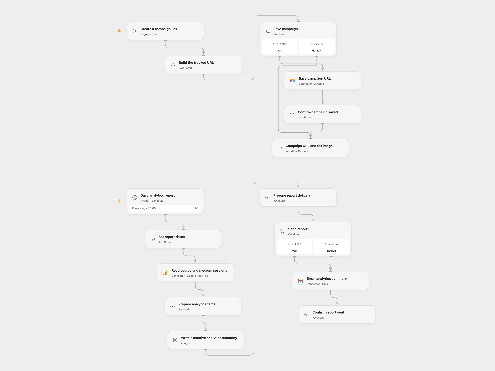

# Create Campaign Links and Email Analytics Reports

Create tracked campaign URLs and QR codes, and email scheduled GA4 traffic summaries.

<picture>
  <source media="(prefers-color-scheme: dark)" srcset="preview-dark.png">
  
</picture>

[Open Flow JSON](templates/create-campaign-links-and-email-analytics-report.openflow.json) · [n8n JSON](templates/create-campaign-links-and-email-analytics-report.n8n.json)

## Setup

Connect Airtable, Google Analytics, Gmail and a model. Configure the Airtable base and table in **Save campaign URL**, the GA4 property in **Read source and medium sessions**, and the recipient in **Prepare report delivery**. The Airtable table needs a writable URL field. The schedule runs daily at midnight UTC; adjust it to suit.

In n8n configure the same accounts, property, recipient, Airtable base and table, and a Data Table with item_key and status text columns on the checkpoint nodes. Use only one format for each campaign or report and prevent overlapping runs.

## Use

Run **Create a campaign link** with the website and campaign parameters. The result includes the tracked URL and a QuickChart QR image URL. Opening it sends the campaign URL to QuickChart. The scheduled branch reads up to 50 source/medium rows for the last seven days through today and asks the model for an executive summary before sending it by email.

If Airtable or Gmail has an unknown result, inspect the service before retrying. Enter the pending key in the corresponding preparation step with resolution confirmed if the write happened, or absent if it did not; run again, then clear both fields. In n8n inspect the pending Data Table row, complete or verify the write manually, then mark it done or delete it to retry.

Inspiration &amp; credits

Corrected URL encoding, the missing Airtable match ID and empty GA4 dimension; removed private account values.

Adapted from [UTM Link Creator & QR Code Generator with Scheduled Google Analytics Reports](https://github.com/Zie619/n8n-workflows/blob/ae8cf6dc5b873cbb4f74587aa9180ed3a9f70682/workflows/Code/1710_Code_Schedule_Automation_Scheduled.json) in [Zie619/n8n-workflows](https://github.com/Zie619/n8n-workflows). The source export does not identify a separate template author or license.

The collection’s [MIT notice](https://github.com/Zie619/n8n-workflows/blob/94007c1445d9258a7da116646b79473e7c7c3282/LICENSE) is pinned at a later revision. This is the collection notice at that revision; it does not establish a separate original template author's license. Our changes are listed above; see [repository licensing](../../README.md#licensing).

> MIT License
>
> Copyright (c) 2025 Zie619
>
> Permission is hereby granted, free of charge, to any person obtaining a copy
> of this software and associated documentation files (the "Software"), to deal
> in the Software without restriction, including without limitation the rights
> to use, copy, modify, merge, publish, distribute, sublicense, and/or sell
> copies of the Software, and to permit persons to whom the Software is
> furnished to do so, subject to the following conditions:
>
> The above copyright notice and this permission notice shall be included in all
> copies or substantial portions of the Software.
>
> THE SOFTWARE IS PROVIDED "AS IS", WITHOUT WARRANTY OF ANY KIND, EXPRESS OR
> IMPLIED, INCLUDING BUT NOT LIMITED TO THE WARRANTIES OF MERCHANTABILITY,
> FITNESS FOR A PARTICULAR PURPOSE AND NONINFRINGEMENT. IN NO EVENT SHALL THE
> AUTHORS OR COPYRIGHT HOLDERS BE LIABLE FOR ANY CLAIM, DAMAGES OR OTHER
> LIABILITY, WHETHER IN AN ACTION OF CONTRACT, TORT OR OTHERWISE, ARISING FROM,
> OUT OF OR IN CONNECTION WITH THE SOFTWARE OR THE USE OR OTHER DEALINGS IN THE
> SOFTWARE.

