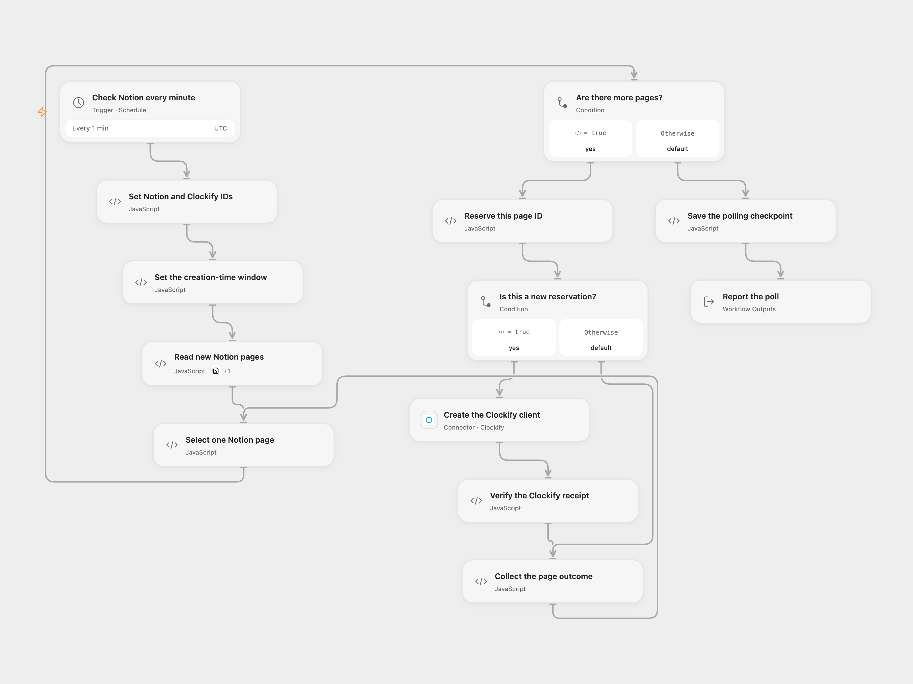

# Create Clockify Clients from New Notion Pages

Create a Clockify client using the Name field of each new page in one Notion data source.

<!-- template-actions:start -->
 
<!-- template-actions:end -->

<picture>
  <source media="(prefers-color-scheme: dark)" srcset="preview-dark.png">
  
</picture>

## Setup

1. Share the Notion client data source with your Notion connection. In **Set Notion and Clockify IDs**, enter the Notion data source ID, the Clockify workspace ID, and the property that holds the client name. The default is `Name` and accepts a title or text property.
2. Bind the Notion connection in **Read new Notion pages** and a Clockify connection with permission to add clients in **Create the Clockify client**. This template uses the standard Clockify API at `api.clockify.me`. Publish and enable one workflow per source and workspace pair.

## Behavior

The first scheduled run establishes a baseline. Each subsequent minute, the workflow reads Notion pages by creation time. Editing an existing page does not create a client. A new page edited before the poll still qualifies and uses the name available when it is read. Pages with an empty name or a name over 100 characters are skipped. The complete poll is limited to 50 Notion result pages.

Each Notion page ID is reserved before sending its name to Clockify. A confirmed result includes the created client ID. If the result is uncertain, check the selected workspace before creating the client manually. Retain the workflow state to prevent replays. Monitor the Workflow State entry limit if you create clients at high volume.

In n8n

Set the same IDs and property in **Set Notion and Clockify IDs**. In **Read new Notion pages**, select a Bearer Auth credential containing the Notion integration secret. In **Create the Clockify client**, select a Header Auth credential with the name `X-Api-Key` and your Clockify API key.

Create a dedicated Data Table with text columns `scope_key`, `status`, and `value`. Select it in each Data Table node. Run one active copy on a regular-mode instance with `N8N_CONCURRENCY_PRODUCTION_LIMIT=1` and avoid overlapping manual runs. Rows marked `pending_review` need checking in Clockify. Keep the checkpoint and reservations when importing workflow updates.

Inspiration &amp; credits

Adapted from [Add new clients from Notion to Clockify](https://github.com/Zie619/n8n-workflows/blob/ae8cf6dc5b873cbb4f74587aa9180ed3a9f70682/workflows/Clockify/1923_Clockify_Stickynote_Create_Triggered.json) in [Zie619/n8n-workflows](https://github.com/Zie619/n8n-workflows). Attribution: Zie619 / n8n-workflows.

The collection’s [MIT notice](https://github.com/Zie619/n8n-workflows/blob/94007c1445d9258a7da116646b79473e7c7c3282/LICENSE) is pinned at a later revision. This is the collection notice at that revision; it does not establish a separate original template author's license. Our changes are listed above; see [repository licensing](../../README.md#licensing).

> MIT License
>
> Copyright (c) 2025 Zie619
>
> Permission is hereby granted, free of charge, to any person obtaining a copy
> of this software and associated documentation files (the "Software"), to deal
> in the Software without restriction, including without limitation the rights
> to use, copy, modify, merge, publish, distribute, sublicense, and/or sell
> copies of the Software, and to permit persons to whom the Software is
> furnished to do so, subject to the following conditions:
>
> The above copyright notice and this permission notice shall be included in all
> copies or substantial portions of the Software.
>
> THE SOFTWARE IS PROVIDED "AS IS", WITHOUT WARRANTY OF ANY KIND, EXPRESS OR
> IMPLIED, INCLUDING BUT NOT LIMITED TO THE WARRANTIES OF MERCHANTABILITY,
> FITNESS FOR A PARTICULAR PURPOSE AND NONINFRINGEMENT. IN NO EVENT SHALL THE
> AUTHORS OR COPYRIGHT HOLDERS BE LIABLE FOR ANY CLAIM, DAMAGES OR OTHER
> LIABILITY, WHETHER IN AN ACTION OF CONTRACT, TORT OR OTHERWISE, ARISING FROM,
> OUT OF OR IN CONNECTION WITH THE SOFTWARE OR THE USE OR OTHER DEALINGS IN THE
> SOFTWARE.

