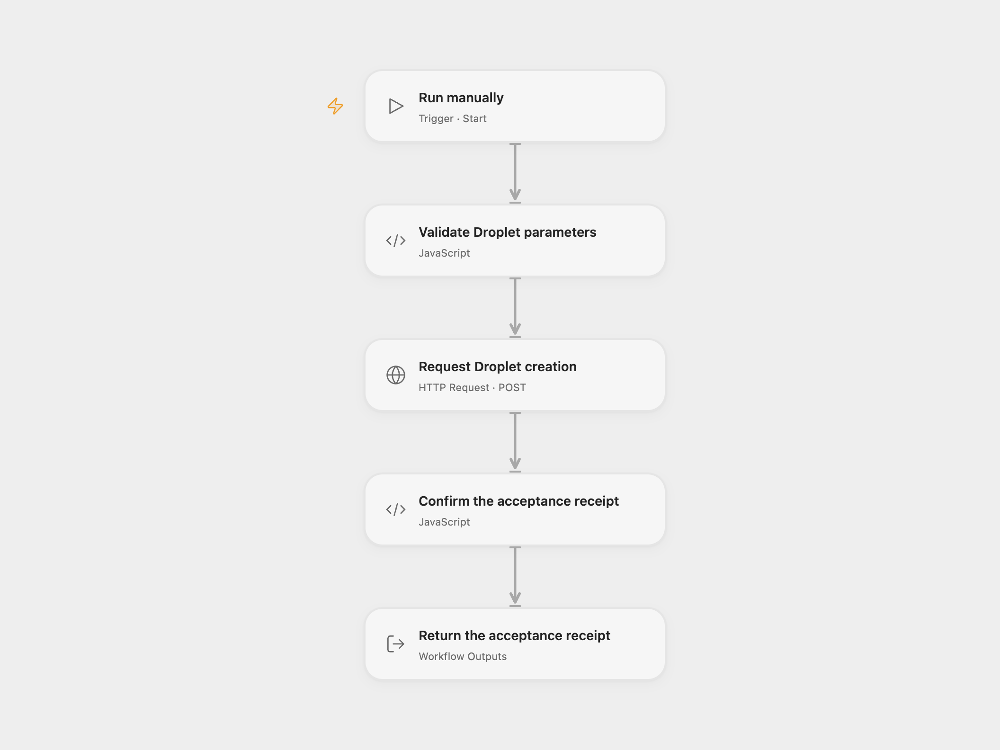

# Create a DigitalOcean Droplet

Submit a single DigitalOcean Droplet creation request and return its ID and provisioning receipt.

<!-- template-actions:start -->
 
<!-- template-actions:end -->

<picture>
  <source media="(prefers-color-scheme: dark)" srcset="preview-dark.png">
  
</picture>

## Setup

1. Bind your personal access token as the secret variable `DIGITALOCEAN_TOKEN` in **Request Droplet creation**. The token needs `droplet:create` and `image:read` access. Pick the account or team where you want to create the Droplet.
2. Run the workflow and enter a Droplet `name`, a `region` slug, a `size` slug, and an `image` slug or numeric ID available to that account. Each accepted request can provision a billable Droplet. [DigitalOcean create Droplet API](https://docs.digitalocean.com/reference/api/reference/droplets/#droplets_create)

## Behavior

The workflow makes one create request for one Droplet. A matching HTTP 202 receipt returns its `dropletId`, the Droplet object, and any links from DigitalOcean. HTTP 202 confirms that DigitalOcean accepted the request for processing. Check the returned action link or the DigitalOcean control panel for provisioning status.

The workflow makes no automatic retries. If the request times out or the receipt is incomplete, check the account before running again. A separate manual run sends a new create request.

In n8n

Edit the four values in **Set Droplet parameters**. For `image`, use a quoted slug or a numeric ID. Create a Header Auth credential with header name `Authorization` and value `Bearer <your token>`. Select it in **Request Droplet creation** and execute the workflow manually.

Inspiration &amp; credits

## Changes to the source

Connect the manual entry point to the original DigitalOcean operation, move the token to a secret variable, and verify the asynchronous acceptance receipt before returning the Droplet ID.

Adapted from [DigitalOcean Droplet creation workflow](https://github.com/Zie619/n8n-workflows/blob/ae8cf6dc5b873cbb4f74587aa9180ed3a9f70682/workflows/Http/0955_HTTP_Automation_Webhook.json) in [Zie619/n8n-workflows](https://github.com/Zie619/n8n-workflows). Attribution: Zie619 / n8n-workflows.

The collection’s [MIT notice](https://github.com/Zie619/n8n-workflows/blob/94007c1445d9258a7da116646b79473e7c7c3282/LICENSE) is pinned at a later revision. This is the collection notice at that revision; it does not establish a separate original template author's license. Our changes are listed above; see [repository licensing](../../README.md#licensing).

> MIT License
>
> Copyright (c) 2025 Zie619
>
> Permission is hereby granted, free of charge, to any person obtaining a copy
> of this software and associated documentation files (the "Software"), to deal
> in the Software without restriction, including without limitation the rights
> to use, copy, modify, merge, publish, distribute, sublicense, and/or sell
> copies of the Software, and to permit persons to whom the Software is
> furnished to do so, subject to the following conditions:
>
> The above copyright notice and this permission notice shall be included in all
> copies or substantial portions of the Software.
>
> THE SOFTWARE IS PROVIDED "AS IS", WITHOUT WARRANTY OF ANY KIND, EXPRESS OR
> IMPLIED, INCLUDING BUT NOT LIMITED TO THE WARRANTIES OF MERCHANTABILITY,
> FITNESS FOR A PARTICULAR PURPOSE AND NONINFRINGEMENT. IN NO EVENT SHALL THE
> AUTHORS OR COPYRIGHT HOLDERS BE LIABLE FOR ANY CLAIM, DAMAGES OR OTHER
> LIABILITY, WHETHER IN AN ACTION OF CONTRACT, TORT OR OTHERWISE, ARISING FROM,
> OUT OF OR IN CONNECTION WITH THE SOFTWARE OR THE USE OR OTHER DEALINGS IN THE
> SOFTWARE.

