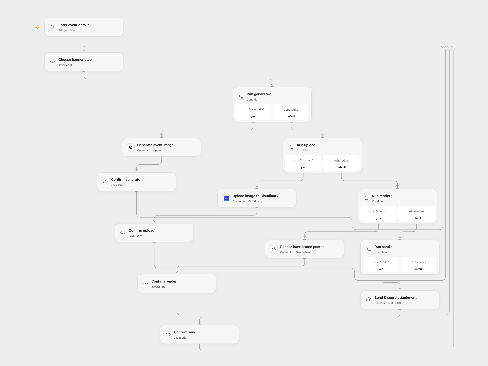

# Create Event Posters for Discord

Generate an event poster from a prompt and share it as a Discord attachment.

<!-- template-actions:start -->
 
<!-- template-actions:end -->

<picture>
  <source media="(prefers-color-scheme: dark)" srcset="preview-dark.png">
  
</picture>

## Setup

Connect OpenAI, Cloudinary and Bannerbear. Create a Bannerbear template with layers named placeholder_image, placeholder_text, placeholder_location and placeholder_date. In n8n connect Discord, configure the relay Discord node with your guild ID and credentials, then set its webhook Header Auth credential to Authorization: Bearer followed by your chosen token. Configure a Data Table with text columns item_key and status for the relay checkpoint nodes, then activate the workflow. Set the webhook HTTPS production URL in **Choose banner step** and bind that token as secret Variable N8N_RELAY_TOKEN. Enable persistent State and prevent overlapping executions. Run Open Flow with a unique submission ID, event details, prompt, template ID and Discord channel ID.

For n8n direct mode, configure the form's two template IDs, Cloudinary account and upload preset, Bannerbear and Discord. Select the same Data Table on the form checkpoint nodes. Enable only one format.

## Behavior

The workflow generates an image, uploads it to Cloudinary, renders the event details in Bannerbear, and sends the poster as a Discord file. Image generation and rendering may take time. The source n8n workflow polls the asynchronous Bannerbear job; Open Flow uses the synchronous endpoint.

If an external write has an unknown result, inspect the corresponding service. In **Choose banner step**, enter the pending key and resolution confirmed or absent. For a confirmed image generation, upload or render enter its resulting HTTPS URL; then rerun with the same submission ID and details and clear the fields. For a pending direct-form row, inspect the affected service and complete any remaining actions manually before marking it done. For a pending relay row, mark it done if the Discord message exists and confirm the Open Flow step; if no message exists, delete the relay row and resolve the Open Flow step as absent before retrying. Protect the relay endpoint and execution history.

Inspiration &amp; credits

Added an authenticated n8n binary attachment relay, configurable account settings, and write checkpoints.

Adapted from [Generate and share an event banner](https://github.com/Zie619/n8n-workflows/blob/ae8cf6dc5b873cbb4f74587aa9180ed3a9f70682/workflows/Bannerbear/1665_Bannerbear_Discord_Automation_Webhook.json) in [Zie619/n8n-workflows](https://github.com/Zie619/n8n-workflows). The source export does not identify a separate template author or license.

The collection’s [MIT notice](https://github.com/Zie619/n8n-workflows/blob/94007c1445d9258a7da116646b79473e7c7c3282/LICENSE) is pinned at a later revision. This is the collection notice at that revision; it does not establish a separate original template author's license. Our changes are listed above; see [repository licensing](../../README.md#licensing).

> MIT License
>
> Copyright (c) 2025 Zie619
>
> Permission is hereby granted, free of charge, to any person obtaining a copy
> of this software and associated documentation files (the "Software"), to deal
> in the Software without restriction, including without limitation the rights
> to use, copy, modify, merge, publish, distribute, sublicense, and/or sell
> copies of the Software, and to permit persons to whom the Software is
> furnished to do so, subject to the following conditions:
>
> The above copyright notice and this permission notice shall be included in all
> copies or substantial portions of the Software.
>
> THE SOFTWARE IS PROVIDED "AS IS", WITHOUT WARRANTY OF ANY KIND, EXPRESS OR
> IMPLIED, INCLUDING BUT NOT LIMITED TO THE WARRANTIES OF MERCHANTABILITY,
> FITNESS FOR A PARTICULAR PURPOSE AND NONINFRINGEMENT. IN NO EVENT SHALL THE
> AUTHORS OR COPYRIGHT HOLDERS BE LIABLE FOR ANY CLAIM, DAMAGES OR OTHER
> LIABILITY, WHETHER IN AN ACTION OF CONTRACT, TORT OR OTHERWISE, ARISING FROM,
> OUT OF OR IN CONNECTION WITH THE SOFTWARE OR THE USE OR OTHER DEALINGS IN THE
> SOFTWARE.

