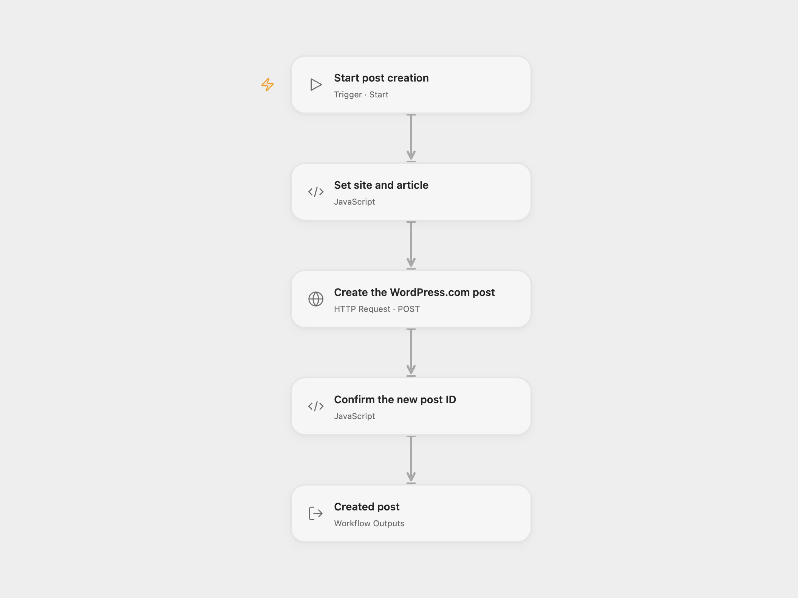

# Create Formatted Posts on WordPress.com

Send a title and formatted article to WordPress.com and return the confirmed post ID.

<!-- template-actions:start -->
 
<!-- template-actions:end -->

<picture>
  <source media="(prefers-color-scheme: dark)" srcset="preview-dark.png">
  
</picture>

## Setup

1. In **Set site and article**, enter the numeric WordPress.com site ID, title, and article body. The body accepts HTML. Find your site's ID in the [WordPress.com API guide](https://developer.wordpress.com/docs/api/getting-started/#getting-your-site-id).
2. Obtain a [WordPress.com OAuth access token](https://developer.wordpress.com/docs/api/oauth2/) for a user who can create posts on that site. To publish directly, use a user who can publish posts and set the article's status to `publish`. The default status is `draft`.
3. In **Create the WordPress.com post**, bind the secret Variable `WORDPRESS_COM_ACCESS_TOKEN` to the Bearer token input. Run manually and open **Created post**.

## Behavior

Each run sends one request to create an article with the configured title, body and status. WordPress.com applies the site's HTML rules. A successful run returns the new `postId` and confirmed status.

A permission error or an unconfirmed response fails the run. If a timeout or service error leaves the result uncertain, check the site's posts before running again. Repeating the workflow can create another post.

In n8n

Enter the numeric site ID, title, body and status in **Set site and article**. Assign a Bearer Auth credential containing your WordPress.com OAuth access token in **Create the WordPress.com post**. Run manually and read the result in **Confirm the new post ID**.

Inspiration &amp; credits

## Changes to the source

- Use the WordPress.com REST API and OAuth for the same title and article body.
- Use an explicit post status. The original XML-RPC method creates a draft by default. Select `publish` to publish immediately.
- Check the API status and numeric post ID before reporting creation.

Adapted from [Use XMLRPC via HttpRequest-node to post on Wordpress.com](https://github.com/Zie619/n8n-workflows/blob/ae8cf6dc5b873cbb4f74587aa9180ed3a9f70682/workflows/Code/2026_Code_Manual_Automation_Webhook.json) in [Zie619/n8n-workflows](https://github.com/Zie619/n8n-workflows). Attribution: Zie619 / n8n-workflows.

The collection’s [MIT notice](https://github.com/Zie619/n8n-workflows/blob/94007c1445d9258a7da116646b79473e7c7c3282/LICENSE) is pinned at a later revision. This is the collection notice at that revision; it does not establish a separate original template author's license. Our changes are listed above; see [repository licensing](../../README.md#licensing).

> MIT License
>
> Copyright (c) 2025 Zie619
>
> Permission is hereby granted, free of charge, to any person obtaining a copy
> of this software and associated documentation files (the "Software"), to deal
> in the Software without restriction, including without limitation the rights
> to use, copy, modify, merge, publish, distribute, sublicense, and/or sell
> copies of the Software, and to permit persons to whom the Software is
> furnished to do so, subject to the following conditions:
>
> The above copyright notice and this permission notice shall be included in all
> copies or substantial portions of the Software.
>
> THE SOFTWARE IS PROVIDED "AS IS", WITHOUT WARRANTY OF ANY KIND, EXPRESS OR
> IMPLIED, INCLUDING BUT NOT LIMITED TO THE WARRANTIES OF MERCHANTABILITY,
> FITNESS FOR A PARTICULAR PURPOSE AND NONINFRINGEMENT. IN NO EVENT SHALL THE
> AUTHORS OR COPYRIGHT HOLDERS BE LIABLE FOR ANY CLAIM, DAMAGES OR OTHER
> LIABILITY, WHETHER IN AN ACTION OF CONTRACT, TORT OR OTHERWISE, ARISING FROM,
> OUT OF OR IN CONNECTION WITH THE SOFTWARE OR THE USE OR OTHER DEALINGS IN THE
> SOFTWARE.

