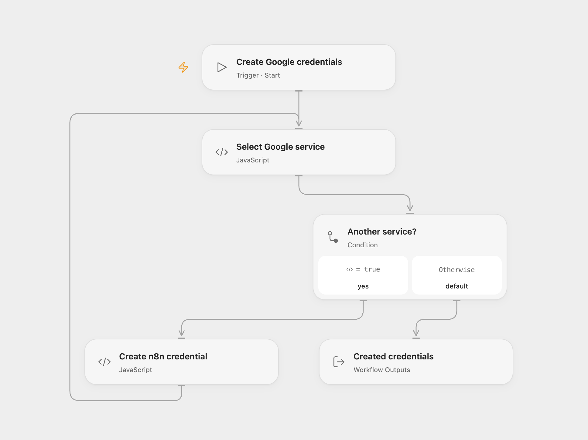

# Create Google Credentials in n8n

Create seven named Google OAuth credential records in n8n using one Google OAuth client.

<picture>
  <source media="(prefers-color-scheme: dark)" srcset="preview-dark.png">
  
</picture>

[Open Flow JSON](templates/create-google-credentials-in-n8n.openflow.json) · [n8n JSON](templates/create-google-credentials-in-n8n.n8n.json)

## Setup and use

Create a Google OAuth client for your n8n instance. In **Create n8n credential**, enter the n8n HTTPS base URL, Google client ID and account email. Set the node’s HTTP capability host to your n8n hostname and bind secret Variables GOOGLE_CLIENT_SECRET and N8N_API_KEY. The n8n key needs permission to create credentials. In n8n configure the n8n API credential, enter the Google client JSON and email, then run one format manually. n8n execution data can retain the client JSON, so restrict access to its execution history.

## Behavior

The workflow creates credentials for Google Docs, Sheets, Slides, Drive, Gmail, Calendar and Contacts, naming each with the email and credential type. The credentials still require Google sign-in in n8n. Each creation is separate; if a run fails or a response is lost, earlier credentials may already exist. Inspect n8n before rerunning to avoid duplicates. Open Flow returns the created record IDs and names.

Inspiration &amp; credits

## Changes to the source

- Use Secret Variables for the Google client secret and n8n API key in Open Flow. Make seven API requests sequentially and return their record IDs.

Adapted from [Create Google Creds](https://github.com/Zie619/n8n-workflows/blob/ae8cf6dc5b873cbb4f74587aa9180ed3a9f70682/workflows/Manual/1853_Manual_N8N_Create_Triggered.json) in [Zie619/n8n-workflows](https://github.com/Zie619/n8n-workflows). The source export does not identify a separate template author or license.

The collection’s [MIT notice](https://github.com/Zie619/n8n-workflows/blob/94007c1445d9258a7da116646b79473e7c7c3282/LICENSE) is pinned at a later revision. This is the collection notice at that revision; it does not establish a separate original template author's license. Our changes are listed above; see [repository licensing](../../README.md#licensing).

> MIT License
>
> Copyright (c) 2025 Zie619
>
> Permission is hereby granted, free of charge, to any person obtaining a copy
> of this software and associated documentation files (the "Software"), to deal
> in the Software without restriction, including without limitation the rights
> to use, copy, modify, merge, publish, distribute, sublicense, and/or sell
> copies of the Software, and to permit persons to whom the Software is
> furnished to do so, subject to the following conditions:
>
> The above copyright notice and this permission notice shall be included in all
> copies or substantial portions of the Software.
>
> THE SOFTWARE IS PROVIDED "AS IS", WITHOUT WARRANTY OF ANY KIND, EXPRESS OR
> IMPLIED, INCLUDING BUT NOT LIMITED TO THE WARRANTIES OF MERCHANTABILITY,
> FITNESS FOR A PARTICULAR PURPOSE AND NONINFRINGEMENT. IN NO EVENT SHALL THE
> AUTHORS OR COPYRIGHT HOLDERS BE LIABLE FOR ANY CLAIM, DAMAGES OR OTHER
> LIABILITY, WHETHER IN AN ACTION OF CONTRACT, TORT OR OTHERWISE, ARISING FROM,
> OUT OF OR IN CONNECTION WITH THE SOFTWARE OR THE USE OR OTHER DEALINGS IN THE
> SOFTWARE.

