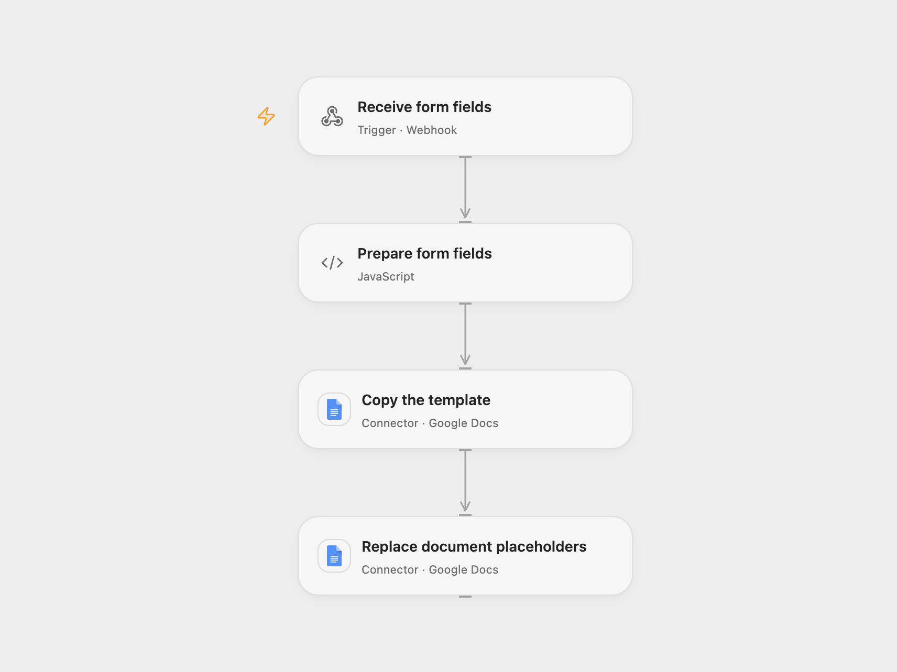

# Create a Google Doc from Form Fields

Copy a Google Docs template and replace placeholders with submitted fields.

<picture>
  <source media="(prefers-color-scheme: dark)" srcset="preview-dark.png">
  
</picture>

[Open Flow JSON](templates/create-google-doc-from-form-fields.openflow.json) · [n8n JSON](templates/create-google-doc-from-form-fields.n8n.json)

## Setup

Connect Google Docs with access to copy and edit the template. Set the document ID in **Prepare form fields**. The Open Flow webhook is public and accepts submissions without authentication; restrict access to its URL. Deploy it over HTTPS and submit JSON such as `{"name":"Example","fields":{"address":"123 Main St"}}`. The document title is `name`; each string field replaces its case-sensitive placeholder such as `{{name}}` or `{{address}}`.

For n8n, import the workflow, enable Basic Auth on **Form**, select Google Drive and Docs credentials, and select your template in **Copy template file**. Add any extra form fields on **Form** and corresponding placeholders to the template. Activate one format.

## Behavior

Each submission creates a separate copy and replaces matching text in that copy. Open Flow accepts extra fields in the JSON `fields` object; n8n uses fields configured in its form. Placeholder names and values are case-sensitive strings. The webhook acknowledgment does not confirm document creation. Restrict access to execution history containing form data. If copying or replacement fails or its result is unknown, inspect Google Drive and the copy before retrying; the copy can remain partially filled and replay can create another document.

Inspiration &amp; credits

## Changes to the source

- Replace the private document ID with a setup value and enable Basic Auth on the n8n form.
- Validate inputs before copying and expose a JSON webhook for Open Flow.

Adapted from [Populate Google Docs from a form](https://github.com/Zie619/n8n-workflows/blob/ae8cf6dc5b873cbb4f74587aa9180ed3a9f70682/workflows/Code/0784_Code_Form_Automation_Webhook.json) in [Zie619/n8n-workflows](https://github.com/Zie619/n8n-workflows). The source export does not identify a separate template author or license.

The collection’s [MIT notice](https://github.com/Zie619/n8n-workflows/blob/94007c1445d9258a7da116646b79473e7c7c3282/LICENSE) is pinned at a later revision. This is the collection notice at that revision; it does not establish a separate original template author's license. Our changes are listed above; see [repository licensing](../../README.md#licensing).

> MIT License
>
> Copyright (c) 2025 Zie619
>
> Permission is hereby granted, free of charge, to any person obtaining a copy
> of this software and associated documentation files (the "Software"), to deal
> in the Software without restriction, including without limitation the rights
> to use, copy, modify, merge, publish, distribute, sublicense, and/or sell
> copies of the Software, and to permit persons to whom the Software is
> furnished to do so, subject to the following conditions:
>
> The above copyright notice and this permission notice shall be included in all
> copies or substantial portions of the Software.
>
> THE SOFTWARE IS PROVIDED "AS IS", WITHOUT WARRANTY OF ANY KIND, EXPRESS OR
> IMPLIED, INCLUDING BUT NOT LIMITED TO THE WARRANTIES OF MERCHANTABILITY,
> FITNESS FOR A PARTICULAR PURPOSE AND NONINFRINGEMENT. IN NO EVENT SHALL THE
> AUTHORS OR COPYRIGHT HOLDERS BE LIABLE FOR ANY CLAIM, DAMAGES OR OTHER
> LIABILITY, WHETHER IN AN ACTION OF CONTRACT, TORT OR OTHERWISE, ARISING FROM,
> OUT OF OR IN CONNECTION WITH THE SOFTWARE OR THE USE OR OTHER DEALINGS IN THE
> SOFTWARE.

