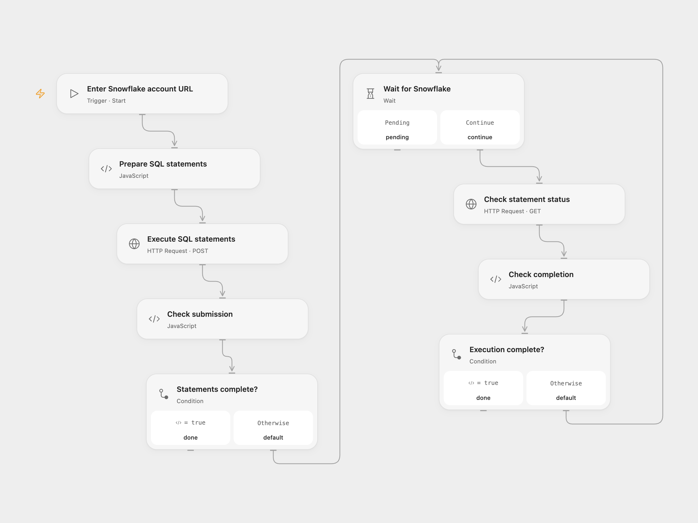

# Create, Insert and Update a Snowflake Table

Create a Snowflake table, insert a row, and update that row.

<picture>
  <source media="(prefers-color-scheme: dark)" srcset="preview-dark.png">
  
</picture>

[Open Flow JSON](templates/create-insert-and-update-snowflake-table.openflow.json) · [n8n JSON](templates/create-insert-and-update-snowflake-table.n8n.json)

## Setup

Provide the Snowflake account URL and configure a programmatic access token in both Open Flow HTTP nodes. The user needs a default database, schema, warehouse and role with rights to create and modify a table. In n8n connect Snowflake credentials. Use a database where a new table named `docs` can be created.

## Behavior

The workflow creates `docs`, inserts ID 1 with name n8n, and updates that ID to nodemation. Open Flow submits three SQL statements as one SQL API request and checks the asynchronous result. n8n runs the three original Snowflake nodes. Existing tables and errors stop the workflow. If any statement fails, earlier statements may already have completed. A lost response or polling timeout can also leave changes; inspect Snowflake before running again. Open Flow checks a pending statement every five seconds for up to five minutes.

Inspiration &amp; credits

## Changes to the source

- Open Flow uses the Snowflake SQL API and a programmatic access token; n8n uses its Snowflake connection. The n8n create node continues when the database returns no rows, and its table and column identifiers use Snowflake's unquoted uppercase names.

Adapted from [Create a table, and insert and update data in the table in Snowflake](https://github.com/Zie619/n8n-workflows/blob/ae8cf6dc5b873cbb4f74587aa9180ed3a9f70682/workflows/Manual/0219_Manual_Snowflake_Create_Triggered.json) in [Zie619/n8n-workflows](https://github.com/Zie619/n8n-workflows). The source export does not identify a separate template author or license.

The collection’s [MIT notice](https://github.com/Zie619/n8n-workflows/blob/94007c1445d9258a7da116646b79473e7c7c3282/LICENSE) is pinned at a later revision. This is the collection notice at that revision; it does not establish a separate original template author's license. Our changes are listed above; see [repository licensing](../../README.md#licensing).

> MIT License
>
> Copyright (c) 2025 Zie619
>
> Permission is hereby granted, free of charge, to any person obtaining a copy
> of this software and associated documentation files (the "Software"), to deal
> in the Software without restriction, including without limitation the rights
> to use, copy, modify, merge, publish, distribute, sublicense, and/or sell
> copies of the Software, and to permit persons to whom the Software is
> furnished to do so, subject to the following conditions:
>
> The above copyright notice and this permission notice shall be included in all
> copies or substantial portions of the Software.
>
> THE SOFTWARE IS PROVIDED "AS IS", WITHOUT WARRANTY OF ANY KIND, EXPRESS OR
> IMPLIED, INCLUDING BUT NOT LIMITED TO THE WARRANTIES OF MERCHANTABILITY,
> FITNESS FOR A PARTICULAR PURPOSE AND NONINFRINGEMENT. IN NO EVENT SHALL THE
> AUTHORS OR COPYRIGHT HOLDERS BE LIABLE FOR ANY CLAIM, DAMAGES OR OTHER
> LIABILITY, WHETHER IN AN ACTION OF CONTRACT, TORT OR OTHERWISE, ARISING FROM,
> OUT OF OR IN CONNECTION WITH THE SOFTWARE OR THE USE OR OTHER DEALINGS IN THE
> SOFTWARE.

