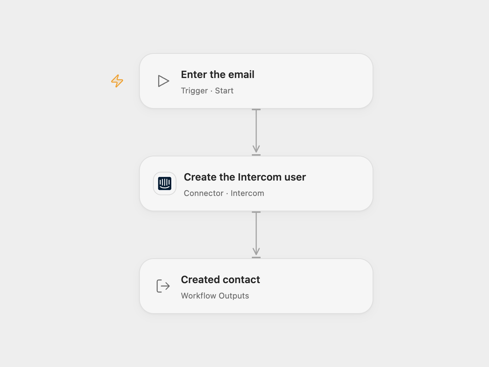

# Create an Intercom User by Email

Create an Intercom user contact from an email address.

<picture>
  <source media="(prefers-color-scheme: dark)" srcset="preview-dark.png">
  
</picture>

[Open Flow JSON](templates/create-intercom-user-by-email.openflow.json) · [n8n JSON](templates/create-intercom-user-by-email.n8n.json)

## Setup

In Open Flow connect Intercom with contact write permission, then run with the email address. The connection determines the Intercom region. In n8n, create an HTTP Header Auth credential with name `Authorization` and value `Bearer YOUR_INTERCOM_ACCESS_TOKEN`; select it in **Create the Intercom user** and replace the email placeholder. The n8n URL targets the US API; use `https://api.eu.intercom.io/contacts` or `https://api.au.intercom.io/contacts` for those regions. Run one format.

## Behavior

A manual run creates one contact with role `user` and returns Intercom's contact record. Intercom rejects a duplicate contact instead of updating it. If a request fails or its outcome is uncertain, check Intercom before retrying; it may already have created the contact.

Inspiration &amp; credits

## Changes to the source

- Replace the deprecated Users API with the Contacts API. The current API performs a strict create rather than updating an existing user, and returns the current contact shape.

Adapted from [Create a new user in Intercom](https://github.com/Zie619/n8n-workflows/blob/ae8cf6dc5b873cbb4f74587aa9180ed3a9f70682/workflows/Manual/1193_Manual_Intercom_Create_Triggered.json) in [Zie619/n8n-workflows](https://github.com/Zie619/n8n-workflows). The source export does not identify a separate template author or license.

The collection’s [MIT notice](https://github.com/Zie619/n8n-workflows/blob/94007c1445d9258a7da116646b79473e7c7c3282/LICENSE) is pinned at a later revision. This is the collection notice at that revision; it does not establish a separate original template author's license. Our changes are listed above; see [repository licensing](../../README.md#licensing).

> MIT License
>
> Copyright (c) 2025 Zie619
>
> Permission is hereby granted, free of charge, to any person obtaining a copy
> of this software and associated documentation files (the "Software"), to deal
> in the Software without restriction, including without limitation the rights
> to use, copy, modify, merge, publish, distribute, sublicense, and/or sell
> copies of the Software, and to permit persons to whom the Software is
> furnished to do so, subject to the following conditions:
>
> The above copyright notice and this permission notice shall be included in all
> copies or substantial portions of the Software.
>
> THE SOFTWARE IS PROVIDED "AS IS", WITHOUT WARRANTY OF ANY KIND, EXPRESS OR
> IMPLIED, INCLUDING BUT NOT LIMITED TO THE WARRANTIES OF MERCHANTABILITY,
> FITNESS FOR A PARTICULAR PURPOSE AND NONINFRINGEMENT. IN NO EVENT SHALL THE
> AUTHORS OR COPYRIGHT HOLDERS BE LIABLE FOR ANY CLAIM, DAMAGES OR OTHER
> LIABILITY, WHETHER IN AN ACTION OF CONTRACT, TORT OR OTHERWISE, ARISING FROM,
> OUT OF OR IN CONNECTION WITH THE SOFTWARE OR THE USE OR OTHER DEALINGS IN THE
> SOFTWARE.

