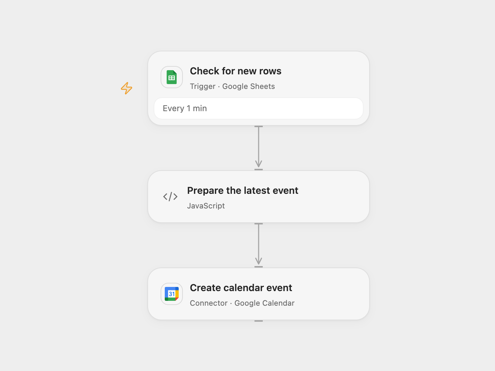

# Create Latest Sheet Event in Google Calendar

Create a Google Calendar all-day event from the latest newly added sheet row.

<picture>
  <source media="(prefers-color-scheme: dark)" srcset="preview-dark.png">
  
</picture>

[Open Flow JSON](templates/create-latest-sheet-event-in-google-calendar.openflow.json) · [n8n JSON](templates/create-latest-sheet-event-in-google-calendar.n8n.json)

## Setup and use

Connect Google Sheets and Google Calendar. Select the spreadsheet, sheet and calendar. Add headers `Event Name`, `Event Description`, `Event Start Date` and `Location`; use a date string such as `11 March 2026`. Enable one format to avoid duplicate events.

## Behavior

The workflow checks for new rows every minute and creates an all-day event from the last row in each received batch. The event is marked available and uses calendar color 3. The date formatter follows the source: if the date text does not include the current year, it appends that year before parsing. Dates are parsed in UTC; review them before enabling. Open Flow processes up to 500 rows per poll, so a larger burst may result in one event per page. The trigger starts from its initial baseline.

If creation has an unknown outcome, inspect the calendar before retrying; the event may already exist. The workflow does not deduplicate events across runs.

Inspiration &amp; credits

## Changes to the source

- Replace personal spreadsheet IDs with configuration and parse dates in UTC and use the next day as the exclusive end of the all-day event in both formats.

Adapted from [Automate Event Creation in Google Calendar from Google Sheets](https://github.com/Zie619/n8n-workflows/blob/ae8cf6dc5b873cbb4f74587aa9180ed3a9f70682/workflows/Googlecalendar/1346_GoogleCalendar_GoogleSheets_Automate_Triggered.json) in [Zie619/n8n-workflows](https://github.com/Zie619/n8n-workflows). The source export does not identify a separate template author or license.

The collection’s [MIT notice](https://github.com/Zie619/n8n-workflows/blob/94007c1445d9258a7da116646b79473e7c7c3282/LICENSE) is pinned at a later revision. This is the collection notice at that revision; it does not establish a separate original template author's license. Our changes are listed above; see [repository licensing](../../README.md#licensing).

> MIT License
>
> Copyright (c) 2025 Zie619
>
> Permission is hereby granted, free of charge, to any person obtaining a copy
> of this software and associated documentation files (the "Software"), to deal
> in the Software without restriction, including without limitation the rights
> to use, copy, modify, merge, publish, distribute, sublicense, and/or sell
> copies of the Software, and to permit persons to whom the Software is
> furnished to do so, subject to the following conditions:
>
> The above copyright notice and this permission notice shall be included in all
> copies or substantial portions of the Software.
>
> THE SOFTWARE IS PROVIDED "AS IS", WITHOUT WARRANTY OF ANY KIND, EXPRESS OR
> IMPLIED, INCLUDING BUT NOT LIMITED TO THE WARRANTIES OF MERCHANTABILITY,
> FITNESS FOR A PARTICULAR PURPOSE AND NONINFRINGEMENT. IN NO EVENT SHALL THE
> AUTHORS OR COPYRIGHT HOLDERS BE LIABLE FOR ANY CLAIM, DAMAGES OR OTHER
> LIABILITY, WHETHER IN AN ACTION OF CONTRACT, TORT OR OTHERWISE, ARISING FROM,
> OUT OF OR IN CONNECTION WITH THE SOFTWARE OR THE USE OR OTHER DEALINGS IN THE
> SOFTWARE.

