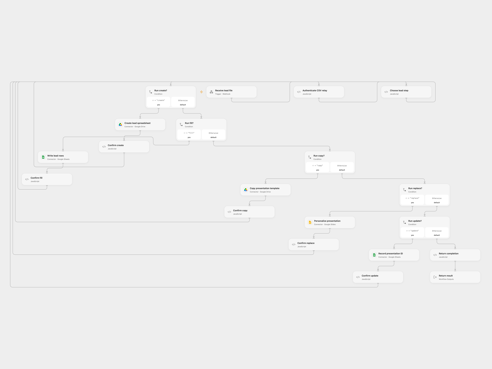

# Create Lead Presentations from CSV

Create a tracking sheet and a personalized presentation for each lead in a new CSV file.

<!-- template-actions:start -->
 
<!-- template-actions:end -->

<picture>
  <source media="(prefers-color-scheme: dark)" srcset="preview-dark.png">
  
</picture>

## Setup

Configure the n8n Drive trigger for the incoming folder. CSV must have headers First Name, Full Name, Email and Company; the source workflow’s 14 lead columns are retained. XLSX was not connected in the original workflow. Configure Drive, Sheets and Slides credentials, the template and destination folder IDs, and a private n8n Data Table with item_key, status and payload text columns. In Open Flow mode change Use Open Flow? from direct to relay, configure the relay header and LEADS_RELAY_AUTH, and enable persistent State. Configure Header Auth for Resume lead file. The parsed CSV must fit the Code node's 1 MiB input/output limit. Process each source file only once at a time.

A new spreadsheet is created in the configured lead folder and each row receives the ID of its own presentation. Stable row positions replace the original email match, so duplicate email addresses do not mix records. The template placeholders are {COMPANYNAME}, {Testdurchgestrichen} and {nichtdurchgestrichen}.

In n8n configure Resume lead file with Header Auth. For an unknown write inspect its Data Table row. If absent, change pending-create to no row, or pending-move, pending-fill, pending-copy, pending-replace or pending-update to the corresponding ready phase. If confirmed, change pending-create to ready-move and include sheetId in payload; pending-move to ready-fill; pending-fill to ready-copy; pending-copy to ready-replace and include presentationId in payload; pending-replace to ready-update; and pending-update to ready-copy after incrementing index, or done after the last lead. Resume with the original fileId.

If an external write has an unknown result, inspect the matching file and operation in Google Drive, Sheets or Slides. For Open Flow enter its pending key and confirmed or absent in Choose lead step; confirmed creates also require the ID. Clear the recovery fields after resuming.

Inspiration &amp; credits

Adapted from [Lead presentations from a CSV](https://github.com/Zie619/n8n-workflows/blob/ae8cf6dc5b873cbb4f74587aa9180ed3a9f70682/workflows/Googleslides/1845_Googleslides_Extractfromfile_Create_Triggered.json) in [Zie619/n8n-workflows](https://github.com/Zie619/n8n-workflows). The source export does not identify a separate template author or license.

The collection’s [MIT notice](https://github.com/Zie619/n8n-workflows/blob/94007c1445d9258a7da116646b79473e7c7c3282/LICENSE) is pinned at a later revision. This is the collection notice at that revision; it does not establish a separate original template author's license. Our changes are listed above; see [repository licensing](../../README.md#licensing).

> MIT License
>
> Copyright (c) 2025 Zie619
>
> Permission is hereby granted, free of charge, to any person obtaining a copy
> of this software and associated documentation files (the "Software"), to deal
> in the Software without restriction, including without limitation the rights
> to use, copy, modify, merge, publish, distribute, sublicense, and/or sell
> copies of the Software, and to permit persons to whom the Software is
> furnished to do so, subject to the following conditions:
>
> The above copyright notice and this permission notice shall be included in all
> copies or substantial portions of the Software.
>
> THE SOFTWARE IS PROVIDED "AS IS", WITHOUT WARRANTY OF ANY KIND, EXPRESS OR
> IMPLIED, INCLUDING BUT NOT LIMITED TO THE WARRANTIES OF MERCHANTABILITY,
> FITNESS FOR A PARTICULAR PURPOSE AND NONINFRINGEMENT. IN NO EVENT SHALL THE
> AUTHORS OR COPYRIGHT HOLDERS BE LIABLE FOR ANY CLAIM, DAMAGES OR OTHER
> LIABILITY, WHETHER IN AN ACTION OF CONTRACT, TORT OR OTHERWISE, ARISING FROM,
> OUT OF OR IN CONNECTION WITH THE SOFTWARE OR THE USE OR OTHER DEALINGS IN THE
> SOFTWARE.

