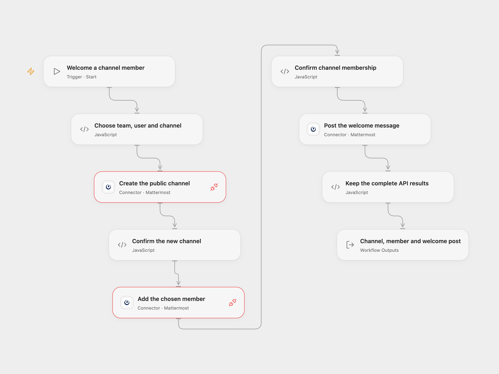

# Create a Mattermost Channel and Welcome a Member

Create a new public channel, add one specified user and send a welcome message in the same channel.

<picture>
  <source media="(prefers-color-scheme: dark)" srcset="preview-dark.png">
  
</picture>

[Open Flow JSON](templates/create-mattermost-channel-and-welcome-member.openflow.json) · [n8n JSON](templates/create-mattermost-channel-and-welcome-member.n8n.json)

## Setup

In **Choose team, user and channel**, set the existing team and user IDs. Choose a new, unique channel handle and its display name, and edit the welcome message. The original example uses `docs`, `Docs` and “Hey! Welcome to the channel!”.

Connect both Provider API Request nodes and **Post the welcome message** to the same Mattermost account. Configure the instance root URL and Personal Access Token. The hosted Connector requires a public HTTPS instance; localhost, private addresses and IPv6 targets are rejected by its current outbound guard. The account needs permission to create public channels, add the selected user and post in the created channel. Enable [Personal Access Tokens](https://docs.mattermost.com/developers/integrate/reference/personal-access-token) for the account when needed.

## Behavior

Run manually once to create the public channel, add the configured user and post the welcome message, in that order. Both later writes use the actual channel ID returned by creation. The result keeps the complete channel, membership and post objects, including extra API fields and the raw post response.

Each step confirms its response before starting the next write. A failure or uncertain response stops later steps. The channel or membership may already exist even when the run fails; a welcome post may also have been accepted. Inspect Mattermost before replaying. There is no workflow retry, lookup/reuse of an existing channel, rollback or cleanup. Running again with the same channel handle can fail because it already exists. Complete configuration and accumulated responses must fit the current Code host’s 1 MiB input/result budgets.

## n8n

Set the same values in **Choose team, user and channel**, then select the same Mattermost credentials on all three Mattermost nodes. Configure the instance URL and Personal Access Token in those credentials. The native Mattermost V1 node creates a public channel by default; this export sets that choice explicitly. The native authentication helper can automatically send a request once more after HTTP 401; other inspected HTTP errors and unknown writes are not automatically repeated. Open Flow’s Provider/Proxy rejects 401 after one request. This transport difference does not provide a safe workflow replay mechanism.

## Changes to the source

- Replace private team/user IDs and credential references with setup.
- Keep public channel creation, membership and the original welcome message in order.
- Validate dependent IDs and full API receipts before later writes, and retain all three results.

Source and license

Adapted from [Create a channel, add a member, and post a message to the channel](https://github.com/Zie619/n8n-workflows/blob/ae8cf6dc5b873cbb4f74587aa9180ed3a9f70682/workflows/Manual/0254_Manual_Mattermost_Create_Triggered.json) in [Zie619/n8n-workflows](https://github.com/Zie619/n8n-workflows). The source export does not identify a separate template author or license.

The collection’s [MIT notice](https://github.com/Zie619/n8n-workflows/blob/94007c1445d9258a7da116646b79473e7c7c3282/LICENSE) is pinned at a later revision. This is the collection notice at that revision; it does not establish a separate original template author's license. Our changes are listed above; see [repository licensing](../../README.md#licensing).

> MIT License
>
> Copyright (c) 2025 Zie619
>
> Permission is hereby granted, free of charge, to any person obtaining a copy
> of this software and associated documentation files (the "Software"), to deal
> in the Software without restriction, including without limitation the rights
> to use, copy, modify, merge, publish, distribute, sublicense, and/or sell
> copies of the Software, and to permit persons to whom the Software is
> furnished to do so, subject to the following conditions:
>
> The above copyright notice and this permission notice shall be included in all
> copies or substantial portions of the Software.
>
> THE SOFTWARE IS PROVIDED "AS IS", WITHOUT WARRANTY OF ANY KIND, EXPRESS OR
> IMPLIED, INCLUDING BUT NOT LIMITED TO THE WARRANTIES OF MERCHANTABILITY,
> FITNESS FOR A PARTICULAR PURPOSE AND NONINFRINGEMENT. IN NO EVENT SHALL THE
> AUTHORS OR COPYRIGHT HOLDERS BE LIABLE FOR ANY CLAIM, DAMAGES OR OTHER
> LIABILITY, WHETHER IN AN ACTION OF CONTRACT, TORT OR OTHERWISE, ARISING FROM,
> OUT OF OR IN CONNECTION WITH THE SOFTWARE OR THE USE OR OTHER DEALINGS IN THE
> SOFTWARE.

