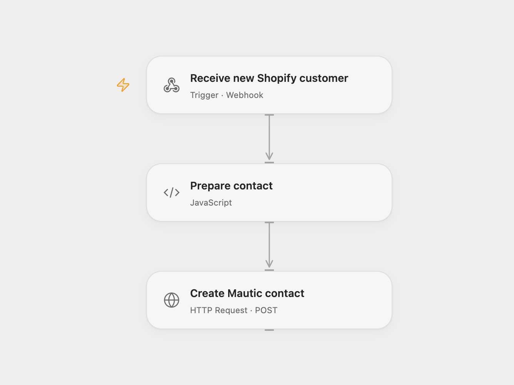

# Create Mautic Contacts for New Shopify Customers

Create a Mautic contact when a Shopify customer is created.

<picture>
  <source media="(prefers-color-scheme: dark)" srcset="preview-dark.png">
  
</picture>

[Open Flow JSON](templates/create-mautic-contacts-for-new-shopify-customers.openflow.json) · [n8n JSON](templates/create-mautic-contacts-for-new-shopify-customers.n8n.json)

## Setup

Enable the Mautic API and Basic Authentication. Set MAUTIC_URL to your Mautic base URL and secret Variables MAUTIC_USERNAME and MAUTIC_PASSWORD to a user with permission to create contacts. Deploy the Open Flow webhook and subscribe to Shopify's customers/create topic using the Shopify app or admin API. Use the current full customer payload. In n8n configure the Shopify Trigger and Mautic credentials. Use one workflow format.

## Behavior

The workflow sends the customer's email, first name and last name to Mautic. The Open Flow webhook does not verify the sender; restrict access as appropriate. Webhook acknowledgement confirms receipt, not that Mautic created the contact. Retries or an unknown write result can lead to repeated requests; inspect Mautic before retrying. Customer details can appear in execution history.

Inspiration &amp; credits

## Changes to the source

- Register the Shopify webhook separately for Open Flow and use Mautic's contacts API with Basic Authentication.

Adapted from [Add new Shopify customers to Mautic](https://github.com/Zie619/n8n-workflows/blob/ae8cf6dc5b873cbb4f74587aa9180ed3a9f70682/workflows/Shopify/0278_Shopify_Mautic_Create_Triggered.json) in [Zie619/n8n-workflows](https://github.com/Zie619/n8n-workflows). The source export does not identify a separate template author or license.

The collection’s [MIT notice](https://github.com/Zie619/n8n-workflows/blob/94007c1445d9258a7da116646b79473e7c7c3282/LICENSE) is pinned at a later revision. This is the collection notice at that revision; it does not establish a separate original template author's license. Our changes are listed above; see [repository licensing](../../README.md#licensing).

> MIT License
>
> Copyright (c) 2025 Zie619
>
> Permission is hereby granted, free of charge, to any person obtaining a copy
> of this software and associated documentation files (the "Software"), to deal
> in the Software without restriction, including without limitation the rights
> to use, copy, modify, merge, publish, distribute, sublicense, and/or sell
> copies of the Software, and to permit persons to whom the Software is
> furnished to do so, subject to the following conditions:
>
> The above copyright notice and this permission notice shall be included in all
> copies or substantial portions of the Software.
>
> THE SOFTWARE IS PROVIDED "AS IS", WITHOUT WARRANTY OF ANY KIND, EXPRESS OR
> IMPLIED, INCLUDING BUT NOT LIMITED TO THE WARRANTIES OF MERCHANTABILITY,
> FITNESS FOR A PARTICULAR PURPOSE AND NONINFRINGEMENT. IN NO EVENT SHALL THE
> AUTHORS OR COPYRIGHT HOLDERS BE LIABLE FOR ANY CLAIM, DAMAGES OR OTHER
> LIABILITY, WHETHER IN AN ACTION OF CONTRACT, TORT OR OTHERWISE, ARISING FROM,
> OUT OF OR IN CONNECTION WITH THE SOFTWARE OR THE USE OR OTHER DEALINGS IN THE
> SOFTWARE.

