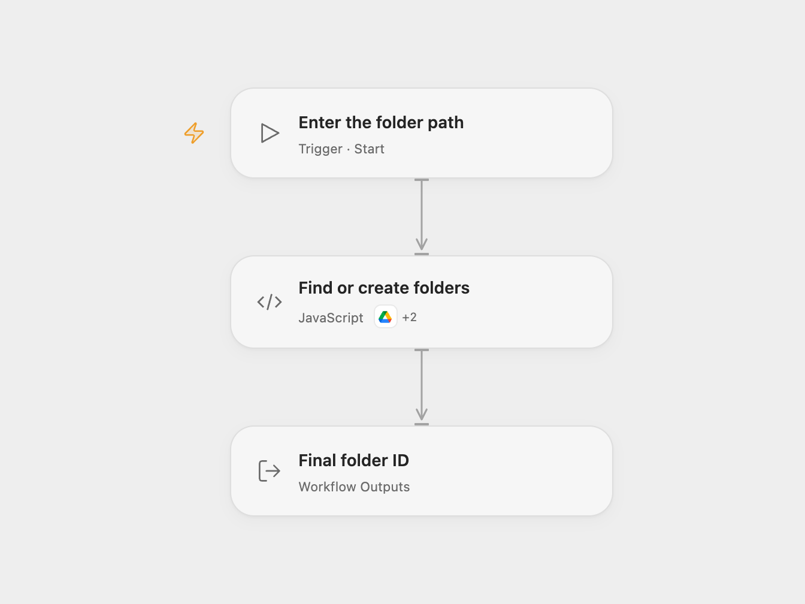

# Create Nested Google Drive Folders

Find or create each segment of a folder path in Google Drive.

<picture>
  <source media="(prefers-color-scheme: dark)" srcset="preview-dark.png">
  
</picture>

[Open Flow JSON](templates/create-nested-google-drive-folders.openflow.json) · [n8n JSON](templates/create-nested-google-drive-folders.n8n.json)

## Setup

Connect Google Drive with access to list and create folders. Run Open Flow with a parent folder ID (or `root`) and a slash-separated path, such as `Projects/2026/Reports`. Allow the declared Drive actions. In n8n configure the same values in **Folder path**, connect Google Drive, and run manually. Other n8n workflows can call the workflow with `google_drive_folder_id` and `desired_path`.

## Behavior

Each path segment is looked up under the previously selected folder. Existing folders are reused; missing folders are created. The result is the final folder ID. Empty segments and ambiguous duplicate folder names stop the run. Folder names are case-sensitive. Avoid concurrent runs for the same path because lookup and creation are not atomic.

A failed or uncertain create may leave some folders created. Inspect Drive before rerunning; the workflow does not automatically retry writes.

Inspiration &amp; credits

## Changes to the source

- Replace example folder and path with run configuration. Reject ambiguous duplicate names and inspect all lookup pages.

Adapted from [Create a Google Drive folder path](https://github.com/Zie619/n8n-workflows/blob/ae8cf6dc5b873cbb4f74587aa9180ed3a9f70682/workflows/Code/0891_Code_Manual_Create_Triggered.json) in [Zie619/n8n-workflows](https://github.com/Zie619/n8n-workflows). The source export does not identify a separate template author or license.

The collection’s [MIT notice](https://github.com/Zie619/n8n-workflows/blob/94007c1445d9258a7da116646b79473e7c7c3282/LICENSE) is pinned at a later revision. This is the collection notice at that revision; it does not establish a separate original template author's license. Our changes are listed above; see [repository licensing](../../README.md#licensing).

> MIT License
>
> Copyright (c) 2025 Zie619
>
> Permission is hereby granted, free of charge, to any person obtaining a copy
> of this software and associated documentation files (the "Software"), to deal
> in the Software without restriction, including without limitation the rights
> to use, copy, modify, merge, publish, distribute, sublicense, and/or sell
> copies of the Software, and to permit persons to whom the Software is
> furnished to do so, subject to the following conditions:
>
> The above copyright notice and this permission notice shall be included in all
> copies or substantial portions of the Software.
>
> THE SOFTWARE IS PROVIDED "AS IS", WITHOUT WARRANTY OF ANY KIND, EXPRESS OR
> IMPLIED, INCLUDING BUT NOT LIMITED TO THE WARRANTIES OF MERCHANTABILITY,
> FITNESS FOR A PARTICULAR PURPOSE AND NONINFRINGEMENT. IN NO EVENT SHALL THE
> AUTHORS OR COPYRIGHT HOLDERS BE LIABLE FOR ANY CLAIM, DAMAGES OR OTHER
> LIABILITY, WHETHER IN AN ACTION OF CONTRACT, TORT OR OTHERWISE, ARISING FROM,
> OUT OF OR IN CONNECTION WITH THE SOFTWARE OR THE USE OR OTHER DEALINGS IN THE
> SOFTWARE.

