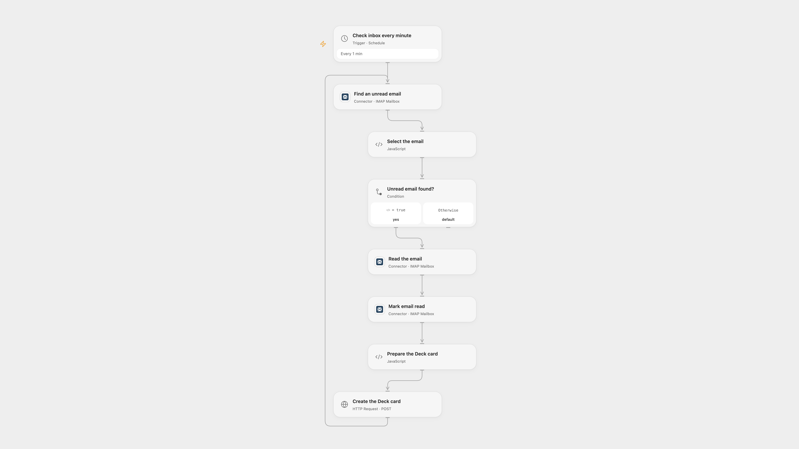

# Create Nextcloud Deck Cards from Email

Create a Deck card from the subject and body of each new email.

<picture>
  <source media="(prefers-color-scheme: dark)" srcset="preview-dark.png">
  
</picture>

[Open Flow JSON](templates/create-nextcloud-deck-cards-from-email.openflow.json) · [n8n JSON](templates/create-nextcloud-deck-cards-from-email.n8n.json)

## Setup

Connect your IMAP mailbox in the three mailbox nodes. In **Create the Deck card**, replace the URL with your HTTPS Nextcloud host, board ID and stack ID. Create secret Variables for the Nextcloud username and app password and bind them to the Basic Authentication inputs. The account must be allowed to create cards in the selected stack.

In n8n, connect the IMAP trigger and configure a Basic Auth credential on **Create the Deck card**; set its Nextcloud URL, board ID and stack ID. Activate only one format to avoid duplicates.

## Behavior

Open Flow checks unread messages every minute; n8n listens for incoming mail. Each message is marked read and creates one card. The subject becomes the title and the HTML body is reduced to text when present; otherwise the plain text body is used. Deck titles must contain 1–255 characters.

A failed run can leave the message marked read. A failed or uncertain card creation may already have created a card, so inspect Deck before replaying. Concurrent Open Flow runs can select the same unread message and create duplicates.

Inspiration &amp; credits

## Changes to the source

- Open Flow polls the IMAP inbox; n8n retains the IMAP trigger.
- Construct JSON from structured fields so quotes and line breaks in email do not corrupt the request.

Adapted from [Create Nextcloud Deck card from email](https://github.com/Zie619/n8n-workflows/blob/ae8cf6dc5b873cbb4f74587aa9180ed3a9f70682/workflows/Http/0344_HTTP_Emailreadimap_Create_Webhook.json) in [Zie619/n8n-workflows](https://github.com/Zie619/n8n-workflows). The matching [n8n community listing](https://n8n.io/workflows/1319-create-nextcloud-deck-card-from-imap-email/) credits Masahiro Minami. The original template does not state a separate license.

The collection’s [MIT notice](https://github.com/Zie619/n8n-workflows/blob/94007c1445d9258a7da116646b79473e7c7c3282/LICENSE) is pinned at a later revision. This is the collection notice at that revision; it does not establish a separate original template author's license. Our changes are listed above; see [repository licensing](../../README.md#licensing).

> MIT License
>
> Copyright (c) 2025 Zie619
>
> Permission is hereby granted, free of charge, to any person obtaining a copy
> of this software and associated documentation files (the "Software"), to deal
> in the Software without restriction, including without limitation the rights
> to use, copy, modify, merge, publish, distribute, sublicense, and/or sell
> copies of the Software, and to permit persons to whom the Software is
> furnished to do so, subject to the following conditions:
>
> The above copyright notice and this permission notice shall be included in all
> copies or substantial portions of the Software.
>
> THE SOFTWARE IS PROVIDED "AS IS", WITHOUT WARRANTY OF ANY KIND, EXPRESS OR
> IMPLIED, INCLUDING BUT NOT LIMITED TO THE WARRANTIES OF MERCHANTABILITY,
> FITNESS FOR A PARTICULAR PURPOSE AND NONINFRINGEMENT. IN NO EVENT SHALL THE
> AUTHORS OR COPYRIGHT HOLDERS BE LIABLE FOR ANY CLAIM, DAMAGES OR OTHER
> LIABILITY, WHETHER IN AN ACTION OF CONTRACT, TORT OR OTHERWISE, ARISING FROM,
> OUT OF OR IN CONNECTION WITH THE SOFTWARE OR THE USE OR OTHER DEALINGS IN THE
> SOFTWARE.

