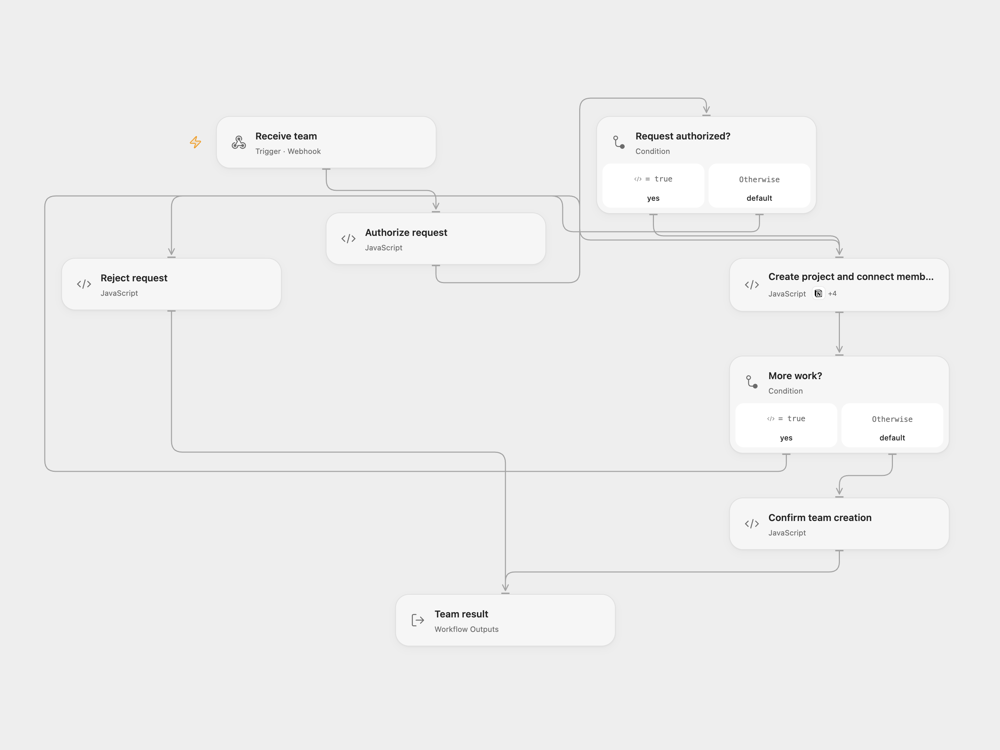

# Create a Notion Project and Enroll a Team

Create a semester project and connect each team member to the project and current semester in Notion.

<picture>
  <source media="(prefers-color-scheme: dark)" srcset="preview-dark.png">
  
</picture>

[Open Flow JSON](templates/create-notion-project-and-enroll-team.openflow.json) · [n8n JSON](templates/create-notion-project-and-enroll-team.n8n.json)

## Setup

Connect Notion with access to users, semesters and projects data sources. Configure all three data source IDs in **Create project and connect members**. The user source needs Name (title), Email (email), Semesters and Project (relations); the semesters source needs Is Current? (checkbox) and Projects (relation); the projects source needs Name (title), Semesters (relation) and Project Idea (rich text).

Set secret Variable TEAM_BASIC_AUTH to a full HTTP Basic Authorization value and send an HTTPS POST JSON request with projectName, projectIdea and teamMembers, an array of objects with name and email. In n8n configure Basic Auth on the webhook, the three IDs in **Prepare team**, and a Notion credential on **Call Notion**. Restrict execution history access because it can contain authorization headers and member data. Activate one format.

## Behavior

The workflow requires one current semester. It creates a project, using Project Group followed by the next project count when projectName is empty. For each distinct member email it finds or creates a user and adds the current semester and new project while preserving existing relations. Duplicate user matches stop processing. Relation properties are read page by page. Notion allows at most 100 relations in a single update; a larger combined relation stops before that update. Platform execution limits apply.

Writes are sequential and not atomic. A failed or uncertain write may already have succeeded, and earlier project or member writes remain. Inspect Notion before repeating a request. Concurrent requests can create duplicate users or overwrite relation updates. Open Flow responds after processing with a 60-second timeout; n8n acknowledges before processing.

Inspiration &amp; credits

## Changes to the source

- Replace private IDs and credentials, require one current semester, and stop on duplicate member matches. Preserve all pages of each existing relation and fix the original project relation concatenation variable.
- Process members sequentially so their emails, user IDs and relations remain associated.

Adapted from [Create a new team for a project in Notion](https://github.com/Zie619/n8n-workflows/blob/ae8cf6dc5b873cbb4f74587aa9180ed3a9f70682/workflows/Notion/0142_Notion_Webhook_Create_Webhook.json) in [Zie619/n8n-workflows](https://github.com/Zie619/n8n-workflows). The matching [n8n listing](https://n8n.io/workflows/1374-create-a-new-team-for-a-project-in-notion/) credits Will Stenzel. The original template does not state a separate license.

The collection’s [MIT notice](https://github.com/Zie619/n8n-workflows/blob/94007c1445d9258a7da116646b79473e7c7c3282/LICENSE) is pinned at a later revision. This is the collection notice at that revision; it does not establish a separate original template author's license. Our changes are listed above; see [repository licensing](../../README.md#licensing).

> MIT License
>
> Copyright (c) 2025 Zie619
>
> Permission is hereby granted, free of charge, to any person obtaining a copy
> of this software and associated documentation files (the "Software"), to deal
> in the Software without restriction, including without limitation the rights
> to use, copy, modify, merge, publish, distribute, sublicense, and/or sell
> copies of the Software, and to permit persons to whom the Software is
> furnished to do so, subject to the following conditions:
>
> The above copyright notice and this permission notice shall be included in all
> copies or substantial portions of the Software.
>
> THE SOFTWARE IS PROVIDED "AS IS", WITHOUT WARRANTY OF ANY KIND, EXPRESS OR
> IMPLIED, INCLUDING BUT NOT LIMITED TO THE WARRANTIES OF MERCHANTABILITY,
> FITNESS FOR A PARTICULAR PURPOSE AND NONINFRINGEMENT. IN NO EVENT SHALL THE
> AUTHORS OR COPYRIGHT HOLDERS BE LIABLE FOR ANY CLAIM, DAMAGES OR OTHER
> LIABILITY, WHETHER IN AN ACTION OF CONTRACT, TORT OR OTHERWISE, ARISING FROM,
> OUT OF OR IN CONNECTION WITH THE SOFTWARE OR THE USE OR OTHER DEALINGS IN THE
> SOFTWARE.

