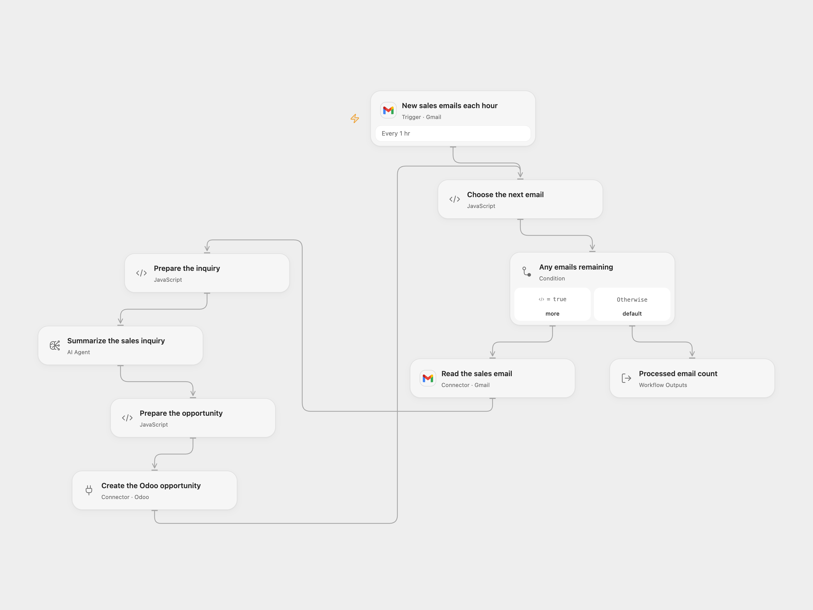

# Create Odoo Opportunities from Sales Emails

Summarize labeled Gmail sales inquiries and create Odoo opportunities with the sender and subject.

<picture>
  <source media="(prefers-color-scheme: dark)" srcset="preview-dark.png">
  
</picture>

[Open Flow JSON](templates/create-odoo-opportunities-from-sales-emails.openflow.json) · [n8n JSON](templates/create-odoo-opportunities-from-sales-emails.n8n.json)

## Setup

Connect the same Gmail mailbox to **New sales emails each hour** and **Read the sales email**. Set the existing Sales label ID in the trigger. Connect Odoo CRM in **Create the Odoo opportunity** and configure the model service in **Summarize the sales inquiry**. Ensure the account may create CRM opportunities.

In n8n select the same Gmail label, configure Gmail and Odoo credentials, and select an available completion model compatible with the summarization chain. The source model may no longer be available. Activate one format.

## Behavior

Each new labeled message is summarized for available budget, timeline, industry and a general overview, then creates an Odoo CRM record with the email subject, sender and summary. Open Flow processes one message at a time within each poll page and uses an Agent with one model round; n8n uses its summarization chain and completion model. Long messages can exceed model or workflow limits. Open Flow excludes drafts, spam and trash; n8n retains its source filter behavior. Poll cursors and delivery do not guarantee exactly-once processing. If creating a record fails or its result is uncertain, inspect Odoo before retrying; it may already exist. In Open Flow, earlier records in the page may already have been created when a later email fails. In n8n the summarization chain processes its input page before the Odoo node starts creating records. Limit access to email bodies, model processing and execution history. AI summaries can omit or misstate information; review the opportunity.

## Changes to the source

- Replace the private Gmail label with setup. Open Flow validates message identity and sender before writing and uses a configured single-round Agent; n8n keeps its summarization chain and requires a compatible available completion model.
- Both formats explicitly set crm.lead type to opportunity. n8n uses the native custom-resource operation and matches each summary to its email by position.

Source and license

Adapted from [Summarize emails and save them as notes on sales opportunity in Odoo](https://github.com/Zie619/n8n-workflows/blob/ae8cf6dc5b873cbb4f74587aa9180ed3a9f70682/workflows/Gmail/1565_Gmail_Stickynote_Create_Triggered.json) in [Zie619/n8n-workflows](https://github.com/Zie619/n8n-workflows). The source export does not identify a separate template author or license.

The collection’s [MIT notice](https://github.com/Zie619/n8n-workflows/blob/94007c1445d9258a7da116646b79473e7c7c3282/LICENSE) is pinned at a later revision. This is the collection notice at that revision; it does not establish a separate original template author's license. Our changes are listed above; see [repository licensing](../../README.md#licensing).

> MIT License
>
> Copyright (c) 2025 Zie619
>
> Permission is hereby granted, free of charge, to any person obtaining a copy
> of this software and associated documentation files (the "Software"), to deal
> in the Software without restriction, including without limitation the rights
> to use, copy, modify, merge, publish, distribute, sublicense, and/or sell
> copies of the Software, and to permit persons to whom the Software is
> furnished to do so, subject to the following conditions:
>
> The above copyright notice and this permission notice shall be included in all
> copies or substantial portions of the Software.
>
> THE SOFTWARE IS PROVIDED "AS IS", WITHOUT WARRANTY OF ANY KIND, EXPRESS OR
> IMPLIED, INCLUDING BUT NOT LIMITED TO THE WARRANTIES OF MERCHANTABILITY,
> FITNESS FOR A PARTICULAR PURPOSE AND NONINFRINGEMENT. IN NO EVENT SHALL THE
> AUTHORS OR COPYRIGHT HOLDERS BE LIABLE FOR ANY CLAIM, DAMAGES OR OTHER
> LIABILITY, WHETHER IN AN ACTION OF CONTRACT, TORT OR OTHERWISE, ARISING FROM,
> OUT OF OR IN CONNECTION WITH THE SOFTWARE OR THE USE OR OTHER DEALINGS IN THE
> SOFTWARE.

