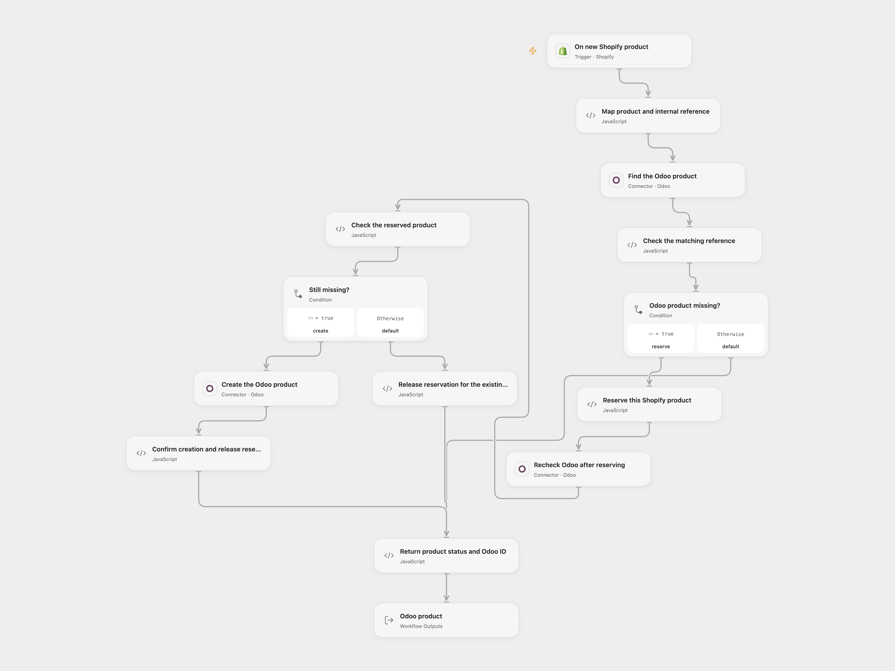

# Create Odoo Products for New Shopify Products

Create an Odoo product for each new Shopify product whose internal reference is missing.

<!-- template-actions:start -->
 
<!-- template-actions:end -->

<picture>
  <source media="(prefers-color-scheme: dark)" srcset="preview-dark.png">
  
</picture>

## Setup

1. Connect one Shopify shop to **On new Shopify product**. The connection needs access to read products and subscribe to product creation events.
2. Select the same Odoo connection in **Find the Odoo product**, **Recheck Odoo after reserving**, and **Create the Odoo product**. Use a publicly reachable HTTPS instance with the external `/jsonrpc` API enabled, such as Odoo 19, and an API user with read and create access to products. Odoo-hosted instances require the Custom plan for external API access.
3. Publish the workflow. Keep the Shopify product IDs available as Odoo Internal References for this shop. Use matching price currencies and ensure the Odoo connection can see products already imported from this shop.

## Behavior

The workflow uses the Shopify parent product ID as the Odoo Internal Reference. It copies the title, HTML description, and first variant’s price into one Odoo `product.product` record. Odoo's default search visibility applies, including its active-record filter.

A matching record is returned with its Odoo ID. An empty lookup allows creation after the workflow reserves the product ID in State and checks Odoo again. A failed lookup or unconfirmed create stops the run. For a pending reservation, check the Internal Reference in Odoo. After all runs for that product finish, clear only the matching `shopify-product:<id>` State entry in the published workflow if you have confirmed the product is absent, and replay from the beginning. If the record exists, the workflow will return it on the next delivery.

In n8n

Configure the Shopify access token and app secret in the Shopify credential. The Odoo requests use the external JSON-2 API on Odoo 19 or newer. Set your HTTPS Odoo instance URL and database name in **Map product and choose Odoo database**, and select the same **Bearer Auth** credential with your Odoo API key in both Odoo HTTP Request nodes. The database is sent in `X-Odoo-Database`.

Create an n8n Data Table with a text column named `product_key` and select it in all three reservation nodes. Keep the reserve node's `product_key` mapping to the Shopify product ID. On self-hosted n8n in regular mode, set `N8N_CONCURRENCY_PRODUCTION_LIMIT=1` so the reservation check and insert run in one production slot. Keep one active copy for this shop and avoid simultaneous manual runs. For an uncertain result, stop duplicate runs, verify the Internal Reference in Odoo, and clear only that table row if the product is absent before replaying from the start.

Inspiration &amp; credits

Adapted from [Sync New Shopify Products to Odoo Product](https://github.com/Zie619/n8n-workflows/blob/ae8cf6dc5b873cbb4f74587aa9180ed3a9f70682/workflows/Shopify/0961_Shopify_Filter_Create_Triggered.json) in [Zie619/n8n-workflows](https://github.com/Zie619/n8n-workflows). Attribution: Zie619 / n8n-workflows.

The collection’s [MIT notice](https://github.com/Zie619/n8n-workflows/blob/94007c1445d9258a7da116646b79473e7c7c3282/LICENSE) is pinned at a later revision. This is the collection notice at that revision; it does not establish a separate original template author's license. Our changes are listed above; see [repository licensing](../../README.md#licensing).

> MIT License
>
> Copyright (c) 2025 Zie619
>
> Permission is hereby granted, free of charge, to any person obtaining a copy
> of this software and associated documentation files (the "Software"), to deal
> in the Software without restriction, including without limitation the rights
> to use, copy, modify, merge, publish, distribute, sublicense, and/or sell
> copies of the Software, and to permit persons to whom the Software is
> furnished to do so, subject to the following conditions:
>
> The above copyright notice and this permission notice shall be included in all
> copies or substantial portions of the Software.
>
> THE SOFTWARE IS PROVIDED "AS IS", WITHOUT WARRANTY OF ANY KIND, EXPRESS OR
> IMPLIED, INCLUDING BUT NOT LIMITED TO THE WARRANTIES OF MERCHANTABILITY,
> FITNESS FOR A PARTICULAR PURPOSE AND NONINFRINGEMENT. IN NO EVENT SHALL THE
> AUTHORS OR COPYRIGHT HOLDERS BE LIABLE FOR ANY CLAIM, DAMAGES OR OTHER
> LIABILITY, WHETHER IN AN ACTION OF CONTRACT, TORT OR OTHERWISE, ARISING FROM,
> OUT OF OR IN CONNECTION WITH THE SOFTWARE OR THE USE OR OTHER DEALINGS IN THE
> SOFTWARE.

