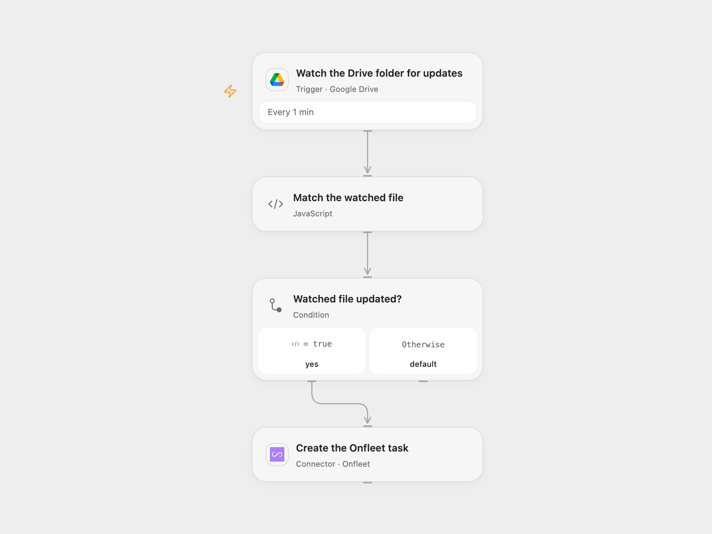

# Create an Onfleet Task for an Updated Drive File

Create an Onfleet delivery task when a selected Google Drive file is updated.

<picture>
  <source media="(prefers-color-scheme: dark)" srcset="preview-dark.png">
  
</picture>

[Open Flow JSON](templates/create-onfleet-task-for-updated-drive-file.openflow.json) · [n8n JSON](templates/create-onfleet-task-for-updated-drive-file.n8n.json)

## Setup

Connect Google Drive and Onfleet. Set the watched file's parent folder ID in **Watch the Drive folder for updates** and its file ID in **Match the watched file**. In **Create the Onfleet task**, enter the destination address and recipient name and phone. Use a Drive account that can read the folder and file.

For n8n connect Google Drive, select the watched file in **Google Drive Trigger**, and configure HTTP Basic credentials in **Create the Onfleet task** with the Onfleet API key as username and an empty password. Set the destination and recipient in its JSON body. Activate one format.

## Behavior

The workflow checks for updates once a minute and creates one task with the configured destination and recipient when the selected file changes. It does not read the file contents. Open Flow watches the parent folder and filters by file ID; its first poll establishes a baseline and does not process earlier changes. Updates made between polls may be observed as one latest change.

An Onfleet create with an uncertain result may have succeeded. Inspect Onfleet before manually repeating it; the workflow does not automatically replay failed or uncertain creates. The service may update a recipient associated with the same phone number, so configure the recipient carefully.

Inspiration &amp; credits

## Changes to the source

- Configure an explicit destination and recipient, which the source leaves empty; n8n uses the Onfleet HTTP API with Basic credentials.
- Open Flow watches the parent folder and matches the selected file ID.

Adapted from [Create an Onfleet task when a file in Google Drive is updated](https://github.com/Zie619/n8n-workflows/blob/ae8cf6dc5b873cbb4f74587aa9180ed3a9f70682/workflows/Onfleet/0187_Onfleet_GoogleDrive_Create_Triggered.json) in [Zie619/n8n-workflows](https://github.com/Zie619/n8n-workflows). The source export does not identify a separate template author or license.

The collection’s [MIT notice](https://github.com/Zie619/n8n-workflows/blob/94007c1445d9258a7da116646b79473e7c7c3282/LICENSE) is pinned at a later revision. This is the collection notice at that revision; it does not establish a separate original template author's license. Our changes are listed above; see [repository licensing](../../README.md#licensing).

> MIT License
>
> Copyright (c) 2025 Zie619
>
> Permission is hereby granted, free of charge, to any person obtaining a copy
> of this software and associated documentation files (the "Software"), to deal
> in the Software without restriction, including without limitation the rights
> to use, copy, modify, merge, publish, distribute, sublicense, and/or sell
> copies of the Software, and to permit persons to whom the Software is
> furnished to do so, subject to the following conditions:
>
> The above copyright notice and this permission notice shall be included in all
> copies or substantial portions of the Software.
>
> THE SOFTWARE IS PROVIDED "AS IS", WITHOUT WARRANTY OF ANY KIND, EXPRESS OR
> IMPLIED, INCLUDING BUT NOT LIMITED TO THE WARRANTIES OF MERCHANTABILITY,
> FITNESS FOR A PARTICULAR PURPOSE AND NONINFRINGEMENT. IN NO EVENT SHALL THE
> AUTHORS OR COPYRIGHT HOLDERS BE LIABLE FOR ANY CLAIM, DAMAGES OR OTHER
> LIABILITY, WHETHER IN AN ACTION OF CONTRACT, TORT OR OTHERWISE, ARISING FROM,
> OUT OF OR IN CONNECTION WITH THE SOFTWARE OR THE USE OR OTHER DEALINGS IN THE
> SOFTWARE.

