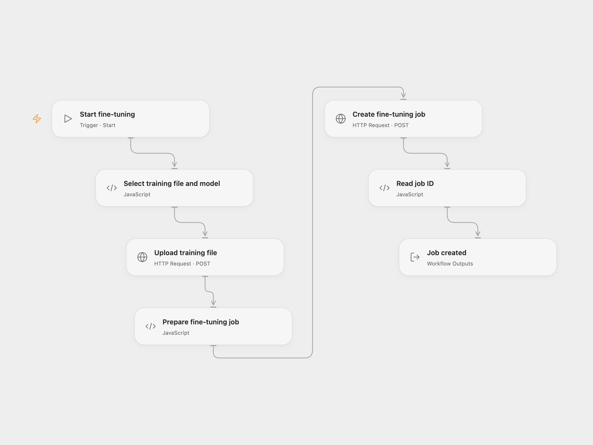

# Create an OpenAI Fine-Tuning Job from Drive

Upload a JSONL training file from Google Drive and create an OpenAI fine-tuning job.

<!-- template-actions:start -->
 
<!-- template-actions:end -->

<picture>
  <source media="(prefers-color-scheme: dark)" srcset="preview-dark.png">
  
</picture>

## Setup and use

OpenAI is winding down fine-tuning and no longer accepts new users. Eligible existing organizations must also have used a fine-tuned model for inference in the prior 60 days. They can create training jobs until January 6, 2027, unless the selected base model shuts down sooner. The source model gpt-4o-mini-2024-07-18 is scheduled to shut down on January 14, 2027. Check [OpenAI fine-tuning availability](https://developers.openai.com/api/docs/guides/supervised-fine-tuning) and select a model supported by your account.

Configure its Google Drive and OpenAI credentials and activate its upload relay. For the direct job node, configure HTTP Header Auth with the name Authorization and value Bearer followed by your OpenAI API key. In Open Flow set the relay URL, Drive JSONL file ID and base model; bind OPENAI_API_KEY as a secret Variable. The relay does not authenticate callers, so restrict access to trusted senders.

## Behavior

Open Flow uses the returned file ID to create the job and returns its job ID. Training runs asynchronously. If either upload or job creation has an unknown result, inspect OpenAI files or jobs before retrying; a repeated run may create another file or job.

In n8n

Import the n8n workflow, configure its Google Drive and OpenAI credentials and activate its upload relay. For direct n8n runs, configure the Drive file ID and the base model in Create Fine-tuning Job. Run either the n8n manual workflow or Open Flow. Use API credentials for the same OpenAI project in n8n and Open Flow so the uploaded file is available to the job. The n8n relay downloads the original JSONL bytes and uploads them to OpenAI with purpose fine-tune.

Inspiration &amp; credits

## Changes to the source

- Keep the binary upload in an n8n relay and create the job in Open Flow. Remove the unrelated chat test and replace private file and model identifiers.

Adapted from [Automated End-to-End Fine-Tuning of OpenAI Models with Google Drive Integration](https://github.com/enescingoz/awesome-n8n-templates/blob/827110332c21cbe000ab13f6d292d5adb1f1f8db/Google_Drive_and_Google_Sheets/Automated%20End-to-End%20Fine-Tuning%20of%20OpenAI%20Models%20with%20Google%20Drive%20Integration.json) in [enescingoz/awesome-n8n-templates](https://github.com/enescingoz/awesome-n8n-templates).

Source collection notice: © 2024–2026 Enes Cingoz, [CC BY 4.0](https://github.com/enescingoz/awesome-n8n-templates/blob/827110332c21cbe000ab13f6d292d5adb1f1f8db/LICENSE). The source export does not identify a separate template author or license. See [repository licensing](../../README.md#licensing) for the scope of OOMOL contributions and third-party material.

