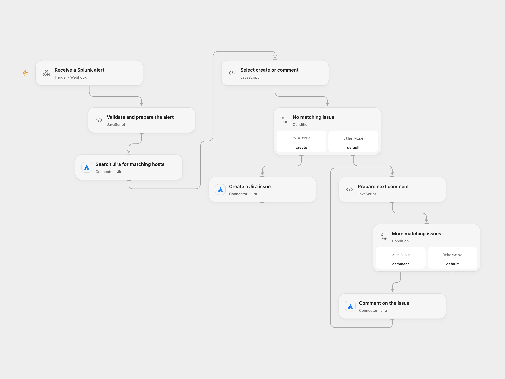

# Create or Comment Jira Issues for Splunk Alerts

Search Jira for a Splunk host alert, then create an issue or comment on matching issues.

<picture>
  <source media="(prefers-color-scheme: dark)" srcset="preview-dark.png">
  
</picture>

[Open Flow JSON](templates/create-or-comment-jira-issues-for-splunk-alerts.openflow.json) · [n8n JSON](templates/create-or-comment-jira-issues-for-splunk-alerts.n8n.json)

## Setup

Connect Jira with permission to search issues, create issues, and add comments. In **Validate and prepare the alert**, set the numeric project and issue type IDs and the Jira text custom field ID, such as customfield_12345. The field must be searchable with Jira's ~ operator and available on the issue creation screen. Create a secret Variable SPLUNK_ALERT_SECRET with at least 24 unpredictable characters and bind it to the same node. Configure the Splunk webhook to send that value as the custom x-splunk-secret header over HTTPS. This checks a static header; it does not verify Splunk’s separate signed webhook mechanism. Restrict access to execution history because webhook headers can be recorded.

In n8n, configure Header Auth on **Webhook** using the same header name and secret, set the Jira search field and the project, issue type and custom field in the Jira nodes, and connect Jira. Activate only one format.

## Behavior

Configure the alert payload to supply inputs.A.key["host.name"], description, messageBody and timestamp. The host is stripped to ASCII letters, digits and spaces, as in the source, and searched with Jira's ~ text operator. A match results in a comment on each returned issue; no match creates an issue containing the original host and description, message body and normalized host field. The search uses at most 50 matches, matching the source's default limit. Text search can match more than one host; configure the field and review your Jira search behavior.

The immediate HTTP response acknowledges receipt only. The search and writes are not atomic: concurrent alerts or Jira search indexing delays can create duplicate issues. A failed or uncertain create or comment may have succeeded; inspect Jira before retrying. No exactly-once guarantee is provided.

## Changes to the source

- Replace account-specific project, issue type and custom field IDs with configuration and require a shared webhook secret. Open Flow rejects missing or empty normalized host before Jira writes.
- Open Flow checks the first 50 matching issues and comments sequentially. n8n uses its native search and item execution.

Source and license

Adapted from [Create Unique Jira tickets from Splunk alerts](https://github.com/Zie619/n8n-workflows/blob/ae8cf6dc5b873cbb4f74587aa9180ed3a9f70682/workflows/Stickynote/1986_Stickynote_Jira_Create_Webhook.json) in [Zie619/n8n-workflows](https://github.com/Zie619/n8n-workflows). The source export does not identify a separate template author or license.

The collection’s [MIT notice](https://github.com/Zie619/n8n-workflows/blob/94007c1445d9258a7da116646b79473e7c7c3282/LICENSE) is pinned at a later revision. This is the collection notice at that revision; it does not establish a separate original template author's license. Our changes are listed above; see [repository licensing](../../README.md#licensing).

> MIT License
>
> Copyright (c) 2025 Zie619
>
> Permission is hereby granted, free of charge, to any person obtaining a copy
> of this software and associated documentation files (the "Software"), to deal
> in the Software without restriction, including without limitation the rights
> to use, copy, modify, merge, publish, distribute, sublicense, and/or sell
> copies of the Software, and to permit persons to whom the Software is
> furnished to do so, subject to the following conditions:
>
> The above copyright notice and this permission notice shall be included in all
> copies or substantial portions of the Software.
>
> THE SOFTWARE IS PROVIDED "AS IS", WITHOUT WARRANTY OF ANY KIND, EXPRESS OR
> IMPLIED, INCLUDING BUT NOT LIMITED TO THE WARRANTIES OF MERCHANTABILITY,
> FITNESS FOR A PARTICULAR PURPOSE AND NONINFRINGEMENT. IN NO EVENT SHALL THE
> AUTHORS OR COPYRIGHT HOLDERS BE LIABLE FOR ANY CLAIM, DAMAGES OR OTHER
> LIABILITY, WHETHER IN AN ACTION OF CONTRACT, TORT OR OTHERWISE, ARISING FROM,
> OUT OF OR IN CONNECTION WITH THE SOFTWARE OR THE USE OR OTHER DEALINGS IN THE
> SOFTWARE.

