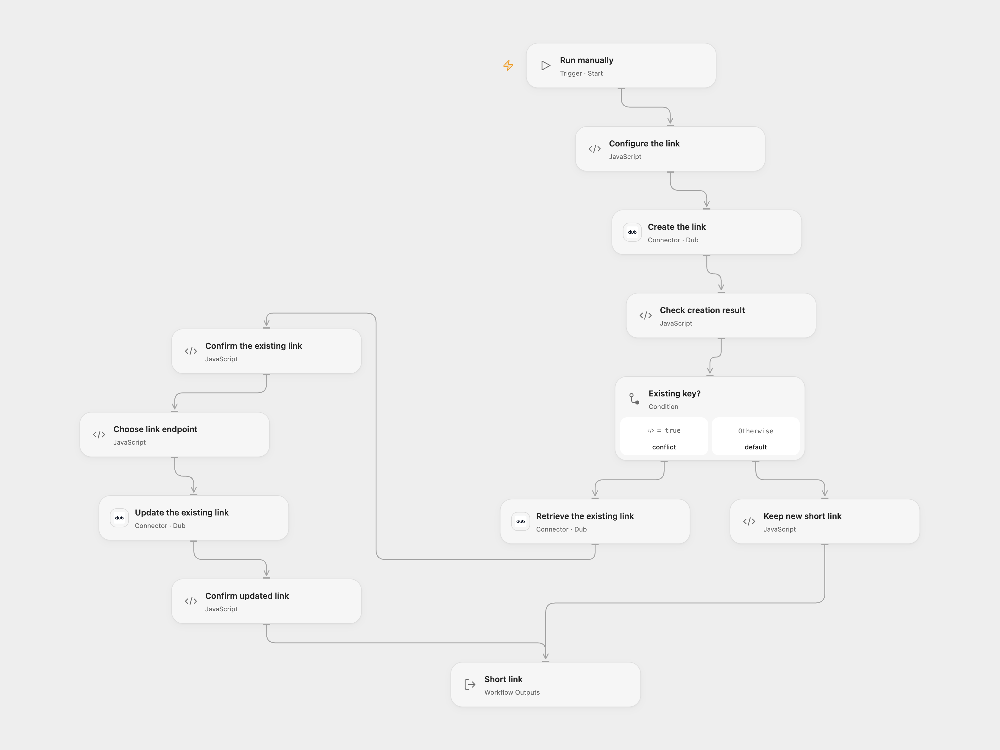

# Create or Update a Dub Short Link

Create a short link or update an existing link with the same domain and key.

<picture>
  <source media="(prefers-color-scheme: dark)" srcset="preview-dark.png">
  
</picture>

[Open Flow JSON](templates/create-or-update-a-dub-short-link.openflow.json) · [n8n JSON](templates/create-or-update-a-dub-short-link.n8n.json)

## Setup and use

Connect Dub and set your project slug and destination URL in **Configure the link**. Optionally set a custom domain and key; leave either blank when creating a new link with Dub defaults. For the duplicate-key update path, both the domain and key must be supplied so the existing link can be identified. In n8n, configure Header Auth with header `Authorization` and value `Bearer YOUR_DUB_TOKEN` on all three HTTP nodes and set the same fields in **API Auth**.

## Behavior

A manual run creates one short link. If Dub specifically reports that the requested key already exists, the workflow retrieves that exact domain and key and updates its destination and comment. Other errors stop the run. The update uses Dub's current PATCH endpoint; the source used PUT. A network failure can leave a create or update completed even when the result is unknown; inspect Dub before retrying.

Inspiration &amp; credits

## Changes to the source

- Store the API key in a connection or credential, build JSON safely, and restrict the update branch to an explicit duplicate-key response. Confirm the retrieved link's domain and key before updating.
- Use the current PATCH update method. When the domain is omitted and a duplicate occurs, require it for a safe lookup instead of guessing the workspace default.

Adapted from [dub.co URL Shortener](https://github.com/Zie619/n8n-workflows/blob/ae8cf6dc5b873cbb4f74587aa9180ed3a9f70682/workflows/Manual/1633_Manual_Stickynote_Automation_Webhook.json) in [Zie619/n8n-workflows](https://github.com/Zie619/n8n-workflows). The source export does not identify a separate template author or license.

The collection’s [MIT notice](https://github.com/Zie619/n8n-workflows/blob/94007c1445d9258a7da116646b79473e7c7c3282/LICENSE) is pinned at a later revision. This is the collection notice at that revision; it does not establish a separate original template author's license. Our changes are listed above; see [repository licensing](../../README.md#licensing).

> MIT License
>
> Copyright (c) 2025 Zie619
>
> Permission is hereby granted, free of charge, to any person obtaining a copy
> of this software and associated documentation files (the "Software"), to deal
> in the Software without restriction, including without limitation the rights
> to use, copy, modify, merge, publish, distribute, sublicense, and/or sell
> copies of the Software, and to permit persons to whom the Software is
> furnished to do so, subject to the following conditions:
>
> The above copyright notice and this permission notice shall be included in all
> copies or substantial portions of the Software.
>
> THE SOFTWARE IS PROVIDED "AS IS", WITHOUT WARRANTY OF ANY KIND, EXPRESS OR
> IMPLIED, INCLUDING BUT NOT LIMITED TO THE WARRANTIES OF MERCHANTABILITY,
> FITNESS FOR A PARTICULAR PURPOSE AND NONINFRINGEMENT. IN NO EVENT SHALL THE
> AUTHORS OR COPYRIGHT HOLDERS BE LIABLE FOR ANY CLAIM, DAMAGES OR OTHER
> LIABILITY, WHETHER IN AN ACTION OF CONTRACT, TORT OR OTHERWISE, ARISING FROM,
> OUT OF OR IN CONNECTION WITH THE SOFTWARE OR THE USE OR OTHER DEALINGS IN THE
> SOFTWARE.

