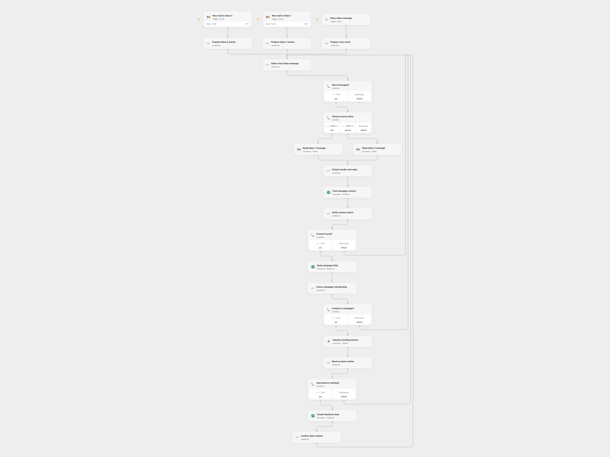

# Create Pipedrive Deals from Interested Replies

Check replies from campaign contacts and create a deal when the sender is interested in a meeting.

<!-- template-actions:start -->
 
<!-- template-actions:end -->

<picture>
  <source media="(prefers-color-scheme: dark)" srcset="preview-dark.png">
  
</picture>

## Setup

Connect each Gmail poll and its corresponding read node to the same inbox. Give the two inboxes distinct namespace values, and keep **Choose source inbox** aligned with them. Connect Pipedrive and Gemini. Set the same person custom-field key in **Read campaign field** and **Check campaign membership**, and set the actual single-option ID for True. Enable persistent State. In n8n connect both Gmail credentials, Gemini and Pipedrive. Configure an HTTP Header Auth credential named x-api-token on the two Pipedrive read nodes, set the campaign custom-field key in **Read campaign contact** and **Check campaign membership**, and set the actual True option ID. Select one Data Table with item_key and status text columns. For an uncertain deal, inspect Pipedrive and set the matching pending row to done if confirmed or delete it if absent. Enter the original inbox, message ID, sender and reply in **Configure retry** before running the manual trigger.

## Behavior

New inbox messages are matched to a unique Pipedrive contact by exact sender email. Only contacts with the configured campaign option are classified. A positive meeting-interest classification creates a deal linked to that person. The model can misclassify; review created deals. Unquoted replies over 14,800 characters stop processing.

If a deal creation is uncertain, inspect Pipedrive for the corresponding person and message, then enter the pending key and confirmed or absent in **Select next inbox message** then run **Retry inbox message** with the original inbox namespace and Gmail message ID. Avoid overlapping runs and clear recovery fields afterward.

Inspiration &amp; credits

Correct message and person association, check the actual campaign option ID, link deals to contacts and stop on uncertain writes.

Adapted from [Create a deal when cold email reply is interested](https://github.com/Zie619/n8n-workflows/blob/ae8cf6dc5b873cbb4f74587aa9180ed3a9f70682/workflows/Code/1619_Code_Pipedrive_Automation_Triggered.json) in [Zie619/n8n-workflows](https://github.com/Zie619/n8n-workflows). Attribution: Zie619 / n8n-workflows.

The collection’s [MIT notice](https://github.com/Zie619/n8n-workflows/blob/94007c1445d9258a7da116646b79473e7c7c3282/LICENSE) is pinned at a later revision. This is the collection notice at that revision; it does not establish a separate original template author's license. Our changes are listed above; see [repository licensing](../../README.md#licensing).

> MIT License
>
> Copyright (c) 2025 Zie619
>
> Permission is hereby granted, free of charge, to any person obtaining a copy
> of this software and associated documentation files (the "Software"), to deal
> in the Software without restriction, including without limitation the rights
> to use, copy, modify, merge, publish, distribute, sublicense, and/or sell
> copies of the Software, and to permit persons to whom the Software is
> furnished to do so, subject to the following conditions:
>
> The above copyright notice and this permission notice shall be included in all
> copies or substantial portions of the Software.
>
> THE SOFTWARE IS PROVIDED "AS IS", WITHOUT WARRANTY OF ANY KIND, EXPRESS OR
> IMPLIED, INCLUDING BUT NOT LIMITED TO THE WARRANTIES OF MERCHANTABILITY,
> FITNESS FOR A PARTICULAR PURPOSE AND NONINFRINGEMENT. IN NO EVENT SHALL THE
> AUTHORS OR COPYRIGHT HOLDERS BE LIABLE FOR ANY CLAIM, DAMAGES OR OTHER
> LIABILITY, WHETHER IN AN ACTION OF CONTRACT, TORT OR OTHERWISE, ARISING FROM,
> OUT OF OR IN CONNECTION WITH THE SOFTWARE OR THE USE OR OTHER DEALINGS IN THE
> SOFTWARE.

