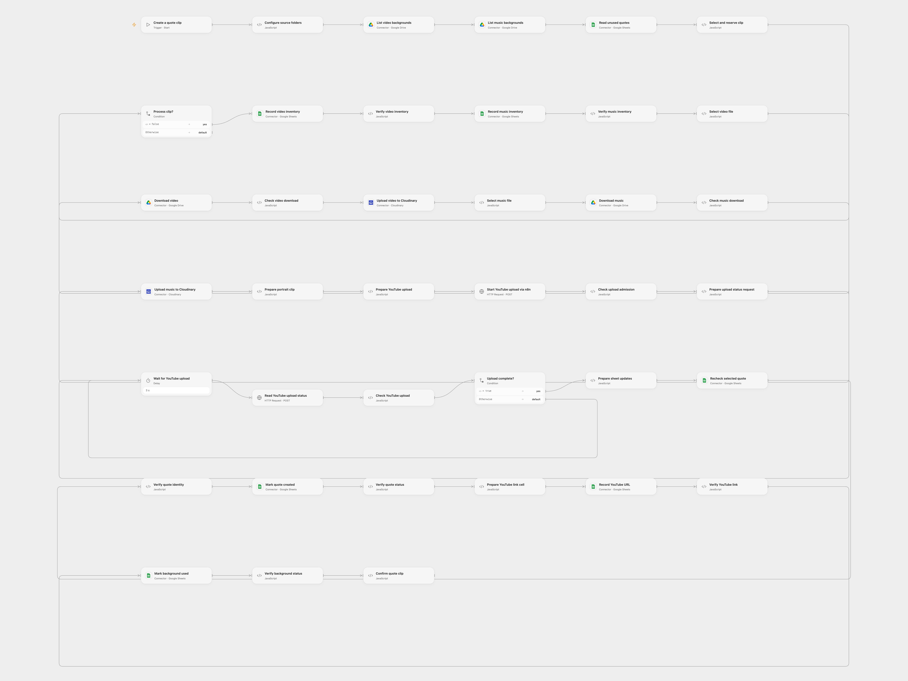

# Create Quote Videos for YouTube

Combine a quote with a random video and music, upload a portrait clip and update its source sheet.

<!-- template-actions:start -->
 
<!-- template-actions:end -->

<picture>
  <source media="(prefers-color-scheme: dark)" srcset="preview-dark.png">
  
</picture>

## Setup

In Open Flow configure the Drive folder IDs, spreadsheet, sheet names and Cloudinary connection. Enable persistent State. Activate the n8n workflow, configure the upload and status webhook URLs, and bind AUTOCLIP_RELAY_TOKEN to the token used by their Header Auth credentials as an Authorization: Bearer header.

In n8n configure the Drive and Sheets credentials and folder and sheet IDs, the YouTube OAuth credential, and the Cloudinary cloud name and restricted unsigned video upload preset in both upload nodes. Select one Data Table with text columns item_key, status and video_id in all checkpoint and relay nodes. For a direct n8n run set a new request ID in **Configure request ID**. The relay returns admission while upload continues; Open Flow polls for the result.

## Behavior

Run with a unique random request ID of 16–128 letters, numbers, underscores or hyphens. It selects an unused quote and random video and music, records the background inventory, creates a portrait clip with quote and author, uploads it publicly to YouTube, and marks the quote and selected video as used. The source sheet has Index, Qoute, Author, CreateStatus and YoutubeURL columns; background sheets have URL and status columns. The first 100 files in each folder are considered. Cloudinary receives the selected media and text, and its delivery URL includes the quote and author. Use a preset restricted to the intended uploads and protect execution history.

An uncertain write leaves the request pending. Inspect the inventory sheets, Cloudinary assets, YouTube and status cells. After completing or repairing all effects, enter the pending key and confirmed in **Select and reserve clip** and rerun; use absent only after verifying no prior effects remain. Clear these recovery fields afterward. In n8n remove the Data Table checkpoint only after all effects are reconciled. Avoid overlapping runs and edits to the source sheets during a run. Uploaded videos are public; review source content before running.

Inspiration &amp; credits

Use Cloudinary video transformations and an authenticated upload relay instead of host files, preserve selected IDs and add a pending checkpoint.

Adapted from [AutoClip – Automatically Generate Video Clips and Upload to YouTube](https://github.com/Zie619/n8n-workflows/blob/ae8cf6dc5b873cbb4f74587aa9180ed3a9f70682/workflows/Code/1864_Code_Executecommand_Create_Webhook.json) in [Zie619/n8n-workflows](https://github.com/Zie619/n8n-workflows). Attribution: Zie619 / n8n-workflows.

The collection’s [MIT notice](https://github.com/Zie619/n8n-workflows/blob/94007c1445d9258a7da116646b79473e7c7c3282/LICENSE) is pinned at a later revision. This is the collection notice at that revision; it does not establish a separate original template author's license. Our changes are listed above; see [repository licensing](../../README.md#licensing).

> MIT License
>
> Copyright (c) 2025 Zie619
>
> Permission is hereby granted, free of charge, to any person obtaining a copy
> of this software and associated documentation files (the "Software"), to deal
> in the Software without restriction, including without limitation the rights
> to use, copy, modify, merge, publish, distribute, sublicense, and/or sell
> copies of the Software, and to permit persons to whom the Software is
> furnished to do so, subject to the following conditions:
>
> The above copyright notice and this permission notice shall be included in all
> copies or substantial portions of the Software.
>
> THE SOFTWARE IS PROVIDED "AS IS", WITHOUT WARRANTY OF ANY KIND, EXPRESS OR
> IMPLIED, INCLUDING BUT NOT LIMITED TO THE WARRANTIES OF MERCHANTABILITY,
> FITNESS FOR A PARTICULAR PURPOSE AND NONINFRINGEMENT. IN NO EVENT SHALL THE
> AUTHORS OR COPYRIGHT HOLDERS BE LIABLE FOR ANY CLAIM, DAMAGES OR OTHER
> LIABILITY, WHETHER IN AN ACTION OF CONTRACT, TORT OR OTHERWISE, ARISING FROM,
> OUT OF OR IN CONNECTION WITH THE SOFTWARE OR THE USE OR OTHER DEALINGS IN THE
> SOFTWARE.

