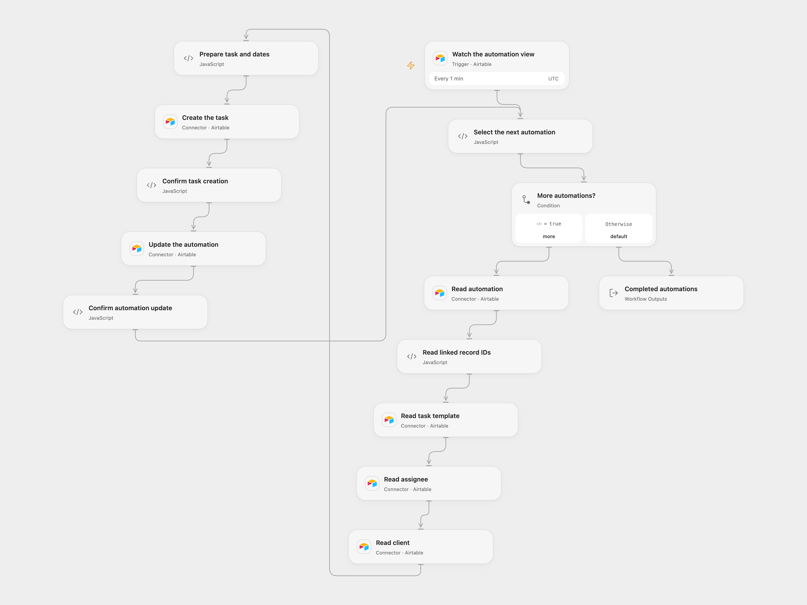

# Create Recurring Airtable Tasks from Templates

Create task records from Airtable automation templates.

<picture>
  <source media="(prefers-color-scheme: dark)" srcset="preview-dark.png">
  
</picture>

[Open Flow JSON](templates/create-recurring-airtable-tasks-from-templates.openflow.json) · [n8n JSON](templates/create-recurring-airtable-tasks-from-templates.n8n.json)

## Setup

Connect Airtable. In the Airtable trigger, choose the automation table and the view containing records ready for their first task; configure its Last Modified field named `updated_at`. Set the same base and the relevant automation, task, template, team and client table IDs in the corresponding Airtable nodes. In n8n, configure the trigger and the **Airtable Base ID's** node and connect an Airtable personal access token. Activate one format.

The automation table needs linked-record fields `Template`, `Assigned Team Member`, and `Client`, plus `First Task Created`, `Start Date`, `Last Task Created`, `Time Value`, `Days for Soft Due Date` and `Next Task Creation Date`. The template table needs `Template Name` and `Description`. The task table needs `Status`, `Task Name`, `Task Description`, `Kickoff Date`, `Soft Due Date`, `Hard Due Date`, `Assignee`, `Template` and `Client`. Match linked-field types to the chosen tables. The first-task field must accept the string `true`.

## Behavior

Each minute, a changed record in the selected view supplies linked template, team member and client IDs. The workflow creates one task using those records and calculates kickoff, soft and hard dates in UTC, then updates the automation record. It uses the first linked item in each field. Missing data or invalid dates stop before task creation. Open Flow starts polling with an initial baseline; changes observed during initial setup may not be emitted. Schedule activation and field visibility affect polling.

A failed or uncertain create or update stops processing. A task may already exist when its response is lost; check Airtable before retrying. Completed writes are not rolled back. Avoid overlapping runs for the same automation. The selected view should exclude completed automations to avoid repeated creation. Poll batches must fit runtime limits.

Inspiration &amp; credits

## Changes to the source

- Replace private base, table and view IDs. The source Slack notification node was disabled and is omitted.
- Use UTC calendar dates, validate linked records before writing, and retain each event's associated records. The source depended on instance local dates and used the first item in several expressions.

Adapted from [Recurring tasks automation](https://github.com/Zie619/n8n-workflows/blob/ae8cf6dc5b873cbb4f74587aa9180ed3a9f70682/workflows/Code/0393_Code_Slack_Create_Webhook.json) in [Zie619/n8n-workflows](https://github.com/Zie619/n8n-workflows). The source export does not identify a separate template author or license.

The collection’s [MIT notice](https://github.com/Zie619/n8n-workflows/blob/94007c1445d9258a7da116646b79473e7c7c3282/LICENSE) is pinned at a later revision. This is the collection notice at that revision; it does not establish a separate original template author's license. Our changes are listed above; see [repository licensing](../../README.md#licensing).

> MIT License
>
> Copyright (c) 2025 Zie619
>
> Permission is hereby granted, free of charge, to any person obtaining a copy
> of this software and associated documentation files (the "Software"), to deal
> in the Software without restriction, including without limitation the rights
> to use, copy, modify, merge, publish, distribute, sublicense, and/or sell
> copies of the Software, and to permit persons to whom the Software is
> furnished to do so, subject to the following conditions:
>
> The above copyright notice and this permission notice shall be included in all
> copies or substantial portions of the Software.
>
> THE SOFTWARE IS PROVIDED "AS IS", WITHOUT WARRANTY OF ANY KIND, EXPRESS OR
> IMPLIED, INCLUDING BUT NOT LIMITED TO THE WARRANTIES OF MERCHANTABILITY,
> FITNESS FOR A PARTICULAR PURPOSE AND NONINFRINGEMENT. IN NO EVENT SHALL THE
> AUTHORS OR COPYRIGHT HOLDERS BE LIABLE FOR ANY CLAIM, DAMAGES OR OTHER
> LIABILITY, WHETHER IN AN ACTION OF CONTRACT, TORT OR OTHERWISE, ARISING FROM,
> OUT OF OR IN CONNECTION WITH THE SOFTWARE OR THE USE OR OTHER DEALINGS IN THE
> SOFTWARE.

