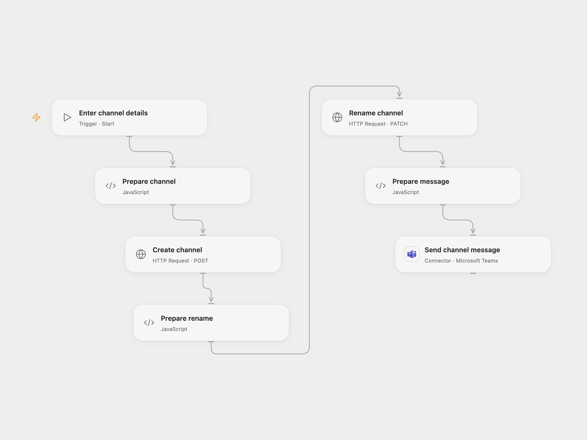

# Create, Rename and Message a Teams Channel

Create a Teams channel, rename it and send a message to the new channel.

<picture>
  <source media="(prefers-color-scheme: dark)" srcset="preview-dark.png">
  
</picture>

[Open Flow JSON](templates/create-rename-and-message-teams-channel.openflow.json) · [n8n JSON](templates/create-rename-and-message-teams-channel.n8n.json)

## Setup

Create a secret Variable named **GRAPH_ACCESS_TOKEN** containing a Microsoft Graph delegated access token with channel creation and channel settings write permissions. Tokens expire and must be refreshed. Connect Microsoft Teams with permission to send channel messages. Run with a team ID, initial channel name, new name and message. In n8n connect the Microsoft Teams nodes and set the team, names and message.

## Behavior

A manual run creates a standard channel, renames it and posts the message to that channel. If an operation fails, earlier changes remain. Check Teams before retrying after an unknown result to avoid duplicate channels or messages.

Inspiration &amp; credits

## Changes to the source

- Configure the team, names and message at run time. Open Flow uses Graph requests for channel creation and rename.

Adapted from [Microsoft Teams channel workflow](https://github.com/Zie619/n8n-workflows/blob/ae8cf6dc5b873cbb4f74587aa9180ed3a9f70682/workflows/Manual/1095_Manual_Teams_Automate_Triggered.json) in [Zie619/n8n-workflows](https://github.com/Zie619/n8n-workflows). The source export does not identify a separate template author or license.

The collection’s [MIT notice](https://github.com/Zie619/n8n-workflows/blob/94007c1445d9258a7da116646b79473e7c7c3282/LICENSE) is pinned at a later revision. This is the collection notice at that revision; it does not establish a separate original template author's license. Our changes are listed above; see [repository licensing](../../README.md#licensing).

> MIT License
>
> Copyright (c) 2025 Zie619
>
> Permission is hereby granted, free of charge, to any person obtaining a copy
> of this software and associated documentation files (the "Software"), to deal
> in the Software without restriction, including without limitation the rights
> to use, copy, modify, merge, publish, distribute, sublicense, and/or sell
> copies of the Software, and to permit persons to whom the Software is
> furnished to do so, subject to the following conditions:
>
> The above copyright notice and this permission notice shall be included in all
> copies or substantial portions of the Software.
>
> THE SOFTWARE IS PROVIDED "AS IS", WITHOUT WARRANTY OF ANY KIND, EXPRESS OR
> IMPLIED, INCLUDING BUT NOT LIMITED TO THE WARRANTIES OF MERCHANTABILITY,
> FITNESS FOR A PARTICULAR PURPOSE AND NONINFRINGEMENT. IN NO EVENT SHALL THE
> AUTHORS OR COPYRIGHT HOLDERS BE LIABLE FOR ANY CLAIM, DAMAGES OR OTHER
> LIABILITY, WHETHER IN AN ACTION OF CONTRACT, TORT OR OTHERWISE, ARISING FROM,
> OUT OF OR IN CONNECTION WITH THE SOFTWARE OR THE USE OR OTHER DEALINGS IN THE
> SOFTWARE.

