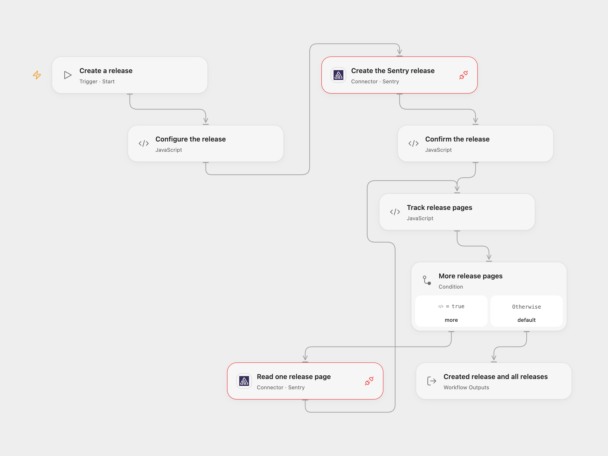

# Create a Sentry Release and List Releases

Create a release for one Sentry project, then retrieve all pages of releases in the organization.

<picture>
  <source media="(prefers-color-scheme: dark)" srcset="preview-dark.png">
  
</picture>

[Open Flow JSON](templates/create-sentry-release-and-list-releases.openflow.json) · [n8n JSON](templates/create-sentry-release-and-list-releases.n8n.json)

## Setup

Connect both Provider API Request nodes to the same Sentry OAuth Connection. Grant `project:releases` and Provider API Request access. In **Configure the release**, enter the organization slug, project slug, release version and public HTTPS release URL.

In n8n, select Sentry OAuth2 credentials on both nodes. Set the same organization, project, version and release URL in **Sentry.io**, and the same organization in **Sentry.io1**. Keep Return All enabled. Run one format for each intended release.

## Behavior

Run manually. The workflow creates the release, then follows Sentry’s next-page cursor until the organization release list is complete. Open Flow returns the create response, all release records and their count. n8n returns the listed releases; its creation response remains in the preceding node. The list is organization-wide and can include other projects.

An existing version may be returned by Sentry as an already-existing release rather than a new one. Neither format adds a workflow-level retry or rollback after an unknown create result or a failed list. The release may already exist; inspect Sentry before replaying. Open Flow rejects repeated or malformed cursors instead of looping. Full pages and accumulated results must fit current execution limits. Sentry API access and OAuth permissions must be configured for the selected organization and project.

Inspiration &amp; credits

## Changes to the source

- Replace empty organization/project and account values with setup; supply a release URL. Use Sentry OAuth2 in n8n as well as Open Flow instead of the source’s token credential.
- Preserve create followed by Return All. Open Flow uses the managed Sentry Provider API for creation and pagination because the current release-list Action does not expose its cursor.
- Open Flow validates the create response and rejects repeated or malformed pagination cursors.

Adapted from [Create a release and get all releases](https://github.com/Zie619/n8n-workflows/blob/ae8cf6dc5b873cbb4f74587aa9180ed3a9f70682/workflows/Manual/0703_Manual_Sentryio_Create_Triggered.json) in [Zie619/n8n-workflows](https://github.com/Zie619/n8n-workflows). The source export does not identify a separate template author or license.

The collection’s [MIT notice](https://github.com/Zie619/n8n-workflows/blob/94007c1445d9258a7da116646b79473e7c7c3282/LICENSE) is pinned at a later revision. This is the collection notice at that revision; it does not establish a separate original template author's license. Our changes are listed above; see [repository licensing](../../README.md#licensing).

> MIT License
>
> Copyright (c) 2025 Zie619
>
> Permission is hereby granted, free of charge, to any person obtaining a copy
> of this software and associated documentation files (the "Software"), to deal
> in the Software without restriction, including without limitation the rights
> to use, copy, modify, merge, publish, distribute, sublicense, and/or sell
> copies of the Software, and to permit persons to whom the Software is
> furnished to do so, subject to the following conditions:
>
> The above copyright notice and this permission notice shall be included in all
> copies or substantial portions of the Software.
>
> THE SOFTWARE IS PROVIDED "AS IS", WITHOUT WARRANTY OF ANY KIND, EXPRESS OR
> IMPLIED, INCLUDING BUT NOT LIMITED TO THE WARRANTIES OF MERCHANTABILITY,
> FITNESS FOR A PARTICULAR PURPOSE AND NONINFRINGEMENT. IN NO EVENT SHALL THE
> AUTHORS OR COPYRIGHT HOLDERS BE LIABLE FOR ANY CLAIM, DAMAGES OR OTHER
> LIABILITY, WHETHER IN AN ACTION OF CONTRACT, TORT OR OTHERWISE, ARISING FROM,
> OUT OF OR IN CONNECTION WITH THE SOFTWARE OR THE USE OR OTHER DEALINGS IN THE
> SOFTWARE.

