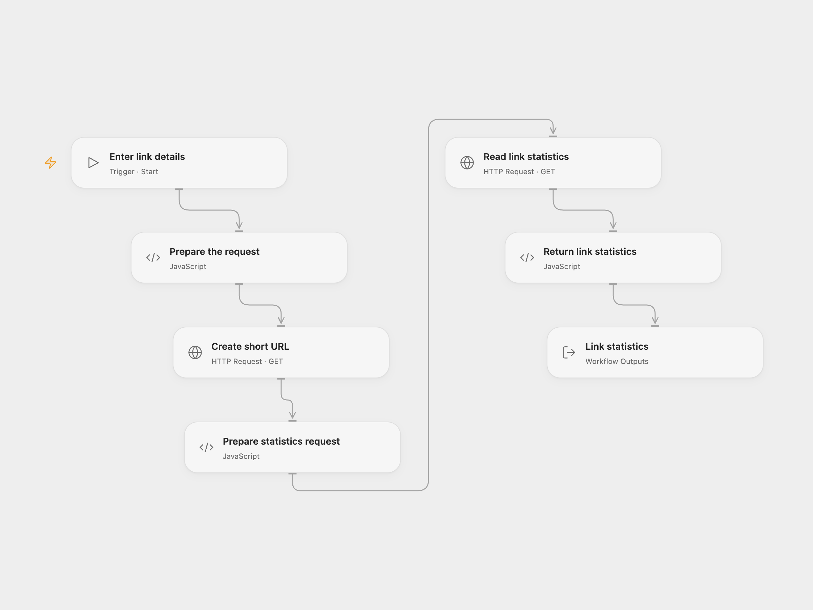

# Create a Short URL and Read Its Statistics

Create a YOURLS short URL and read its link statistics.

<picture>
  <source media="(prefers-color-scheme: dark)" srcset="preview-dark.png">
  
</picture>

[Open Flow JSON](templates/create-short-url-and-read-stats.openflow.json) · [n8n JSON](templates/create-short-url-and-read-stats.n8n.json)

## Setup

Use a YOURLS instance accessible over HTTPS and its API signature. In Open Flow, create a secret Variable for the signature and bind **Auth Token** on both HTTP nodes. Run with the instance base URL, destination URL and link title. In n8n, connect the YOURLS credential to both nodes and edit **Set link details**.

The signature is sent in the request query, as in the source node. Server and proxy URL logs may contain it; protect those logs. Use only a trusted YOURLS instance.

## Behavior

Each run asks YOURLS to shorten the destination and uses the returned short URL to retrieve its statistics. YOURLS controls whether an existing short URL is returned. Failure stops subsequent steps; a lost response may mean creation succeeded, so check YOURLS before retrying. No automatic retry or rollback is performed.

## Changes to the source

- Replace the example URL and title with configurable values. Open Flow requires HTTPS for the instance; configure the n8n credential with an HTTPS instance URL.
- Open Flow uses the YOURLS API with the same signature authentication and returns the link statistics. Both formats validate the creation result before requesting statistics.

Source and license

Adapted from [Create a short URL and get the statistics of the URL](https://github.com/Zie619/n8n-workflows/blob/ae8cf6dc5b873cbb4f74587aa9180ed3a9f70682/workflows/Manual/0210_Manual_Yourls_Create_Triggered.json) in [Zie619/n8n-workflows](https://github.com/Zie619/n8n-workflows). The matching [n8n community listing](https://n8n.io/workflows/815-create-a-short-url-and-get-the-statistics-of-the-url/) credits Harshil Agrawal. The original template does not state a separate license.

The collection’s [MIT notice](https://github.com/Zie619/n8n-workflows/blob/94007c1445d9258a7da116646b79473e7c7c3282/LICENSE) is pinned at a later revision. This is the collection notice at that revision; it does not establish a separate original template author's license. Our changes are listed above; see [repository licensing](../../README.md#licensing).

> MIT License
>
> Copyright (c) 2025 Zie619
>
> Permission is hereby granted, free of charge, to any person obtaining a copy
> of this software and associated documentation files (the "Software"), to deal
> in the Software without restriction, including without limitation the rights
> to use, copy, modify, merge, publish, distribute, sublicense, and/or sell
> copies of the Software, and to permit persons to whom the Software is
> furnished to do so, subject to the following conditions:
>
> The above copyright notice and this permission notice shall be included in all
> copies or substantial portions of the Software.
>
> THE SOFTWARE IS PROVIDED "AS IS", WITHOUT WARRANTY OF ANY KIND, EXPRESS OR
> IMPLIED, INCLUDING BUT NOT LIMITED TO THE WARRANTIES OF MERCHANTABILITY,
> FITNESS FOR A PARTICULAR PURPOSE AND NONINFRINGEMENT. IN NO EVENT SHALL THE
> AUTHORS OR COPYRIGHT HOLDERS BE LIABLE FOR ANY CLAIM, DAMAGES OR OTHER
> LIABILITY, WHETHER IN AN ACTION OF CONTRACT, TORT OR OTHERWISE, ARISING FROM,
> OUT OF OR IN CONNECTION WITH THE SOFTWARE OR THE USE OR OTHER DEALINGS IN THE
> SOFTWARE.

