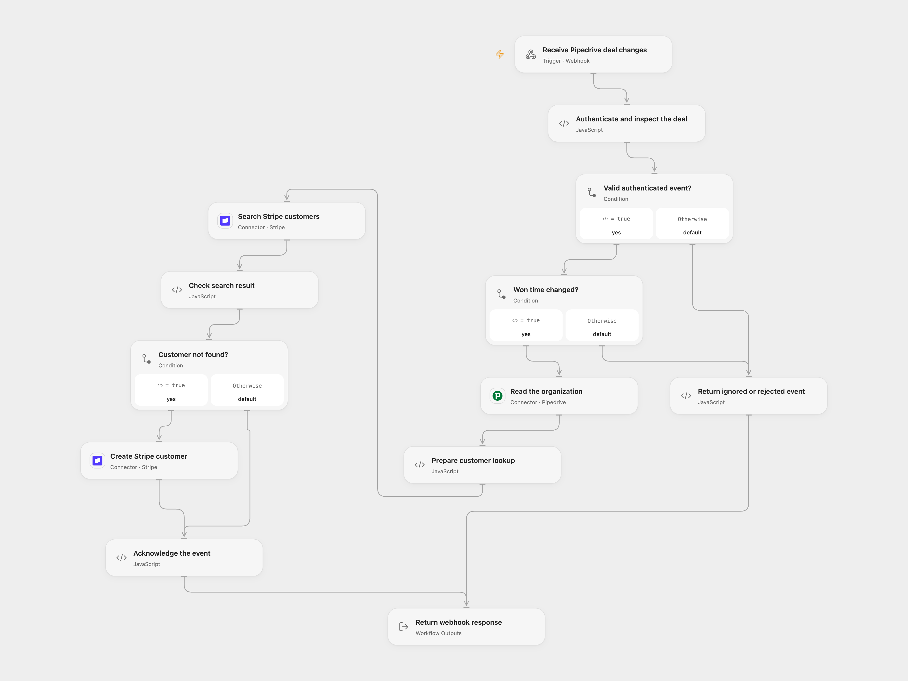

# Create Stripe Customers from Pipedrive Deals

Create a Stripe customer for a Pipedrive organization when a deal’s won time changes and no customer with that name is found.

<picture>
  <source media="(prefers-color-scheme: dark)" srcset="preview-dark.png">
  
</picture>

[Open Flow JSON](templates/create-stripe-customers-from-pipedrive-deals.openflow.json) · [n8n JSON](templates/create-stripe-customers-from-pipedrive-deals.n8n.json)

## Setup

Connect Pipedrive and Stripe with access to read organizations and search/create customers. In Open Flow, create a secret Variable containing the full Basic authorization header and bind it in **Authenticate and inspect the deal**; set your Pipedrive company ID there. In n8n, configure Basic Auth credentials on the webhook and set the same company ID in **Inspect deal change**. Create a Pipedrive webhook for version 2.0, entity `deal`, action `change`, pointing to the chosen format's HTTPS URL with the matching Basic credentials. Use a webhook owner with access to the deals. Run one format.

Organization countries can be ISO alpha-2 codes or English country names. For other names, set the `countryMap` input in Open Flow or edit `countryMap:{}` in the n8n **Prepare customer lookup** Code, for example `{ "États-Unis": "US" }`. Unknown or ambiguous names stop before creation. Restrict execution history access because incoming request headers can contain the authorization value.

## Behavior

A Pipedrive deal-change event whose `won_time` changes reads the associated organization. It searches Stripe for that organization name and creates a customer with its name and address only when the search is empty. This includes a cleared or edited won time, as in the source. Other deal changes do nothing. Search is name-based: two different organizations with the same name may be treated as one customer. Stripe Search is eventually consistent and may not find a recent customer; concurrent events and redelivery can create duplicates. Review Stripe before repeating an uncertain request.

Open Flow responds after processing, with a 60-second response timeout; Pipedrive may redeliver after a failed or timed-out response. n8n acknowledges the webhook on receipt, so a later failure is visible in its execution history rather than in the webhook response. A failed or unknown create may already have succeeded. The workflow adds no deduplication or write retry. Verify the customer before replaying an event.

## Changes to the source

- Use authenticated Pipedrive v2 webhook events and explicitly configure the subscription. The available managed trigger emits only status/stage changes and cannot capture an edit of won time alone.
- Validate the event and address and escape the organization name in the Stripe search query.

Source and license

Adapted from [Automatically add customers from Pipedrive to Stripe](https://github.com/Zie619/n8n-workflows/blob/ae8cf6dc5b873cbb4f74587aa9180ed3a9f70682/workflows/Http/0245_HTTP_Stripe_Create_Webhook.json) in [Zie619/n8n-workflows](https://github.com/Zie619/n8n-workflows). The matching [n8n community listing](https://n8n.io/workflows/1775-automatically-add-customers-from-pipedrive-to-stripe/) credits n8n Team. The original template does not state a separate license. Country-code values are based on [Debian iso-codes 4.18.0](https://salsa.debian.org/iso-codes-team/iso-codes/-/tree/v4.18.0), distributed under the [GNU LGPL 2.1 or later](https://salsa.debian.org/iso-codes-team/iso-codes/-/blob/v4.18.0/COPYING).

The collection’s [MIT notice](https://github.com/Zie619/n8n-workflows/blob/94007c1445d9258a7da116646b79473e7c7c3282/LICENSE) is pinned at a later revision. This is the collection notice at that revision; it does not establish a separate original template author's license. Our changes are listed above; see [repository licensing](../../README.md#licensing).

> MIT License
>
> Copyright (c) 2025 Zie619
>
> Permission is hereby granted, free of charge, to any person obtaining a copy
> of this software and associated documentation files (the "Software"), to deal
> in the Software without restriction, including without limitation the rights
> to use, copy, modify, merge, publish, distribute, sublicense, and/or sell
> copies of the Software, and to permit persons to whom the Software is
> furnished to do so, subject to the following conditions:
>
> The above copyright notice and this permission notice shall be included in all
> copies or substantial portions of the Software.
>
> THE SOFTWARE IS PROVIDED "AS IS", WITHOUT WARRANTY OF ANY KIND, EXPRESS OR
> IMPLIED, INCLUDING BUT NOT LIMITED TO THE WARRANTIES OF MERCHANTABILITY,
> FITNESS FOR A PARTICULAR PURPOSE AND NONINFRINGEMENT. IN NO EVENT SHALL THE
> AUTHORS OR COPYRIGHT HOLDERS BE LIABLE FOR ANY CLAIM, DAMAGES OR OTHER
> LIABILITY, WHETHER IN AN ACTION OF CONTRACT, TORT OR OTHERWISE, ARISING FROM,
> OUT OF OR IN CONNECTION WITH THE SOFTWARE OR THE USE OR OTHER DEALINGS IN THE
> SOFTWARE.

