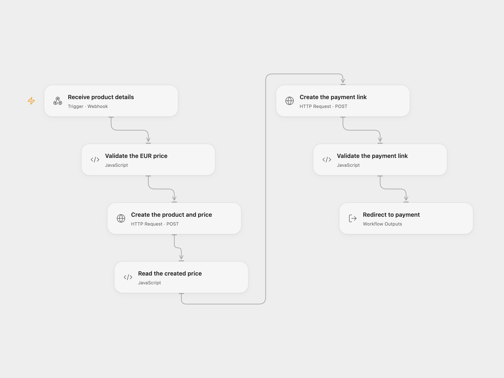

# Create a Stripe Payment Link from a Form

Create a Stripe product and payment link from a title and EUR price.

<picture>
  <source media="(prefers-color-scheme: dark)" srcset="preview-dark.png">
  
</picture>

[Open Flow JSON](templates/create-stripe-payment-link-from-form.openflow.json) · [n8n JSON](templates/create-stripe-payment-link-from-form.n8n.json)

## Setup

Create Secret Variable `STRIPE_SECRET_KEY` with a Stripe key allowed to create products and payment links. Deploy the Open Flow webhook over HTTPS and POST JSON such as `{"title":"Example","price":12.50}`. The webhook is public and accepts requests without authentication; restrict access to its URL. Use Stripe test mode while configuring.

Import the included n8n workflow for its browser form. To use Open Flow, deploy it, set **Choose delivery mode** to `relay`, and configure the Open Flow webhook URL in **Forward to Open Flow**. To run n8n directly, leave the mode as `direct` and connect a Stripe credential to both Stripe HTTP nodes. Activate one mode only.

## Behavior

Each submission creates a Stripe product with a one-time EUR price, creates a payment link for quantity one, then returns the link. Open Flow returns the URL to the included n8n form relay; the form redirects the browser to the payment link. In direct mode n8n creates the link itself and performs the same redirect. The price must be positive and use whole euro cents; Stripe also enforces its currency-specific amount limits. The link is not proof of payment; Stripe processes payment separately. The original form did not authenticate submissions.

These are two external writes. If product creation succeeds and link creation fails, the product remains. An uncertain response may mean a write succeeded; inspect Stripe before retrying to avoid duplicates. A timeout does not prove that creation failed. No automatic write retry is configured.

Inspiration &amp; credits

## Changes to the source

- Validate the title and EUR amount before creating anything, and explicitly use cents and JSON input.
- Provide mutually exclusive n8n direct and form relay modes so either format retains the browser form and redirect.

Adapted from [Create Stripe payment links from a form](https://github.com/Zie619/n8n-workflows/blob/ae8cf6dc5b873cbb4f74587aa9180ed3a9f70682/workflows/Http/0471_HTTP_Form_Create_Webhook.json) in [Zie619/n8n-workflows](https://github.com/Zie619/n8n-workflows). The source credits [n8n.ninja](https://n8n.ninja). No separate original template license is stated.

The collection’s [MIT notice](https://github.com/Zie619/n8n-workflows/blob/94007c1445d9258a7da116646b79473e7c7c3282/LICENSE) is pinned at a later revision. This is the collection notice at that revision; it does not establish a separate original template author's license. Our changes are listed above; see [repository licensing](../../README.md#licensing).

> MIT License
>
> Copyright (c) 2025 Zie619
>
> Permission is hereby granted, free of charge, to any person obtaining a copy
> of this software and associated documentation files (the "Software"), to deal
> in the Software without restriction, including without limitation the rights
> to use, copy, modify, merge, publish, distribute, sublicense, and/or sell
> copies of the Software, and to permit persons to whom the Software is
> furnished to do so, subject to the following conditions:
>
> The above copyright notice and this permission notice shall be included in all
> copies or substantial portions of the Software.
>
> THE SOFTWARE IS PROVIDED "AS IS", WITHOUT WARRANTY OF ANY KIND, EXPRESS OR
> IMPLIED, INCLUDING BUT NOT LIMITED TO THE WARRANTIES OF MERCHANTABILITY,
> FITNESS FOR A PARTICULAR PURPOSE AND NONINFRINGEMENT. IN NO EVENT SHALL THE
> AUTHORS OR COPYRIGHT HOLDERS BE LIABLE FOR ANY CLAIM, DAMAGES OR OTHER
> LIABILITY, WHETHER IN AN ACTION OF CONTRACT, TORT OR OTHERWISE, ARISING FROM,
> OUT OF OR IN CONNECTION WITH THE SOFTWARE OR THE USE OR OTHER DEALINGS IN THE
> SOFTWARE.

