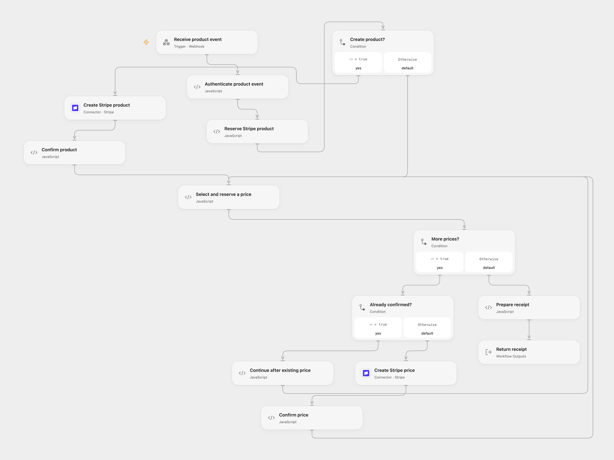

# Create Stripe Products from Pipedrive

Create a Stripe product and prices for a new Pipedrive product.

<picture>
  <source media="(prefers-color-scheme: dark)" srcset="preview-dark.png">
  
</picture>

[Open Flow JSON](templates/create-stripe-products-from-pipedrive.openflow.json) · [n8n JSON](templates/create-stripe-products-from-pipedrive.n8n.json)

## Setup

Connect Stripe with product and price creation access. In Open Flow configure the company ID and bind a secret Variable containing the full Basic authorization header in **Authenticate product event**. Register a Pipedrive v2 product-create webhook with matching Basic credentials. Keep State persistent and prevent overlapping executions. In n8n connect Pipedrive and Stripe, replace YOUR_COMPANY_ID in **Prepare product**, and choose a Data Table with text columns item_key and status. Activate one format.

## Behavior

For each added product, create a Stripe product with its name and description and create one Stripe price for each currency in the event. A stable Stripe product ID includes the company and Pipedrive product IDs, so every price stays associated with that product. The workflow follows the source conversion of price × 100; this is appropriate only for currencies with two decimal places. Do not use it for zero-decimal currencies without adjusting the conversion to Stripe currency rules. Validate price amounts before enabling it.

Each write is reserved before it starts. If its result is unknown, inspect Stripe before replaying. In Open Flow enter the pending key and either absent or confirmed in the matching reserve node; for a confirmed product also enter its Stripe ID in confirmedId. Replay the same event and clear the recovery fields after it completes. In n8n inspect the pending Data Table row and the Stripe account. Mark that row done only after confirming the write, or delete it only after confirming it did not happen. The stable product ID appears in the pending product's Pipedrive record ID and configured company ID. The workflow then continues remaining prices on replay. Store executions securely because product data and webhook headers can be sensitive.

Inspiration &amp; credits

Add per-write checkpoints, stable product IDs and authenticated webhook setup.

Adapted from [Create products in Stripe from Pipedrive](https://github.com/Zie619/n8n-workflows/blob/ae8cf6dc5b873cbb4f74587aa9180ed3a9f70682/workflows/Functionitem/0247_Functionitem_HTTP_Create_Webhook.json) in [Zie619/n8n-workflows](https://github.com/Zie619/n8n-workflows). The source export does not identify a separate template author or license.

The collection’s [MIT notice](https://github.com/Zie619/n8n-workflows/blob/94007c1445d9258a7da116646b79473e7c7c3282/LICENSE) is pinned at a later revision. This is the collection notice at that revision; it does not establish a separate original template author's license. Our changes are listed above; see [repository licensing](../../README.md#licensing).

> MIT License
>
> Copyright (c) 2025 Zie619
>
> Permission is hereby granted, free of charge, to any person obtaining a copy
> of this software and associated documentation files (the "Software"), to deal
> in the Software without restriction, including without limitation the rights
> to use, copy, modify, merge, publish, distribute, sublicense, and/or sell
> copies of the Software, and to permit persons to whom the Software is
> furnished to do so, subject to the following conditions:
>
> The above copyright notice and this permission notice shall be included in all
> copies or substantial portions of the Software.
>
> THE SOFTWARE IS PROVIDED "AS IS", WITHOUT WARRANTY OF ANY KIND, EXPRESS OR
> IMPLIED, INCLUDING BUT NOT LIMITED TO THE WARRANTIES OF MERCHANTABILITY,
> FITNESS FOR A PARTICULAR PURPOSE AND NONINFRINGEMENT. IN NO EVENT SHALL THE
> AUTHORS OR COPYRIGHT HOLDERS BE LIABLE FOR ANY CLAIM, DAMAGES OR OTHER
> LIABILITY, WHETHER IN AN ACTION OF CONTRACT, TORT OR OTHERWISE, ARISING FROM,
> OUT OF OR IN CONNECTION WITH THE SOFTWARE OR THE USE OR OTHER DEALINGS IN THE
> SOFTWARE.

