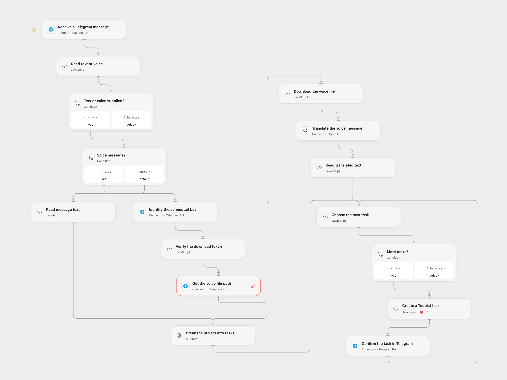

# Create Todoist Tasks from Telegram Messages

Turn a Telegram text or voice project description into Todoist tasks and send confirmations.

<picture>
  <source media="(prefers-color-scheme: dark)" srcset="preview-dark.png">
  
</picture>

[Open Flow JSON](templates/create-todoist-tasks-from-telegram-messages.openflow.json) · [n8n JSON](templates/create-todoist-tasks-from-telegram-messages.n8n.json)

## Setup

Connect the same Telegram bot to **Receive a Telegram message**, **Identify the connected bot**, **Get the voice file path** and **Confirm the task in Telegram**. For voice, bind secret Variable **TELEGRAM_TASK_BOT_TOKEN** to the matching bot token and enable the Telegram Provider API and access to api.telegram.org. Configure the trigger's chat or user filters to limit who can create tasks. Connect OpenAI for voice translation, configure the AI model, connect Todoist and set the project ID in **Choose the next task**.

In n8n connect Telegram, OpenAI and Todoist, and choose the Todoist project. Enable only one format for a bot, as Telegram supports one webhook per bot.

## Behavior

Send the bot a text or voice description of a project. Voice is translated into English by Whisper before analysis. The AI breaks the description into actionable tasks and assigns each a Todoist priority from 1 (lowest) to 4 (highest). Each task is created in order and confirmed in the original chat. Other message types are ignored. Review the generated tasks and priorities; model output can vary. Audio and text are sent to the configured AI services.

Open Flow verifies that the download token belongs to the connected bot. Its voice bytes and Base64 representation must fit the host's 1 MiB fetch and Code limits; oversized audio fails rather than being truncated. The source n8n Telegram V1 trigger does not verify its callback secret, so protect its callback URL. Restrict execution history access because it can contain message and audio data.

If a later task or confirmation fails, earlier tasks remain. A failed or uncertain create/send may already have succeeded; inspect Todoist and Telegram before retrying. There is no cross-run deduplication.

Inspiration &amp; credits

## Changes to the source

- Configure private project IDs and credentials. Open Flow uses the formal Telegram Provider API for file lookup and verifies the matching download token.
- Fix the source's single-task parser conflicting with its multi-task prompt: both formats create and confirm each generated task sequentially.

Adapted from [Create Todoist tasks from Telegram text or voice](https://github.com/Zie619/n8n-workflows/blob/ae8cf6dc5b873cbb4f74587aa9180ed3a9f70682/workflows/Telegram/0768_Telegram_Stickynote_Create_Triggered.json) in [Zie619/n8n-workflows](https://github.com/Zie619/n8n-workflows). The matching [n8n listing](https://n8n.io/workflows/3052-effortless-task-management-create-todoist-tasks-directly-from-telegram-with-ai/) credits Onur. The original template does not state a separate license.

The collection’s [MIT notice](https://github.com/Zie619/n8n-workflows/blob/94007c1445d9258a7da116646b79473e7c7c3282/LICENSE) is pinned at a later revision. This is the collection notice at that revision; it does not establish a separate original template author's license. Our changes are listed above; see [repository licensing](../../README.md#licensing).

> MIT License
>
> Copyright (c) 2025 Zie619
>
> Permission is hereby granted, free of charge, to any person obtaining a copy
> of this software and associated documentation files (the "Software"), to deal
> in the Software without restriction, including without limitation the rights
> to use, copy, modify, merge, publish, distribute, sublicense, and/or sell
> copies of the Software, and to permit persons to whom the Software is
> furnished to do so, subject to the following conditions:
>
> The above copyright notice and this permission notice shall be included in all
> copies or substantial portions of the Software.
>
> THE SOFTWARE IS PROVIDED "AS IS", WITHOUT WARRANTY OF ANY KIND, EXPRESS OR
> IMPLIED, INCLUDING BUT NOT LIMITED TO THE WARRANTIES OF MERCHANTABILITY,
> FITNESS FOR A PARTICULAR PURPOSE AND NONINFRINGEMENT. IN NO EVENT SHALL THE
> AUTHORS OR COPYRIGHT HOLDERS BE LIABLE FOR ANY CLAIM, DAMAGES OR OTHER
> LIABILITY, WHETHER IN AN ACTION OF CONTRACT, TORT OR OTHERWISE, ARISING FROM,
> OUT OF OR IN CONNECTION WITH THE SOFTWARE OR THE USE OR OTHER DEALINGS IN THE
> SOFTWARE.

