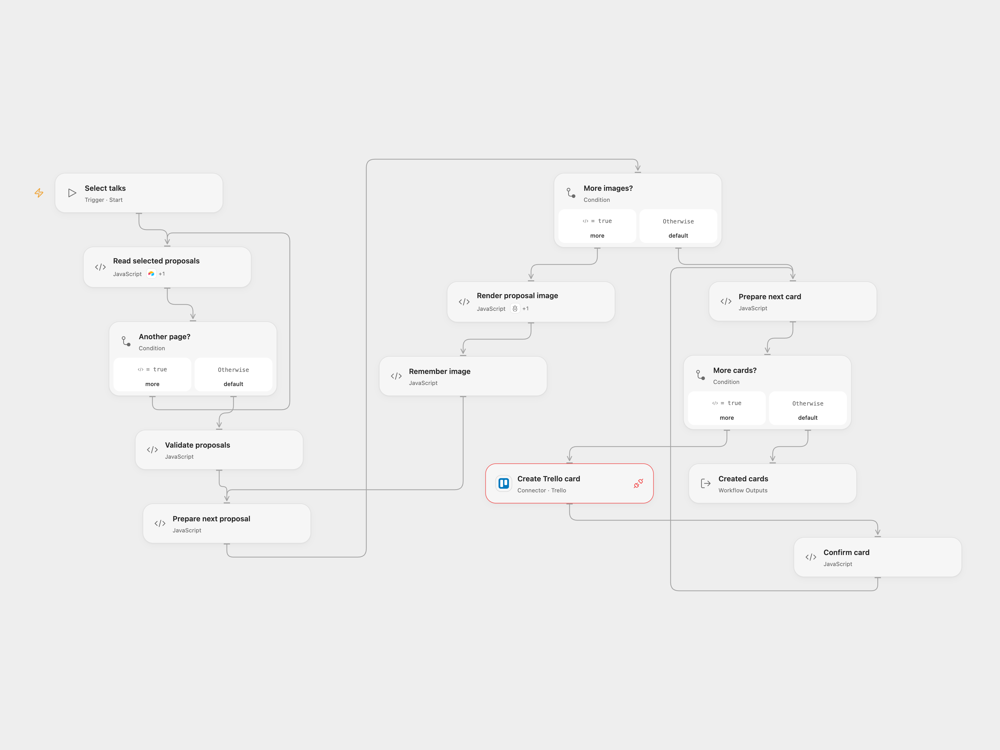

# Create Trello Cards for Selected Talks

Create illustrated Trello cards for talk proposals scoring above 15.

<picture>
  <source media="(prefers-color-scheme: dark)" srcset="preview-dark.png">
  
</picture>

[Open Flow JSON](templates/create-trello-cards-for-selected-talks.openflow.json) · [n8n JSON](templates/create-trello-cards-for-selected-talks.n8n.json)

## Setup

Provide an Airtable table with numeric `Total Score` and these exact text fields: `What's the title of your talk?`, `Please share the abstract of your talk.`, `Please share a URL of your profile picture.`, `Your twitter handle`, `Great, can we get your full name?`, `Please share a bit of information about you.`, and `And what's your email address?`. The profile picture must be a public URL. Provide a Bannerbear template with layers `talk title`, `abstract`, `profile image`, `username` and `full name`. Connect Airtable and Bannerbear in the corresponding Open Flow nodes and allow their declared Actions. Set the base and table in **Read selected proposals**, template UID in **Render proposal image**, and list ID in **Prepare next card**. Connect Trello to **Create Trello card** and allow Provider API access. In n8n, configure the Airtable base and table, template UID in **Bannerbear**, and Trello list. Select an Airtable personal access token credential, Bannerbear project API key credential and Trello credentials.

## Behavior

A manual run retrieves all Airtable records matching `{Total Score} > 15`, including subsequent pages. It generates an image for each proposal, then creates a Trello card for each image in the same order. The card contains the title, abstract, name, biography, email and Twitter handle, and the generated image URL. This sends proposal details to Bannerbear and Trello. No matches create no images or cards. Repeating a run creates new images and cards for the same matching proposals.

Both formats require the seven proposal fields as text and a completed Bannerbear image. Empty values are omitted from the corresponding Bannerbear layer modification, retaining the template default. Open Flow uses Bannerbear's synchronous endpoint, which waits up to 10 seconds. n8n uses asynchronous creation followed by up to three status checks, two seconds apart. A timeout or failed write can leave an image or card behind. Earlier successful writes are not rolled back and no automatic retry is configured. Inspect the services before repeating a run with an uncertain outcome.

## Changes to the source

- Replace empty identifiers with user configuration. Both formats check proposal fields and completed images. Open Flow uses the synchronous Bannerbear endpoint; n8n keeps the source asynchronous creation and polling.

Source and license

Adapted from [CFP Selection 2](https://github.com/Zie619/n8n-workflows/blob/ae8cf6dc5b873cbb4f74587aa9180ed3a9f70682/workflows/Manual/1028_Manual_Trello_Automation_Triggered.json) in [Zie619/n8n-workflows](https://github.com/Zie619/n8n-workflows). The matching [n8n community listing](https://n8n.io/workflows/385-send-airtable-data-as-tasks-to-trello/) credits Tanay Pant. The original template does not state a separate license.

The collection’s [MIT notice](https://github.com/Zie619/n8n-workflows/blob/94007c1445d9258a7da116646b79473e7c7c3282/LICENSE) is pinned at a later revision. This is the collection notice at that revision; it does not establish a separate original template author's license. Our changes are listed above; see [repository licensing](../../README.md#licensing).

> MIT License
>
> Copyright (c) 2025 Zie619
>
> Permission is hereby granted, free of charge, to any person obtaining a copy
> of this software and associated documentation files (the "Software"), to deal
> in the Software without restriction, including without limitation the rights
> to use, copy, modify, merge, publish, distribute, sublicense, and/or sell
> copies of the Software, and to permit persons to whom the Software is
> furnished to do so, subject to the following conditions:
>
> The above copyright notice and this permission notice shall be included in all
> copies or substantial portions of the Software.
>
> THE SOFTWARE IS PROVIDED "AS IS", WITHOUT WARRANTY OF ANY KIND, EXPRESS OR
> IMPLIED, INCLUDING BUT NOT LIMITED TO THE WARRANTIES OF MERCHANTABILITY,
> FITNESS FOR A PARTICULAR PURPOSE AND NONINFRINGEMENT. IN NO EVENT SHALL THE
> AUTHORS OR COPYRIGHT HOLDERS BE LIABLE FOR ANY CLAIM, DAMAGES OR OTHER
> LIABILITY, WHETHER IN AN ACTION OF CONTRACT, TORT OR OTHERWISE, ARISING FROM,
> OUT OF OR IN CONNECTION WITH THE SOFTWARE OR THE USE OR OTHER DEALINGS IN THE
> SOFTWARE.

