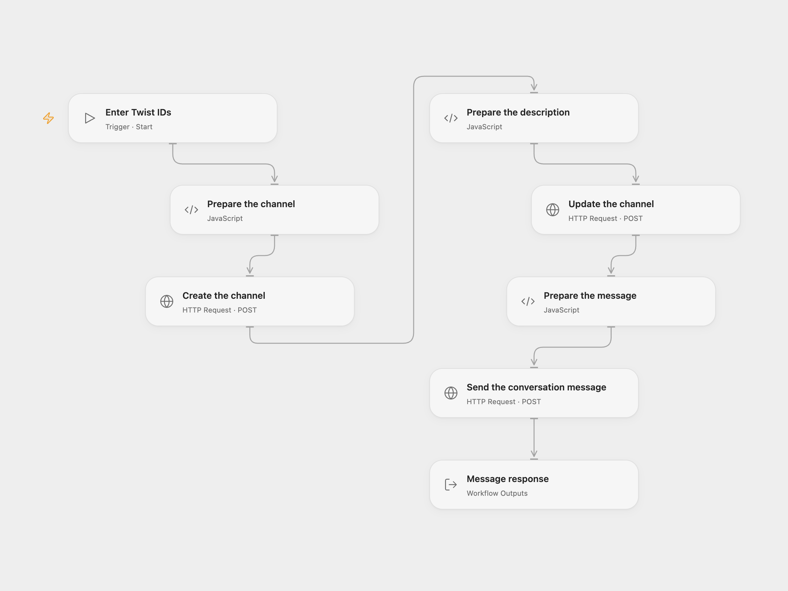

# Create a Twist Channel and Send a Message

Create a channel, update its description and send a message to an existing Twist conversation.

<picture>
  <source media="(prefers-color-scheme: dark)" srcset="preview-dark.png">
  
</picture>

[Open Flow JSON](templates/create-twist-channel-and-send-message.openflow.json) · [n8n JSON](templates/create-twist-channel-and-send-message.n8n.json)

## Setup

In Open Flow, create a secret Variable containing a Twist OAuth access token and bind it to all three HTTP nodes. Refresh or replace the token when necessary. Run with the workspace ID, user ID to add and mention, and an existing conversation ID in that workspace. The conversation is the message destination; it is separate from the channel being created.

In n8n, connect the same Twist OAuth credential to all three Twist nodes. Configure the workspace and user in **Twist**, and the same workspace and the existing conversation in **Twist2**. Run one format at a time.

## Behavior

The workflow creates an `n8n-docs` channel with the selected member, updates its description to `Discussion for documentation`, then sends the selected conversation a message mentioning the member and naming the created channel. The message includes a button linking to the n8n documentation. The displayed mention label is `Recipient`.

A failure or uncertain request can leave a created channel, an updated channel or a sent message. Inspect Twist before retrying; the workflow does not roll back or replay writes. Open Flow returns the full message response. Twist says the service will shut down on March 1, 2027; check its [migration guidance](https://06.twist.com/help/articles/welcome-to-twist-Ndgp3sInM) before relying on this workflow.

Inspiration &amp; credits

## Changes to the source

- Replace private workspace, user and conversation IDs with configuration and use a generic mention label. Open Flow uses Twist API v3 directly with an OAuth access token.

Adapted from [Create and update a channel, and send a message on Twist](https://github.com/Zie619/n8n-workflows/blob/ae8cf6dc5b873cbb4f74587aa9180ed3a9f70682/workflows/Manual/0225_Manual_Twist_Create_Triggered.json) in [Zie619/n8n-workflows](https://github.com/Zie619/n8n-workflows). The matching [n8n community listing](https://n8n.io/workflows/826-create-and-update-a-channel-and-send-a-message-on-twist/) credits Harshil Agrawal. The original template does not state a separate license.

The collection’s [MIT notice](https://github.com/Zie619/n8n-workflows/blob/94007c1445d9258a7da116646b79473e7c7c3282/LICENSE) is pinned at a later revision. This is the collection notice at that revision; it does not establish a separate original template author's license. Our changes are listed above; see [repository licensing](../../README.md#licensing).

> MIT License
>
> Copyright (c) 2025 Zie619
>
> Permission is hereby granted, free of charge, to any person obtaining a copy
> of this software and associated documentation files (the "Software"), to deal
> in the Software without restriction, including without limitation the rights
> to use, copy, modify, merge, publish, distribute, sublicense, and/or sell
> copies of the Software, and to permit persons to whom the Software is
> furnished to do so, subject to the following conditions:
>
> The above copyright notice and this permission notice shall be included in all
> copies or substantial portions of the Software.
>
> THE SOFTWARE IS PROVIDED "AS IS", WITHOUT WARRANTY OF ANY KIND, EXPRESS OR
> IMPLIED, INCLUDING BUT NOT LIMITED TO THE WARRANTIES OF MERCHANTABILITY,
> FITNESS FOR A PARTICULAR PURPOSE AND NONINFRINGEMENT. IN NO EVENT SHALL THE
> AUTHORS OR COPYRIGHT HOLDERS BE LIABLE FOR ANY CLAIM, DAMAGES OR OTHER
> LIABILITY, WHETHER IN AN ACTION OF CONTRACT, TORT OR OTHERWISE, ARISING FROM,
> OUT OF OR IN CONNECTION WITH THE SOFTWARE OR THE USE OR OTHER DEALINGS IN THE
> SOFTWARE.

