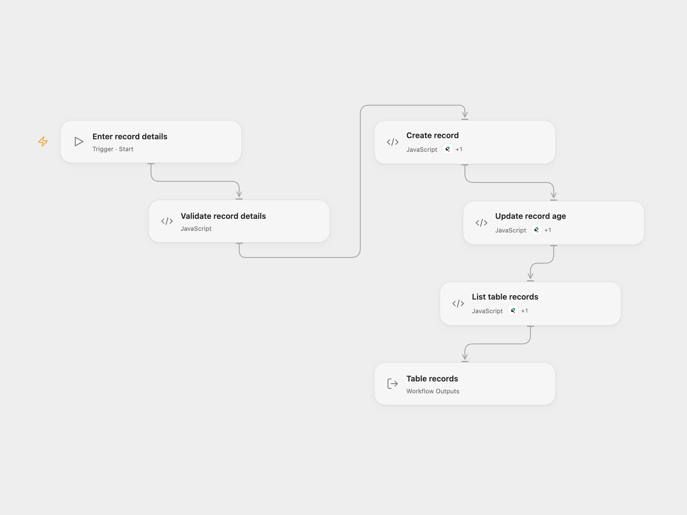

# Create, Update and List Quickbase Records

Create a Quickbase record, update its age field and list up to 50 records.

<picture>
  <source media="(prefers-color-scheme: dark)" srcset="preview-dark.png">
  
</picture>

[Open Flow JSON](templates/create-update-and-list-quickbase-records.openflow.json) · [n8n JSON](templates/create-update-and-list-quickbase-records.n8n.json)

## Setup

Use a Quickbase table with a text name field, numeric age field and the standard Record ID# field 3 as its table key. Find the field IDs in the table settings. Connect Quickbase with access to create, update and query records. In Open Flow select the connection and allow the declared Action on **Create record**, **Update record age** and **List table records**. Run with the table ID, field IDs, name and both age values. In n8n, configure the same values in **Set record details** and connect the Quick Base credential to each Quick Base node.

## Behavior

Each run creates one record, updates that same Record ID# with the new age, then returns up to 50 table records. The source uses the Quickbase node's default limit of 50. This is not a full-table export. The workflow checks write results and stops on errors. Earlier writes are not rolled back; inspect Quickbase before retrying an unknown outcome. Avoid concurrent deletion or modification of the new record. Quickbase's update endpoint is an upsert, so a missing merge key can create a record; the workflow checks the returned ID and rejects an unexpected creation, but cannot undo it.

Inspiration &amp; credits

## Changes to the source

- Replace example values and the missing table with inputs. Use field IDs in both formats.
- Fix the source's record-ID mapping and update request so the update includes Record ID# 3, and check write metadata before listing.

Adapted from [Create, update and get records in Quick Base](https://github.com/Zie619/n8n-workflows/blob/ae8cf6dc5b873cbb4f74587aa9180ed3a9f70682/workflows/Manual/0189_Manual_Quickbase_Create_Triggered.json) in [Zie619/n8n-workflows](https://github.com/Zie619/n8n-workflows). The matching [n8n community listing](https://n8n.io/workflows/805-create-update-and-get-records-in-quick-base/) credits Harshil Agrawal. The original template does not state a separate license.

The collection’s [MIT notice](https://github.com/Zie619/n8n-workflows/blob/94007c1445d9258a7da116646b79473e7c7c3282/LICENSE) is pinned at a later revision. This is the collection notice at that revision; it does not establish a separate original template author's license. Our changes are listed above; see [repository licensing](../../README.md#licensing).

> MIT License
>
> Copyright (c) 2025 Zie619
>
> Permission is hereby granted, free of charge, to any person obtaining a copy
> of this software and associated documentation files (the "Software"), to deal
> in the Software without restriction, including without limitation the rights
> to use, copy, modify, merge, publish, distribute, sublicense, and/or sell
> copies of the Software, and to permit persons to whom the Software is
> furnished to do so, subject to the following conditions:
>
> The above copyright notice and this permission notice shall be included in all
> copies or substantial portions of the Software.
>
> THE SOFTWARE IS PROVIDED "AS IS", WITHOUT WARRANTY OF ANY KIND, EXPRESS OR
> IMPLIED, INCLUDING BUT NOT LIMITED TO THE WARRANTIES OF MERCHANTABILITY,
> FITNESS FOR A PARTICULAR PURPOSE AND NONINFRINGEMENT. IN NO EVENT SHALL THE
> AUTHORS OR COPYRIGHT HOLDERS BE LIABLE FOR ANY CLAIM, DAMAGES OR OTHER
> LIABILITY, WHETHER IN AN ACTION OF CONTRACT, TORT OR OTHERWISE, ARISING FROM,
> OUT OF OR IN CONNECTION WITH THE SOFTWARE OR THE USE OR OTHER DEALINGS IN THE
> SOFTWARE.

