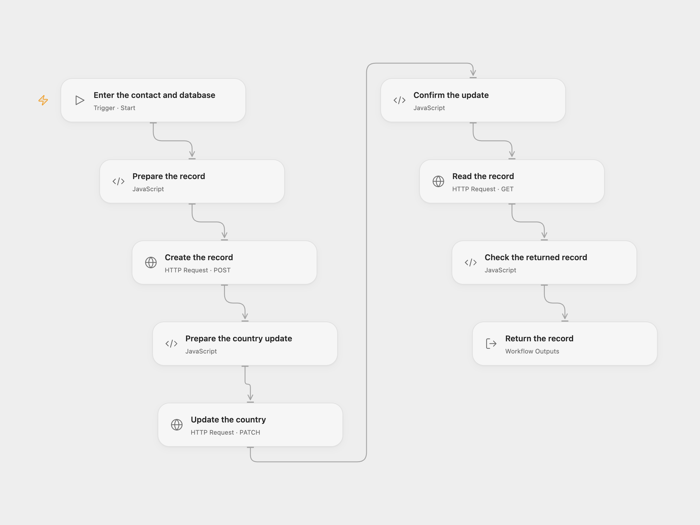

# Create, Update and Read a FileMaker Record

Create a FileMaker contact, update its country, and read the same record.

<picture>
  <source media="(prefers-color-scheme: dark)" srcset="preview-dark.png">
  
</picture>

[Open Flow JSON](templates/create-update-and-read-a-filemaker-record.openflow.json) · [n8n JSON](templates/create-update-and-read-a-filemaker-record.n8n.json)

## Setup

Enable the FileMaker Data API on a reachable HTTPS server and grant access to the database, layout and fields. In Open Flow obtain a [database session token](https://help.claris.com/en/data-api-guide/content/log-in-database-session.html) and bind it as a secret Variable to the Bearer token of each HTTP node. Sessions expire after inactivity; obtain a fresh token as needed. Enter the server origin, database, layout, first name, last name and country when starting.

In n8n connect FileMaker credentials to the three FileMaker nodes, configure the layout and edit the contact fields and country.

## Behavior

The workflow creates a record with first and last name, updates its country using the returned record ID, and reads that same record. Open Flow also sends the returned modification ID to guard the update; the n8n FileMaker V1 node ignores the source modId parameter. The source example uses Germany. If a write has an unknown outcome, inspect the database before retrying to avoid duplicates.

Inspiration &amp; credits

## Changes to the source

- Replace personal example data and database identifiers with configuration. Open Flow uses the official Data API with a manually supplied session token; n8n uses its native FileMaker credential. Remove the duplicate source node definition.

Adapted from [Create, update and read a FileMaker record](https://github.com/Zie619/n8n-workflows/blob/ae8cf6dc5b873cbb4f74587aa9180ed3a9f70682/workflows/Manual/0032_Manual_Filemaker_Automate_Triggered.json) in [Zie619/n8n-workflows](https://github.com/Zie619/n8n-workflows). The source export does not identify a separate template author or license.

The collection’s [MIT notice](https://github.com/Zie619/n8n-workflows/blob/94007c1445d9258a7da116646b79473e7c7c3282/LICENSE) is pinned at a later revision. This is the collection notice at that revision; it does not establish a separate original template author's license. Our changes are listed above; see [repository licensing](../../README.md#licensing).

> MIT License
>
> Copyright (c) 2025 Zie619
>
> Permission is hereby granted, free of charge, to any person obtaining a copy
> of this software and associated documentation files (the "Software"), to deal
> in the Software without restriction, including without limitation the rights
> to use, copy, modify, merge, publish, distribute, sublicense, and/or sell
> copies of the Software, and to permit persons to whom the Software is
> furnished to do so, subject to the following conditions:
>
> The above copyright notice and this permission notice shall be included in all
> copies or substantial portions of the Software.
>
> THE SOFTWARE IS PROVIDED "AS IS", WITHOUT WARRANTY OF ANY KIND, EXPRESS OR
> IMPLIED, INCLUDING BUT NOT LIMITED TO THE WARRANTIES OF MERCHANTABILITY,
> FITNESS FOR A PARTICULAR PURPOSE AND NONINFRINGEMENT. IN NO EVENT SHALL THE
> AUTHORS OR COPYRIGHT HOLDERS BE LIABLE FOR ANY CLAIM, DAMAGES OR OTHER
> LIABILITY, WHETHER IN AN ACTION OF CONTRACT, TORT OR OTHERWISE, ARISING FROM,
> OUT OF OR IN CONNECTION WITH THE SOFTWARE OR THE USE OR OTHER DEALINGS IN THE
> SOFTWARE.

