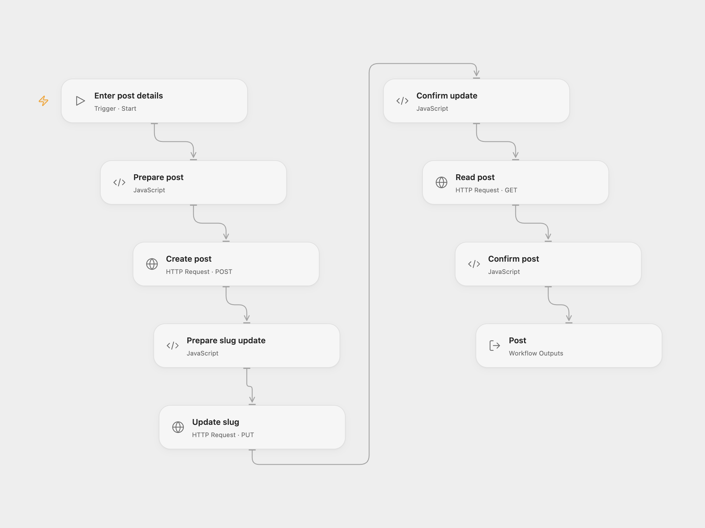

# Create, Update and Read a Strapi Post

Create a Strapi post, update its slug and read the same document.

<picture>
  <source media="(prefers-color-scheme: dark)" srcset="preview-dark.png">
  
</picture>

[Open Flow JSON](templates/create-update-and-read-strapi-post.openflow.json) · [n8n JSON](templates/create-update-and-read-strapi-post.n8n.json)

## Setup

Use Strapi 5 with a collection whose plural API ID is `posts` and fields `Title`, `Content`, `Description` and `slug`. Grant an API token create, update and read access. If Draft & Publish is enabled, these requests immediately publish the created and updated document. Use a trusted HTTPS instance and an endpoint that does not redirect.

In Open Flow, bind a secret Variable containing the token to **Auth Token** on each HTTP node. Run with the instance base URL and post fields. In n8n, set the values in **Set post details** and connect an HTTP Header Auth credential named `Authorization` with value `Bearer YOUR_STRAPI_TOKEN` to all HTTP nodes.

## Behavior

Each run creates a post, updates its slug, and reads the same document by Strapi 5 document ID. Failure stops subsequent requests; there is no automatic retry or rollback. A lost response may mean a write succeeded, so inspect Strapi before rerunning.

Inspiration &amp; credits

## Changes to the source

- Replace example post values with inputs and validate the same document is returned.
- Use Strapi 5 REST and document IDs in both formats. The original workflow passes its entry ID; Strapi 5 requires a document ID for update and read.

Adapted from [Create, update, and get an entry in Strapi](https://github.com/Zie619/n8n-workflows/blob/ae8cf6dc5b873cbb4f74587aa9180ed3a9f70682/workflows/Manual/0079_Manual_Strapi_Create_Triggered.json) in [Zie619/n8n-workflows](https://github.com/Zie619/n8n-workflows). The matching [n8n community listing](https://n8n.io/workflows/779-create-update-and-get-an-entry-in-strapi/) credits Harshil Agrawal. The original template does not state a separate license.

The collection’s [MIT notice](https://github.com/Zie619/n8n-workflows/blob/94007c1445d9258a7da116646b79473e7c7c3282/LICENSE) is pinned at a later revision. This is the collection notice at that revision; it does not establish a separate original template author's license. Our changes are listed above; see [repository licensing](../../README.md#licensing).

> MIT License
>
> Copyright (c) 2025 Zie619
>
> Permission is hereby granted, free of charge, to any person obtaining a copy
> of this software and associated documentation files (the "Software"), to deal
> in the Software without restriction, including without limitation the rights
> to use, copy, modify, merge, publish, distribute, sublicense, and/or sell
> copies of the Software, and to permit persons to whom the Software is
> furnished to do so, subject to the following conditions:
>
> The above copyright notice and this permission notice shall be included in all
> copies or substantial portions of the Software.
>
> THE SOFTWARE IS PROVIDED "AS IS", WITHOUT WARRANTY OF ANY KIND, EXPRESS OR
> IMPLIED, INCLUDING BUT NOT LIMITED TO THE WARRANTIES OF MERCHANTABILITY,
> FITNESS FOR A PARTICULAR PURPOSE AND NONINFRINGEMENT. IN NO EVENT SHALL THE
> AUTHORS OR COPYRIGHT HOLDERS BE LIABLE FOR ANY CLAIM, DAMAGES OR OTHER
> LIABILITY, WHETHER IN AN ACTION OF CONTRACT, TORT OR OTHERWISE, ARISING FROM,
> OUT OF OR IN CONNECTION WITH THE SOFTWARE OR THE USE OR OTHER DEALINGS IN THE
> SOFTWARE.

